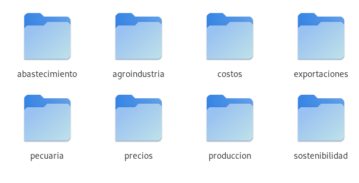
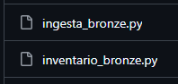
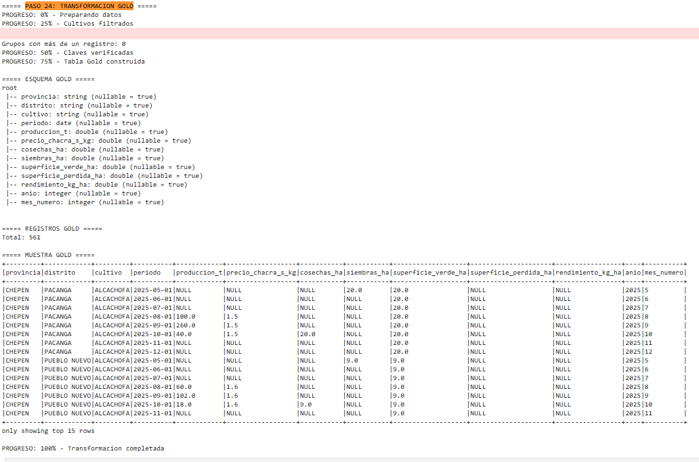
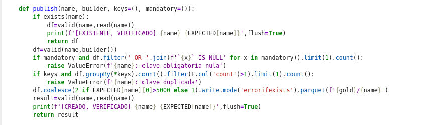
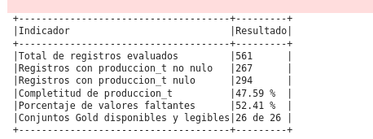
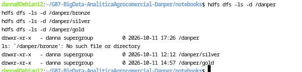
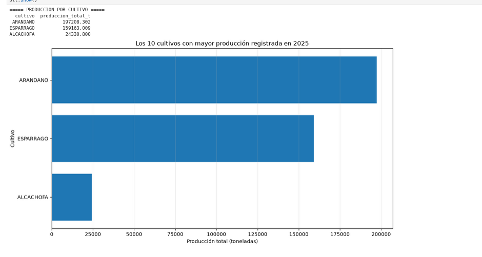
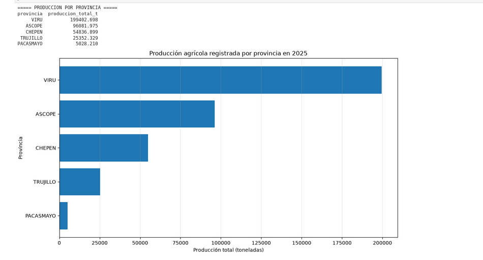
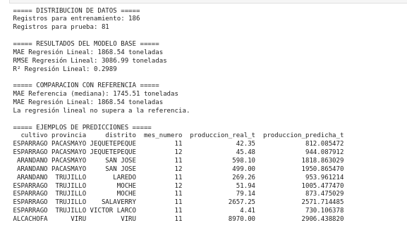

<!--
REGISTRO DE CAMBIOS (noviembre de 2026)
Este archivo se actualizó con lo implementado hasta la corrección del proyecto
(rama feature/correccion-proyecto, PR #7 y #8). Las secciones que dependen de trabajo
aún no terminado (despliegue en AWS, secciones 5 y 6, conclusiones) se mantienen como
estaban y se actualizarán al cerrar el proyecto.

Cómo encontrar los cambios para pasarlos al .docx:
- Cada sección modificada empieza con el comentario <!- - ACTUALIZADO - -> (sin espacios).
- Donde hace falta una imagen nueva hay un bloque "[CAPTURA PENDIENTE]" que dice qué mostrar
  y con qué comando obtenerla.
- Donde falta un dato que se medirá después hay un bloque "[PENDIENTE]".
  - [PENDIENTE OE3]: tiempo de la consulta manual (lo mide el equipo).
  - [PENDIENTE AWS]: lo que se completará cuando el cluster en AWS esté desplegado.
- Las figuras que ya no corresponden a lo implementado se eliminaron (pruebas de caché y
  escalabilidad anteriores) o se conservaron como antecedente (modelo base de la Semana 7).

Actualización del 26/11/2026 (rama feature/aws):
- Se agregó lo hecho en la consola de AWS (etapas 1 a 4: cuenta, red, S3, IAM, RDS y
  Parameter Store) en las secciones 0.2, 0.3, 0.4, 2.4 y 3.8, y se redactaron las
  secciones 5.1 a 5.5 y 6.4 con lo que ya está en el repositorio.
- Las secciones 6.1 a 6.3 (trazabilidad del valor, conclusiones y recomendaciones) se
  redactan al cerrar el proyecto, cuando estén los resultados en AWS y la medición del OE3.
- Donde la imagen YA ESTÁ TOMADA hay un bloque "[FOTO GUARDADA]" con el nombre del archivo
  (carpeta BIG DATA/capturas_aws/) y su pie de figura listo para copiar.
-->

<!-- Página 1 del PDF -->

<!-- ACTUALIZADO -->

UNIVERSIDAD PRIVADA ANTENOR ORREGO FACULTAD DE INGENIERÍA PROGRAMA DE ESTUDIO DE ING. COMPUTACIÓN Y SISTEMAS

# PROYECTO DE BIG DATA Y ANALÍTICA DE DATOS

PARA LA EMPRESA «Danper Trujillo S.A.C.»

ASIGNATURA: Big Data y Analítica de Datos PERIODO ACADÉMICO: 2026-20 CICLO: VIII

RUTA DE DESPLIEGUE: X | ☐ | On-premise | ☐ | Nube

<!-- PENDIENTE AWS: al terminar el despliegue en el cluster de Amazon EC2, marcar "Nube". -->

DOCENTE: Caballero Alvarado Javier Armando

INTEGRANTES DEL EQUIPO

1. Castañeda Castillo Estanis Vidal Rol: Coordinación 2. Olguín Vasquez Danna Rol: Analista y modelado 3. Rubiños Angulo Víctor Fabrizio Rol: Calidad y Documentación 4. Vera Perez Xiomara Rol: Ingeniería de datos

Trujillo – Perú 2026

<!-- Página 2 del PDF -->

<!-- ACTUALIZADO: se quitó el texto de la plantilla y las entradas del índice que pertenecían a la guía del curso. En Word, regenerar el índice automático. -->

Índice

0. Ficha del proyecto y gestión del equipo

0.1. Equipo y roles

0.2. Cronograma

0.3. Riesgos y mitigación

0.4. Bitácora de decisiones

1. La empresa, el problema y la línea base

1.1. Resumen ejecutivo

1.2. La empresa y su contexto

1.3. Definición del problema de negocio

1.4. Línea base del negocio

1.5. Objetivos del proyecto

1.6. Alcance y limitaciones

1.7. Justificación del proyecto como problema de Big Data

2. Arquitectura de la solución

2.1. Arquitectura propuesta

2.2. Atributos de calidad del diseño

2.3. Prueba de sustitución de componentes

2.4. Stack tecnológico y equivalencia entre rutas

3. Implementación del pipeline de datos

3.1. Fuentes de datos y ficha de procedencia

3.2. Ingesta y organización del data lake

3.3. Procesamiento y limpieza

3.4. Control de calidad de los datos

3.5. Almacenamiento de datos procesados

3.6. Optimización del rendimiento

3.7. Prueba de escalabilidad

3.8. Seguridad de la plataforma

4. Análisis, modelado y capa de consumo

4.1. Análisis exploratorio de datos

4.2. Modelo base

4.3. Modelo definitivo, selección y evaluación

4.4. Modelo dimensional y capa de consumo

5. Ética, privacidad y gobierno de datos

5.1. Datos sensibles y protección aplicada

5.2. Linaje y gobierno del dato

5.3. Sesgos y consecuencias del modelo

5.4. Marco normativo aplicable

5.5. Aporte al desarrollo sostenible de la región

6. Valor generado, conclusiones y recomendaciones

6.1. Trazabilidad del valor

6.2. Conclusiones

6.3. Recomendaciones de negocio

6.4. Trabajo futuro

7. Anexos

Anexo A. Declaración de uso de herramientas de IA generativa

Anexo B. Lista de verificación previa a la entrega

Anexo C. Diccionario de datos del proyecto

Anexo D. Repositorio

Referencias

<!-- Página 4 del PDF -->

# 0. Ficha del proyecto y gestión del equipo

En esta sección presentamos la organización y planificación del proyecto de Big Data desarrollado para la empresa Danper, considerando la distribución de responsabilidades, las actividades programadas, los riesgos asociados y las decisiones técnicas necesarias para su ejecución. Su finalidad es establecer una gestión ordenada del proyecto, permitiendo realizar un seguimiento de los avances y verificar el cumplimiento de los entregables durante el semestre académico 2026-20.

### 0.1. Equipo y roles

El equipo de trabajo está conformado por cuatro integrantes, quienes asumen responsabilidades específicas de acuerdo con las necesidades del proyecto. La distribución de roles busca aprovechar las capacidades de cada miembro y facilitar la coordinación de las actividades relacionadas con la obtención, procesamiento, análisis y presentación de los datos.

INTEGRANTES | ROL UNIDAD 1 | ROL UNIDAD 2 | RESPONSABILIDADES

Castañeda Castillo Estanis | Coordinaciòn | Calidad y Documentaciòn | Inicialmente organiza las actividades,

supervisa el cronograma y coordina los Vidal entregables. Posteriormente verifica la calidad de los resultados, documenta los procedimientos y revisa el informe final.

Olguín Vasquez Danna | Analista y modelado Ingeniería de datos | Inicialmente realiza el análisis

exploratorio, identifica patrones y evalúa técnicas analíticas. Posteriormente implementa procesos de integración, transformación y procesamiento de datos mediante herramientas de Big Data.

Rubiños Angulo Víctor | Calidad y | Coordinación | Inicialmente evalúa la calidad de los

Documentaciòn | datos, identifica inconsistencias y

Fabrizio documenta los avances. Posteriormente supervisa el cumplimiento de los objetivos, coordina las actividades pendientes y organiza la presentación final.

Vera Perez Xiomara | Ingeniería de datos | Analista y modelado | Inicialmente configura el entorno

tecnológico, organiza las fuentes de información y desarrolla los procesos de extracción y transformación. Posteriormente aplica técnicas de análisis, evalúa los resultados y desarrolla visualizaciones.

### 0.2. Cronograma

<!-- Página 5 del PDF -->

Semana | Actividades y entregables previstos | Responsable

2 | Conformación del equipo, selección de Danper y asignación de responsabilidades. | Coordinación

3 | Identificación de la problemática empresarial y definición de los objetivos del | Coordinación y Análisis

proyecto.

4 | Identificación de fuentes de datos internas, externas y públicas relacionadas con | Ingeniería y Calidad

el problema.

5 | Recolección de datos, evaluación de su estructura y revisión de su disponibilidad. | Ingeniería de datos

6 | Limpieza, transformación e integración inicial de los conjuntos de datos. | Ingeniería y Calidad

7 | Análisis exploratorio, presentación de avances y entrega del primer hito del | Todo el equipo

proyecto.

8 | Revisión de observaciones del docente y ajustes en el procesamiento de datos. | Todo el equipo

9 | Implementación o mejora de la arquitectura de almacenamiento y procesamiento | Ingeniería de datos

de Big Data.

10 | Selección, implementación y evaluación inicial de técnicas de análisis o modelado. | Análisis y modelado

11 | Optimización del procesamiento y evaluación de los resultados obtenidos. | Ingeniería y Análisis

12 | Elaboración de visualizaciones e interpretación de resultados para Danper. | Análisis y Calidad

13 | Validación de resultados, revisión de riesgos y elaboración de conclusiones. | Calidad y Coordinación

<!-- Página 6 del PDF -->

14 | Consolidación del informe, presentación de resultados y sustentación final. | Todo el equipo

El proyecto se desarrollará desde la semana 2 hasta la semana 14 del semestre académico 2026-20. La planificación contempla actividades progresivas, comenzando con la definición del problema y el reconocimiento de las fuentes de información de Danper, hasta llegar al procesamiento de datos, la implementación de técnicas analíticas y la presentación de los resultados. El cronograma se organiza considerando las dependencias entre las actividades. Por ejemplo, antes de implementar un modelo analítico es necesario disponer de datos procesados y evaluar su calidad. De esta manera, se busca reducir retrasos y evitar repetir procedimientos por errores detectados tardíamente.

<!-- ACTUALIZADO -->

Con la finalidad de evaluar el avance del proyecto, se realizó un seguimiento de las actividades planificadas, contrastándolas con los resultados obtenidos durante la implementación. Para ello, se tomaron como evidencias los scripts del repositorio GitHub, los reportes generados por esos scripts (archivos CSV y Markdown versionados) y las ejecuciones realizadas en Debian 12 y en Ubuntu 24.04. El 17/11/2026 el pipeline completo se reconstruyó desde los datasets originales en un entorno nuevo (Ubuntu 24.04) y se obtuvieron los mismos resultados documentados.

**Tabla 0.2. Seguimiento de las actividades planificadas**

| Actividad | Semana planificada | Ejecución comprobada | Observaciones |
|---|---|---|---|
| Recolección y revisión de datos | 5 | Se recopilaron 181 archivos de fuentes institucionales y se generó el inventario con tamaño y SHA-256 de cada archivo (`reportes/inventario_bronze.csv`). | 180 archivos de la carga base más 1 reporte GMML incorporado después de forma incremental. |
| Limpieza y transformación | 6 | 9 scripts Bronze → Silver generan 11 tablas Silver con 79 498 filas. | Las validaciones de conteos fijos se reemplazaron por reglas de calidad para admitir datos nuevos. |
| Análisis exploratorio | 7 | Tres visualizaciones sobre producción agrícola 2025. | Sin cambios respecto a la Semana 7. |
| Arquitectura de almacenamiento | 9 | Bronze (181 archivos, `fsck` HEALTHY), Silver (11 tablas) y Gold (26 componentes) verificados en un mismo entorno. | Se resolvió la observación anterior: las tres capas se comprobaron en una misma instalación y en una corrida completa. |
| Pipeline incremental y orquestación | No prevista | `run_pipeline.py` lleva un archivo nuevo de Bronze a PostgreSQL. Con `--vigilar` revisa la carpeta de datos cada 60 s. | Un reporte GMML nuevo llegó de Bronze a PostgreSQL en 2 min 22 s (18/11/2026). |
| Modelo analítico | 10 | Modelo inicial de regresión lineal (Semana 7) y modelo definitivo con Spark MLlib (GBT, Random Forest y regresión lineal) para el ingreso de materia prima a planta. | Ningún modelo supera a la línea base estacional (WAPE 36,9 %); se reporta tal cual (sección 4.3). |
| Optimización del procesamiento | 11 | Prueba de caché reproducible con `scripts/prueba_escalabilidad.py`. | Con 1 000 veces el volumen, la caché reduce 90 % el tiempo de las consultas repetidas (sección 3.6). |
| Evaluación de escalabilidad | No diferenciada en el cronograma original | Prueba local con réplicas ×1 a ×1000 y de 1 a 8 hilos, con métricas de Spark. | Reemplaza a la prueba anterior, que no tenía respaldo en el código (sección 3.7). La medición con 1, 2 y 3 workers se hará en AWS. |
| Capa de consumo | 12 | Gold publicado en PostgreSQL (29 tablas) y tablero en Grafana con 5 KPI de abastecimiento. | El tablero se actualiza solo cada 5 s (sección 4.4). |
| Despliegue en la nube | No prevista | Scripts de instalación y configuración del cluster preparados y probados en contenedores. Entre el 25 y el 26/11/2026 se creó en AWS la infraestructura base: red privada, bucket S3 con los 181 archivos, roles de acceso, base de datos RDS PostgreSQL y contraseñas cifradas en Parameter Store (secciones 2.4 y 3.8). | [PENDIENTE AWS] Lanzar las 4 instancias EC2 (1 master y 3 workers), instalar Hadoop y Spark y ejecutar el pipeline en el cluster. |

### 0.3. Riesgos y mitigación

La implementación de una solución de Big Data para Danper implica riesgos relacionados principalmente con la disponibilidad de información, la calidad de los datos, los recursos tecnológicos y el desempeño de los modelos analíticos.

Para gestionar estos riesgos, se identificaron situaciones que podrían afectar el cumplimiento de los objetivos y se establecieron medidas preventivas.

RIESGO IDENTIFICADO | PROBABILIDAD | IMPACTO | MEDIDA DE MITIGACIÓN

Acceso restringido a información de | Alta | Alto | Gestionar las solicitudes de

Danper. La empresa podría limitar o | información con anticipación y

retrasar la entrega de datos por | recurrir a fuentes públicas de la

políticas de confidencialidad. | empresa, verificando su

pertinencia para el problema estudiado.

Calidad insuficiente de los datos. Los | Alta | Alto | Implementar procesos de

conjuntos de datos podrían contener | limpieza, normalización y

registros duplicados, valores nulos, | validación de datos,

inconsistencias o información | estableciendo criterios de calidad

incompleta. | antes de realizar el análisis.

<!-- Página 8 del PDF -->

Fallos en el entorno de procesamiento | Media | Alto | Realizar pruebas de

distribuido. Pueden presentarse | funcionamiento, verificar las

errores de configuración o ejecución | configuraciones y documentar los

en herramientas como Apache | procedimientos de instalación y

Hadoop y Apache Spark. | recuperación del entorno.

Bajo rendimiento del modelo | Media | Alto | Comparar diferentes algoritmos,

analítico. Los algoritmos seleccionados | ajustar hiperparámetros y evaluar

podrían no alcanzar las métricas de | los resultados mediante métricas

desempeño esperadas. | acordes con los objetivos del

proyecto.

Limitaciones de recursos tecnológicos | Media | Medio | Optimizar el procesamiento,

y costos. El procesamiento de grandes | controlar el consumo de recursos

volúmenes de información podría | y establecer límites

exceder la capacidad de los equipos o | presupuestarios en caso de

generar gastos elevados en servicios | utilizar infraestructura en la nube.

de nube.

Retrasos en el cumplimiento de | Media | Medio | Realizar reuniones de

actividades. La acumulación de tareas, | seguimiento, distribuir las

dificultades técnicas o ausencia de | actividades de manera

integrantes podría afectar el | equilibrada y mantener

cronograma establecido. | documentación compartida que

facilite la continuidad del trabajo.

<!-- ACTUALIZADO -->

Durante el desarrollo del proyecto se identificaron situaciones relacionadas con la disponibilidad de información, la calidad de los datos, el rendimiento del modelo analítico y los recursos tecnológicos. Estas dificultades se contrastaron con los riesgos previstos inicialmente para evaluar las medidas de mitigación aplicadas.

**Tabla 0.4. Riesgos observados y medidas aplicadas**

| Riesgo identificado | Situación observada | Medida aplicada |
|---|---|---|
| Acceso restringido a datos empresariales | No se contó con información operativa interna de Danper. | Se usaron datasets públicos institucionales y los reportes de sostenibilidad publicados por Danper (2022–2024), de los que se tomaron cifras de la empresa, como la meta de compra de materia prima a terceros. |
| Calidad insuficiente de los datos | Valores faltantes, años completos en cero y una serie copiada de un año a otro en el Excel original (espárrago 2024 igual a 2023). | Limpieza y validación con PySpark. Los vacíos del registro se tratan como faltantes y no como producción cero; las incidencias se guardan en `/danper/calidad`. |
| Bajo rendimiento del modelo analítico | La regresión lineal de la Semana 7 no superó a la mediana. El modelo definitivo con Spark MLlib tampoco supera a la línea base estacional. | Se cambió a una variable objetivo con 15 años de historia, se compararon tres algoritmos con validación hacia adelante y el resultado se reporta sin ajustarlo a los años de prueba (sección 4.3). |
| Limitaciones de recursos tecnológicos | La prueba de escalabilidad anterior no tenía respaldo en el código y sus réplicas se fusionaban en las agregaciones. | Se rehízo con un script versionado y réplicas que no se fusionan. En una sola máquina, pasar de 4 a 8 hilos no acelera el trabajo, lo que justifica medir con varios workers en AWS. |
| Fallos en el entorno de procesamiento distribuido | HDFS no queda activo después de reiniciar el equipo local. | Se documentó el arranque en el README. En AWS, los servicios de Hadoop y Spark se instalan como servicios que arrancan solos con la máquina. |
| Costos y restricciones de la nube | La cuenta del plan gratuito de AWS solo permite la región us-east-2, no incluye Amazon EMR y restringe la base de datos a la capa gratuita. | Se eligieron recursos de la capa gratuita (RDS `db.t4g.micro` con 20 GB, sin escalado automático ni réplicas), una red sin NAT Gateway y una alerta de presupuesto de US$ 10. Las instancias EC2 se detienen al terminar cada sesión. |

El seguimiento permitió comprobar que los riesgos de disponibilidad y calidad de los datos se presentaron y fueron atendidos con fuentes públicas, reglas de validación y registro de incidencias. El rendimiento limitado del modelo se identificó al compararlo con una referencia sencilla y se documentó con sus causas. En cuanto a los recursos, la nueva prueba mostró el límite de una sola máquina: con 1 000 veces el volumen, el tiempo deja de mejorar al pasar de 4 a 8 hilos porque el equipo tiene 4 núcleos físicos.

### 0.4. Bitácora de decisiones

La bitácora de decisiones permite registrar las principales elecciones técnicas realizadas durante el desarrollo del proyecto de Big Data aplicado a la empresa Danper. Su propósito es documentar las alternativas consideradas, los criterios que justifican cada elección y las consecuencias que estas decisiones tienen sobre la implementación de la solución. Esto facilita la trazabilidad del proyecto y permite comprender por qué se seleccionaron determinadas herramientas y metodologías.

Fecha | Decisión técnica | Alternativas | Criterio de elección | Consecuencia

evaluadas

02/09/2026 | Selección | de | Empresas de los | Relevancia de los | Se establece el

Danper | como | sectores | procesos | contexto

empresa | de | agroindustrial, | agroindustriales | y | empresarial | para

estudio. | comercial | e | oportunidades | de | desarrollar | el

industrial. | aplicación de Big | proyecto.

Data.

<!-- Página 10 del PDF -->

Semana 2 de | Identificación | de | Producción, logística, | Importancia de los | Se | orienta | la

septiembre | procesos | comercialización | y | procesos | y | identificación de la

de 2026 | empresariales para | distribución. | posibilidades | de | problemática que

el análisis. | generar información | abordará | el

útil para la empresa. | proyecto.

11/09/2026 | Evaluación de las | Datos internos de | Disponibilidad, | Se identifican las

fuentes | de | Danper, | fuentes | confiabilidad | y | fuentes que podrían

información. | públicas y datos | relación de los datos | utilizarse | en | el

externos. | con el problema | análisis.

identificado.

Septiembre | Definición | de | Validación manual, | Necesidad | de | Se | establecen

de 2026 | criterios de calidad | reglas automáticas y | detectar | registros | criterios | para

de datos. | combinación | de | duplicados, valores | evaluar la calidad de

ambos métodos. | nulos | e | la | información

inconsistencias. | recopilada.

Semana 3 de | Selección | de | CSV, JSON y Parquet. Compatibilidad con | Se | orienta | la

septiembre | formatos para el | herramientas de Big | organización de los

de 2026 | almacenamiento | Data, facilidad de | datos | para | su

de información. | integración | y | posterior

eficiencia | de | procesamiento.

almacenamiento.

24/09/2026 | Evaluación | de | Apache | Spark, | Velocidad | de | Se considera Apache

herramientas | de | Hadoop MapReduce | procesamiento, | Spark | como

procesamiento | y | procesamiento | capacidad de ejecutar | herramienta

distribuido. | tradicional | con | operaciones | principal | de

Python. | distribuidas | y | procesamiento | y

recursos disponibles. | análisis.

Semana 4 de | Definición | de | Procesamiento | Necesidad | de | Se establece la

septiembre | procedimientos de | directo o aplicación | obtener | datos | preparación | de

de 2026 | preparación | de | previa de limpieza y | consistentes antes de | datos como etapa

datos. | transformación. | ejecutar operaciones | necesaria | del

analíticas. | procesamiento.

<!-- Página 11 del PDF -->

Octubre de | Elección de la ruta | Ruta | A: | Costos, | Determina | la

2026 | de despliegue. | infraestructura local | disponibilidad | de | infraestructura

con Hadoop y Spark. | equipos, | tecnológica y los

Ruta B: servicios en la | conocimientos | recursos necesarios

nube mediante AWS. | técnicos y capacidad | para implementar la

de escalabilidad. | solución.

01/10/2026 | Evaluación | del | Operaciones | con | Facilidad | para | Permite orientar la

procesamiento | DataFrames, | transformar | datos | implementación de

mediante | consultas Spark SQL y | estructurados, | procesos | de

DataFrames y Spark | procesamiento | realizar consultas y | transformación | y

SQL. | mediante RDD. | ejecutar operaciones | análisis | de

distribuidas. | información.

Semana 1 de | Evaluación | de | Procesamiento | sin | Tiempo de ejecución, | Permite identificar

octubre de | estrategias | para | caché, | reutilización de datos | estrategias | para

2026 | optimizar | el | almacenamiento en | y | consumo | de | mejorar | el

procesamiento. | memoria | y | recursos. | rendimiento | del

operaciones | procesamiento.

tradicionales.

Octubre de | Utilizar | Almacenamiento | Trazabilidad | y | Se organizaron los

2026 | arquitectura | único o separación | organización de los | archivos originales,

Bronze, Silver y | por capas. | datos. | procesados | y

Gold. | analíticos en HDFS.

Octubre de | Aplicar | memoria | Procesamiento | sin | Comparación | de | Se comprobó una

2026 | caché en Spark. | caché y con caché. | tiempos | de | mejora en consultas

ejecución. | repetidas.

Octubre de | Evaluar el modelo | Regresión lineal y | Determinar si el | Se identificó la

2026 | inicial frente a la | modelo | de | algoritmo aporta una | necesidad de probar

mediana. | referencia. | mejora real. | otros algoritmos.

<!-- Página 12 del PDF -->

Octubre de | Realizar pruebas de | Volumen original y | Evaluar tiempos y | Se documentó el

2026 | escalabilidad. | réplicas ×10 y ×100. | consumo de recursos. | rendimiento | de

Silver | → | Gold.

<!-- ACTUALIZADO: decisiones nuevas, agregar a continuación de la tabla anterior -->

**Tabla 0.5. Decisiones técnicas de la corrección del proyecto**

| Fecha | Decisión técnica | Alternativas evaluadas | Criterio de elección | Consecuencia |
|---|---|---|---|---|
| 17/11/2026 | Centralizar rutas y conexión en `scripts/config.py` con variables de entorno | Rutas y master de Spark fijos en cada script | Ejecutar el mismo código en local y en un cluster sin modificarlo | Los scripts dejan de fijar `local[2]` y `hdfs://localhost:9000`; en el cluster solo cambian variables de entorno. |
| 17/11/2026 | Validar con reglas de calidad en vez de conteos exactos | Mantener conteos fijos de filas y archivos | Los conteos fijos hacían fallar el pipeline con cualquier dato nuevo | El pipeline acepta datos nuevos y registra las incidencias. |
| 17/11/2026 | Pipeline incremental con tabla de control por SHA-256 | Reprocesar todo en cada carga | Incorporar solo lo nuevo y no procesar dos veces el mismo archivo | `run_pipeline.py` lleva un archivo nuevo de Bronze a PostgreSQL. |
| 17/11/2026 | Reconstruir Gold con Write-Audit-Publish (`--rebuild`) | Sobrescribir Gold directamente | No dejar Gold a medio escribir si falla una validación | Gold se escribe aparte, se valida y recién entonces reemplaza a la versión anterior. |
| 19/11/2026 | PostgreSQL y Grafana como capa de consumo | Power BI, Metabase o Superset | Software libre en Linux, actualización automática del tablero y conexión con un usuario de solo lectura | Tablero con refresco cada 5 s y 5 KPI de abastecimiento. |
| 19/11/2026 | Cambiar la variable objetivo del modelo al ingreso mensual de materia prima a planta y usar Spark MLlib | Producción mensual 2025 con scikit-learn | La producción solo tenía un año válido; el ingreso a planta tiene 15 años y se relaciona con la decisión de compra de Danper | Validación hacia adelante 2019–2024; resultado honesto frente a la línea base. |
| 20/11/2026 | Rehacer la prueba de escalabilidad con un script versionado y réplicas que no se fusionan | Conservar las cifras anteriores | Las cifras anteriores no estaban respaldadas por código y las réplicas colapsaban en las agregaciones | Resultados reproducibles en `reportes/escalabilidad/`. |
| 23/11/2026 | Publicar en PostgreSQL vía un esquema de staging en una sola transacción | Vaciar y recargar cada tabla | El tablero no debe mostrar tablas vacías durante una publicación | Grafana ve siempre una versión completa: la anterior o la nueva. |
| 25/11/2026 | Desplegar en un cluster propio en Amazon EC2 | Amazon EMR | La cuenta del plan gratuito de AWS no permite EMR; un cluster propio demuestra HDFS y YARN con los mismos scripts | [PENDIENTE AWS] Despliegue con 1 master y 3 workers. |
| 25/11/2026 | Guardar las contraseñas en SSM Parameter Store (SecureString) | AWS Secrets Manager | El proyecto no requiere rotación automática y Parameter Store no tiene costo | Ninguna contraseña queda en archivos del servidor ni del repositorio. |
| 26/11/2026 | Desplegar en la región us-east-2 (Ohio) | us-east-1 (N. Virginia), prevista al inicio | El proyecto del plan gratuito de AWS quedó asignado a us-east-2 y no permite otras regiones | Se corrigió la región en la política IAM del master y en los scripts (commit `34192dd`). |
| 26/11/2026 | Amazon RDS for PostgreSQL 16 en la capa gratuita | Aurora PostgreSQL; PostgreSQL instalado en el master | Aurora no entra en la capa gratuita; RDS separa la base del cluster, que se detiene entre sesiones, y mantiene la versión 16 usada en el proyecto | El tablero y el pipeline se conectan a una base que no se apaga con el cluster. |
| 26/11/2026 | Red sin NAT Gateway: máquinas en subredes públicas sin puertos abiertos y base de datos en subredes privadas | Máquinas en subredes privadas con NAT Gateway | El NAT Gateway cobra por hora (unos US$ 32 al mes); con grupos de seguridad sin reglas de entrada desde internet se logra el mismo aislamiento | Las máquinas descargan programas por el Internet Gateway y leen S3 por un endpoint privado sin costo. |
| 26/11/2026 | Instancias EC2 `m7i-flex.large` (2 vCPU, 8 GB) | `t3.small`, `t3.micro` y `c7i-flex.large` (1 a 4 GB) | Es el único tipo de la capa gratuita con memoria suficiente para un executor de Spark de 4 GB por worker | Se mantiene la configuración de YARN y Spark preparada para el cluster. |

# 1. La empresa, el problema y la línea base

### 1.1. Resumen ejecutivo

Danper Trujillo S.A.C. es una empresa agroindustrial ubicada en el distrito de Moche, provincia de Trujillo, que desarrolla actividades agrícolas, de procesamiento y comercialización de frutas y hortalizas. La empresa opera en un entorno en el que la producción, los precios, los costos agrícolas y las condiciones del mercado nacional e internacional presentan variaciones según el producto, la zona y el periodo. El proyecto propone desarrollar una plataforma de Big Data y Analítica Agrocomercial que integre datos públicos procedentes de MIDAGRI, INEI, SISAP/EMMSA y otras fuentes institucionales sobre producción agrícola, precios en chacra, costos de producción, abastecimiento mayorista, actividad agroindustrial y exportaciones. La solución permitirá analizar de manera conjunta estas variables, identificar tendencias y desarrollar modelos predictivos que apoyen la planificación del abastecimiento y la comercialización, principalmente para espárrago y alcachofa, complementando el análisis con arándano, palta y uva. El valor esperado para Danper es disponer de información agrocomercial integrada que permita detectar con mayor anticipación zonas, productos y periodos con condiciones favorables o riesgosas para la toma de decisiones.

### 1.2. La empresa y su contexto

Danper Trujillo S.A.C. es una empresa peruana del sector agroindustrial ubicada en el distrito de Moche, provincia de Trujillo, departamento de La Libertad. Se dedica a la producción agrícola, procesamiento, empaque y comercialización de frutas y hortalizas. Según Danper (2022), la empresa inició sus operaciones en 1994 con una planta de procesamiento de espárrago blanco en conserva en Trujillo y posteriormente amplió sus actividades mediante la incorporación de fundos agrícolas y plantas industriales. Esta expansión le ha permitido integrar diferentes etapas de la cadena productiva, desde la siembra y cosecha hasta el procesamiento y exportación de productos alimenticios.

La empresa opera principalmente en el mercado agroindustrial nacional e internacional, abasteciendo a marcas de alimentos y cadenas de supermercados de distintos países. Danper (2022) señala que mantiene relaciones comerciales directas con clientes de los cinco continentes, lo que evidencia su participación en un entorno competitivo donde la calidad, la disponibilidad de productos y el cumplimiento de las condiciones comerciales son fundamentales. Dentro de su oferta destacan el espárrago y la alcachofa, productos que constituyen el enfoque principal de este proyecto. Asimismo, se considera información complementaria de cultivos como arándano, palta y uva para ampliar el análisis del comportamiento agrocomercial.

Asimismo, el comportamiento comercial de los productos agrícolas depende de las condiciones del mercado interno y externo. El MIDAGRI (2026) publica información sobre volúmenes de abastecimiento y precios de productos comercializados en los mercados mayoristas, mientras que sus estadísticas de comercio exterior permiten analizar el valor, peso y destino de las exportaciones agrícolas. Para el presente proyecto, estas

<!-- Página 13 del PDF -->

fuentes resultan relevantes porque permiten estudiar la evolución de los precios en chacra, precios mayoristas y valores unitarios FOB de exportación del espárrago y la alcachofa, según la disponibilidad de registros comparables.

En ese contexto, los datos pueden convertirse en un soporte para responder preguntas como: ¿en qué zonas existe mayor disponibilidad de un determinado cultivo?, ¿cómo están evolucionando los costos?, ¿qué relación existe entre producción y precio?, ¿qué comportamiento presenta el mercado interno?, ¿cómo evolucionan las exportaciones y el precio FOB?

El destinatario funcional propuesto de los resultados sería el área responsable del abastecimiento agrícola y la planificación comercial, debido a que necesita evaluar disponibilidad de materia prima y comportamiento de mercados para apoyar decisiones operativas. La empresa incluso publica funciones relacionadas con programas de recolecta agrícola, fresco y conserva, lo que evidencia la relevancia de los procesos de abastecimiento agrícola dentro de su operación.

Uno de los principales desafíos para Danper es la reducción de la disponibilidad de espárrago, producto importante dentro de sus operaciones agroindustriales. Según el Instituto Nacional de Estadística e Informática (INEI, 2025), en abril de 2025 la producción de espárrago en La Libertad disminuyó un 24,6 % respecto al mismo mes de 2024, principalmente por la reducción de las áreas cosechadas. Esta situación representa un riesgo para la planificación del abastecimiento de materia prima, debido a que una menor producción regional puede afectar la disponibilidad del cultivo para su procesamiento y comercialización.

### 1.3. Definición del problema de negocio

Danper Trujillo S.A.C. requiere evaluar continuamente las condiciones de abastecimiento y comercialización de los productos agrícolas vinculados a sus operaciones. Sin embargo, la información sobre producción, precios, costos agrícolas, abastecimiento mayorista, actividad agroindustrial y exportaciones se encuentra distribuida en diferentes fuentes institucionales, como MIDAGRI, INEI y SISAP/EMMSA. Esta dispersión dificulta analizar de manera conjunta el comportamiento de un producto agrícola en una zona y periodo determinados, limitando la identificación oportuna de tendencias y variaciones relevantes para la planificación agrocomercial.

Esta situación cobra especial importancia en productos como el espárrago y la alcachofa, cuya disponibilidad y comportamiento comercial pueden variar entre regiones y periodos. Según el Instituto Nacional de Estadística e Informática (INEI, 2025), en abril de 2025 la producción de espárrago en La Libertad disminuyó un 24,62 % respecto al mismo mes del año anterior. Este indicador evidencia la importancia de analizar las variaciones productivas junto con los precios, costos y condiciones comerciales para anticipar posibles riesgos de abastecimiento.

El proyecto identifica la necesidad de contar con una vista integrada de seis dimensiones de información agrocomercial: producción, precios, costos, abastecimiento mayorista, agroindustria y exportaciones. Actualmente, estas dimensiones se encuentran distribuidas en diferentes fuentes de información pública, lo que dificulta comparar de manera conjunta productos, zonas y periodos, así como identificar oportunamente condiciones favorables o riesgosas para apoyar las decisiones de abastecimiento y comercialización de Danper.

**Tabla 1.1 Dimensiones del problema agrocomercial e indicadores de medición**

<!-- Página 14 del PDF -->

Dimensión | Dificultad identificada | ¿Cómo la medirá el proyecto?

Producción agrícola Dificultad para identificar variaciones | Volumen | de | producción | en

productivas entre zonas y periodos. | toneladas y variación porcentual por

cultivo, ubicación y periodo.

Precios agrícolas | Información de precios distribuida entre | Precio en chacra (S/kg), precio

distintas fuentes y periodos. | mayorista | (S/kg) | y | variación

porcentual.

Costos | de | Dificultad para relacionar los costos | Costo de producción por hectárea o

producción | agrícolas con las condiciones de | kilogramo, según disponibilidad de

producción y precios. | datos.

Abastecimiento | Falta de una comparación conjunta entre | Volumen de ingreso a mercados

mayorista | los volúmenes comercializados y sus | mayoristas en toneladas y evolución

precios. | de precios.

Actividad | Dificultad | para | relacionar | el | Indicadores | de | producción

agroindustrial | comportamiento productivo con la | agroindustrial y sus variaciones por

actividad | de | procesamiento | periodo.

agroindustrial.

Exportaciones | Dificultad para analizar conjuntamente los | Volumen exportado, valor FOB y

volúmenes exportados y su valor | valor unitario FOB por kilogramo.

comercial.

La problemática no se limita a la existencia de información dispersa, sino a la dificultad de transformar datos de diferentes fuentes en información integrada y comparable para apoyar decisiones empresariales. Por ello, el proyecto propone desarrollar una plataforma de Big Data y Analítica Agrocomercial que permita integrar estas seis dimensiones, identificar tendencias y evaluar las condiciones productivas y comerciales del espárrago y la alcachofa, complementando el análisis con otros cultivos de interés para Danper.

### 1.4. Línea base del negocio

<!-- ACTUALIZADO -->

La línea base establece la situación inicial de los indicadores que el proyecto de Big Data y Analítica Agrocomercial busca mejorar, permitiendo comparar los resultados obtenidos antes y después de implementar la solución propuesta para Danper Trujillo S.A.C.

**Proceso de la empresa al que apunta el proyecto.** Danper procesa espárrago y alcachofa provenientes de fundos propios y de proveedores terceros, y debe programar con anticipación cuánta materia prima comprar a esos terceros para cada campaña. Según su Reporte de Sostenibilidad 2023, ese año la compra de alcachofa a terceros quedó 16,8 % por debajo de lo planificado (21 315 t logradas frente a una meta de 25 623 t) y la de espárrago, 2,5 % por debajo (5 965 t frente a 6 117 t). La decisión que apoya el proyecto es, por tanto, **cuánta materia prima asegurar por mes**, y la información para tomarla está dispersa en fuentes distintas.

La línea base revela el hallazgo más importante del arranque: el problema no es la ausencia de información agrocomercial, sino su dispersión entre diferentes fuentes que dificultan analizar conjuntamente las condiciones de abastecimiento y comercialización. El equipo ha recopilado datos sobre producción agrícola, precios, costos, abastecimiento mayorista, agroindustria y exportaciones; sin embargo, al inicio del proyecto, ninguna de estas seis dimensiones se encuentra integrada en una misma capa analítica de la plataforma propuesta. Esto establece un valor inicial de 0 de 6 dimensiones integradas (0 %).

La importancia de este problema se evidencia en los registros agrícolas y comerciales recopilados. Según la Gerencia Regional de Agricultura de La Libertad, durante la campaña agrícola 2024–2025, el precio en chacra del espárrago en Virú fluctuó entre S/ 2,80 y S/ 4,88 por kilogramo, mientras que su producción alcanzó las 33 950,76 toneladas. Asimismo, las estadísticas regionales muestran que las exportaciones de espárrago disminuyeron un 24,19 % en volumen entre 2022 y 2023. Estas variaciones son relevantes para Danper, porque pueden influir en la disponibilidad de materia prima, los costos de adquisición y las decisiones comerciales. Todas estas cifras se obtienen ahora directamente de las tablas Gold de la plataforma, por lo que son trazables hasta el archivo de origen.

**Tabla 1.2 Indicadores de la línea base del negocio**

| Indicador | Valor actual o de referencia | Fuente | Fecha de medición |
|---|---|---|---|
| Dimensiones agrocomerciales integradas en la plataforma propuesta | 0 de 6 (0 %) | Diagnóstico inicial del equipo | Octubre de 2026 |
| Fuentes de información agrocomercial que requieren integración | 6 dimensiones: producción, precios, costos, abastecimiento, agroindustria y exportaciones | Inventario de datasets del proyecto | Octubre de 2026 |
| Cumplimiento de la meta de compra de materia prima a terceros | Alcachofa: 83,2 % (21 315 de 25 623 t). Espárrago: 97,5 % (5 965 de 6 117 t) | Danper, Reporte de Sostenibilidad 2023 | Año 2023 |
| Error del método simple de planificación (promedio del mismo mes en los 3 años anteriores) para el ingreso de materia prima a planta | WAPE 36,9 %; el total anual se subestima en 16,0 % | Cálculo del proyecto con datos GRLL-OIA (`reportes/modelo/metricas.csv`) | Validación 2019–2024 |
| Variación del precio en chacra del espárrago en Virú | S/ 2,80 a S/ 4,88 por kg, diferencia de S/ 2,08/kg | Gerencia Regional de Agricultura de La Libertad | Campaña 2024–2025 |
| Producción agrícola de espárrago en Virú | 33 950,76 toneladas | Gerencia Regional de Agricultura de La Libertad | Campaña 2024–2025 |
| Producción agrícola de alcachofa en Virú | 20 730,80 toneladas | Gerencia Regional de Agricultura de La Libertad | Campaña 2024–2025 |
| Variación del volumen exportado de espárrago en La Libertad | −24,19 %, de 78 692,24 a 59 659,85 toneladas | GRLL-GRAG-OIA, con datos del BCRP | Comparación 2022–2023 |
| Ingreso de alcachofa para procesamiento agroindustrial en La Libertad | 156 157,73 toneladas | GRLL-OIA, registros de empresas agroindustriales | Año 2024 |
| Tiempo para elaborar la consulta agrocomercial consolidada de espárrago en Virú (precio en chacra, producción y exportaciones) | Manual: [PENDIENTE OE3]. Con la plataforma: [PENDIENTE OE3] | Medición del equipo | [PENDIENTE OE3] |

> **[PENDIENTE OE3]** Cronometrar la elaboración manual de la consulta de la última fila (abrir los Excel y PDF de origen, ubicar los valores y armar el resumen) y la misma consulta desde la plataforma. Registrar ambos tiempos, la fecha y quién la realizó.

Los resultados muestran que existen variaciones productivas y comerciales que pueden representar riesgos para la planificación agrocomercial de Danper. Sin embargo, identificar cómo se relacionan estos cambios requiere consultar y comparar información procedente de distintas fuentes, con diferentes periodos y niveles geográficos.

Por ello, la métrica principal que el proyecto busca mejorar es el porcentaje de dimensiones agrocomerciales integradas, cuyo valor inicial es del 0 %. La meta propuesta es alcanzar la integración del 100 % de las seis dimensiones seleccionadas, permitiendo consultar información por producto, zona y periodo. Como indicadores adicionales se evaluarán el error de la planificación del ingreso de materia prima, comparando el método simple con el modelo predictivo, y la reducción del tiempo necesario para elaborar una consulta agrocomercial consolidada, comparando una prueba manual con la consulta realizada mediante la plataforma.

El valor del proyecto no se medirá por un aumento directo de la producción agrícola o una reducción de los precios del mercado, variables que la plataforma no controla, sino por su capacidad para transformar información dispersa en indicadores comparables que faciliten la identificación oportuna de riesgos y oportunidades de abastecimiento y comercialización.

### 1.5. Objetivos del proyecto

## Objetivo general

Desarrollar durante el semestre 2026-20 una plataforma de Big Data y Analítica de Datos que integre información de producción, precios, costos, abastecimiento, agroindustria y exportaciones de La Libertad, para apoyar las decisiones de abastecimiento y comercialización de Danper Trujillo S.A.C.

## Objetivo específico 1

Integrar, hasta la Semana 7, las seis dimensiones agrocomerciales consideradas en el proyecto en una única capa de datos procesados, mediante un pipeline reproducible de ingesta, limpieza, transformación e integración.

## Objetivo específico 2

Desarrollar y evaluar, hasta la Semana 14, un modelo predictivo para una variable agrocomercial relevante, como producción, precio o volumen exportado, que obtenga un error menor que un modelo base de referencia, utilizando métricas como MAE, RMSE o MAPE según corresponda.

## Objetivo específico 3

Implementar, hasta la Semana 14, una capa de consumo con indicadores y visualizaciones que permita consultar información por producto, zona y periodo, buscando reducir al menos en 70 % el tiempo necesario para elaborar la consulta agrocomercial definida en la línea base del proyecto.

### 1.6. Alcance y limitaciones

Alcance

<!-- Página 17 del PDF -->

El proyecto se enfocará en el análisis agrocomercial de productos agrícolas vinculados a Danper Trujillo S.A.C. en la región La Libertad. Para la información agrícola territorial se utilizará como periodo principal la campaña 2024–2025, mientras que 2025 será el año de referencia para las fuentes complementarias que dispongan de información anual.

El análisis considerará principalmente los productos espárrago, alcachofa, arándano, palta y uva, debido a que cuentan con información suficiente para relacionar distintas dimensiones del proyecto. En el caso del espárrago y la alcachofa se realizará un análisis más completo, ya que también se dispone de información agroindustrial.

La solución integrará las siguientes dimensiones:

- | producción agrícola, siembras, cosechas y rendimiento;

- | precios en chacra;

- | costos e indicadores de costos agrícolas;

- | abastecimiento y precios mayoristas;

- | producción y ventas físicas agroindustriales;

- | exportaciones, volumen exportado y valor FOB.

El proyecto incluirá la ingesta, limpieza, transformación e integración de los datos, su almacenamiento en una arquitectura de datos, el análisis exploratorio, el desarrollo de un modelo predictivo y la construcción de una capa de consumo con indicadores para apoyar la planificación del abastecimiento y el análisis agrocomercial.

<!-- ACTUALIZADO -->

La implementación se desarrolló en la ruta on-premise, utilizando Debian 12 y Ubuntu 24.04 como sistemas operativos, Hadoop HDFS para el almacenamiento de datos, Apache Spark/PySpark para la limpieza, transformación, integración y el modelo predictivo, PostgreSQL para publicar los resultados y Grafana para el tablero. Las ejecuciones documentadas hasta ahora se realizaron en un solo equipo, con Spark en modo local. Los scripts ya no fijan el modo de ejecución, de modo que el mismo código podrá ejecutarse sobre YARN en un cluster de varios nodos. [PENDIENTE AWS] Ejecución en el cluster de Amazon EC2.

Limitaciones

El proyecto utilizará principalmente datos públicos institucionales, por lo que no se contará con información interna de Danper relacionada con inventarios, contratos con proveedores, costos reales de adquisición, ventas por cliente, márgenes de utilidad o rentabilidad por producto. Por ello, los resultados deben interpretarse como información de apoyo para la toma de decisiones y no como una representación de la situación financiera interna de la empresa.

Las fuentes utilizadas presentan diferentes periodos, niveles de detalle y frecuencias de actualización. Por ejemplo, algunas bases se encuentran a nivel distrital y mensual, mientras otras presentan información regional o anual. Además, no todos los productos cuentan con información en las seis dimensiones consideradas, por lo que el nivel de profundidad del análisis variará según la disponibilidad de datos.

La información de mercados mayoristas será utilizada como indicador de abastecimiento y comportamiento del mercado interno, pero no representa directamente el consumo final de los hogares.

<!-- Página 18 del PDF -->

<!-- ACTUALIZADO -->

Finalmente, la prueba de escalabilidad (sección 3.7) se realizó en una sola máquina con el conjunto original y réplicas de 10, 100 y 1 000 veces su tamaño. Comprende el procesamiento de Silver a Gold con un trabajo representativo, no el recorrido completo desde Bronze. Mostró el límite de un solo equipo: con 1 000 veces el volumen, pasar de 4 a 8 hilos ya no reduce el tiempo. La escalabilidad horizontal, con varios nodos, aún no se ha medido.

### 1.7. Justificación del proyecto como problema de Big Data

El proyecto se justifica dentro del enfoque de Big Data principalmente por la necesidad de integrar y procesar múltiples fuentes de datos con diferentes estructuras, niveles de detalle, frecuencias de actualización y formatos, para convertirlas en información útil para la planificación agrocomercial de Danper. No se considera un proyecto de Big Data únicamente por utilizar Apache Spark, sino por los retos que presenta la integración, calidad, crecimiento y procesamiento de los datos.

<!-- ACTUALIZADO -->

En relación con las cinco V de Big Data, no todas se presentan con la misma intensidad en el proyecto. La variedad, la veracidad y el valor constituyen las características más evidentes, mientras que la velocidad se presenta de forma moderada. Respecto al volumen, Silver tiene 79 498 filas en once conjuntos y Bronze 181 archivos (unos 605 MB); la prueba de escalabilidad llegó a 78,5 millones de filas de entrada con réplicas de hasta 1 000 veces el tamaño original.

- | Volumen: se integran datos de producción agrícola de las provincias y distritos de La Libertad, costos, precios, abastecimiento mayorista, agroindustria y exportaciones: 79 498 filas en once conjuntos Silver, de fuentes y niveles de detalle distintos. El volumen actual cabe en un solo equipo. La prueba de escalabilidad muestra que, al crecer 1 000 veces, el procesamiento sigue funcionando en una máquina, pero deja de acelerarse con más hilos; para crecer más allá se necesita repartir el trabajo entre varios nodos.

- | Velocidad: las fuentes presentan diferentes frecuencias de actualización. Existen datos diarios de precios y abastecimiento mayorista, datos mensuales de producción y exportaciones, y fuentes anuales como la ENA. Por ello, el pipeline incorpora los archivos nuevos de forma incremental, sin reconstruir todo el procesamiento: un reporte diario del GMML llega al tablero en unos 2 minutos. El proyecto no presenta un escenario de procesamiento en tiempo real.

- | Variedad: constituye una de las principales características del proyecto, debido a que las fuentes se

encuentran en formatos como CSV, XLSX, XLS y PDF y presentan diferentes estructuras y granularidades. Por ejemplo, algunas fuentes trabajan a nivel de distrito y cultivo, mientras otras se encuentran a nivel regional, mensual o por producto.

- | Veracidad: los conjuntos pueden presentar valores faltantes, diferencias en nombres de productos,

distintas unidades de medida, periodos incompletos y diferentes niveles de agregación. Por ello, será necesario aplicar reglas de limpieza, normalización y control de calidad antes de integrar la información.

<!-- Página 19 del PDF -->

- | Valor: la integración permitirá transformar datos actualmente separados en información orientada

a decisiones. La plataforma buscará facilitar la identificación de productos, zonas y periodos con mejores condiciones de producción, costos, abastecimiento y comportamiento comercial para apoyar la planificación de Danper.

<!-- ACTUALIZADO -->

Respecto a la pregunta “¿los datos caben y rinden en una sola máquina, hoy y cuando crezcan?”: hoy sí caben. En la prueba de la sección 3.7, con el volumen real el procesamiento Silver → Gold tarda 4,8 s y con 1 000 veces el volumen, 32,4 s. Sin embargo, con ese volumen el equipo llegó a su límite: pasar de 4 a 8 hilos no redujo el tiempo, porque solo tiene 4 núcleos físicos y un disco. Si los datos siguen creciendo, la forma de mantener el rendimiento es agregar nodos, cada uno con núcleos y disco propios. [PENDIENTE AWS] Esta afirmación se comprobará midiendo el mismo trabajo con 1, 2 y 3 workers.

Por lo tanto, el uso de tecnologías Big Data se plantea no solo para resolver el volumen actual, sino para construir una arquitectura escalable, reproducible y capaz de integrar fuentes heterogéneas, manteniendo su funcionamiento a medida que aumenten los datos disponibles.

# 2. Arquitectura de la solución

La arquitectura de la plataforma de Big Data y Analítica Agrocomercial propuesta para Danper Trujillo S.A.C. está orientada a integrar información procedente de distintas instituciones públicas, procesarla de manera organizada y transformarla en indicadores que permitan analizar el comportamiento de la producción, los precios, los costos agrícolas, el abastecimiento, la actividad agroindustrial y las exportaciones de productos relevantes para la empresa.

<!-- ACTUALIZADO -->

La solución utiliza una arquitectura de datos por capas, implementada mediante la ruta on-premise. Hadoop Distributed File System (HDFS) permite almacenar la información en las capas Bronze, Silver y Gold, mientras que Apache Spark/PySpark se encarga de las operaciones de limpieza, transformación, integración y del modelo predictivo con Spark MLlib. Los datos procesados se almacenan en formato Parquet y la capa Gold se publica en PostgreSQL, desde donde la consulta un tablero de Grafana. Un orquestador lleva cada archivo nuevo por todas las capas de forma automática. Esta organización busca conservar los datos originales, facilitar su limpieza e integración y mantener separados los procesos técnicos de los resultados utilizados para la toma de decisiones.

El diseño también considera la posibilidad de incorporar nuevas fuentes y periodos de información sin reconstruir toda la plataforma. Para ello, se establecerán formatos, esquemas y rutas de almacenamiento consistentes, procurando que cada componente pueda mantenerse o sustituirse sin afectar innecesariamente al resto de la solución.

### 2.1. Arquitectura propuesta

Según Zaharia et al. (2016), Apache Spark constituye un motor de procesamiento unificado que permite ejecutar operaciones de transformación, consultas SQL y análisis de datos mediante un modelo de procesamiento distribuido. Por su parte, la documentación de Apache Hadoop describe HDFS como un

<!-- Página 20 del PDF -->

sistema de archivos distribuido diseñado para almacenar datos mediante bloques y permitir su procesamiento dentro de infraestructuras Hadoop (Apache Software Foundation, s. f.).

A partir de estos fundamentos, se propone implementar un Data Lake con arquitectura de tres capas: Bronze, Silver y Gold, que permita organizar los datos según su nivel de transformación y utilidad analítica. La solución seguirá un enfoque ELT (Extract, Load, Transform), en el cual los archivos primero se obtienen y almacenan en su formato original y posteriormente se someten a procesos de limpieza, normalización e integración.

Este enfoque resulta adecuado para el proyecto porque las fuentes agrocomerciales presentan diferencias de formato, periodicidad y nivel de agregación. Por ejemplo, los registros agrícolas pueden encontrarse a nivel distrital o provincial, mientras que determinados indicadores agroindustriales y de exportación se publican a nivel regional o nacional. Por ello, la arquitectura debe preservar estas diferencias y evitar integrar directamente valores que no representan la misma unidad de análisis.

La plataforma permitirá procesar información de cinco productos priorizados: espárrago, alcachofa, arándano, palta y uva. Sin embargo, las seis dimensiones no estarán disponibles necesariamente para todos los productos y periodos. Esta condición será identificada durante el procesamiento para evitar que la ausencia de registros se interprete incorrectamente como un valor igual a cero.

Figura 2.1. Arquitectura propuesta de la plataforma Big Data y Analítica Agrocomercial de Danper

> **[CAPTURA PENDIENTE] Actualizar la Figura 2.1.** El diagrama debe mostrar lo implementado: orquestador `run_pipeline.py` con la tabla de control, modelo con Spark MLlib (no Scikit-learn), PostgreSQL (esquemas `gold` y `gold_staging`) y tablero de Grafana como capa de consumo.

El recorrido mostrado en la Figura 2.1 comienza con la obtención de información institucional de MIDAGRI, INEI, SISAP/EMMSA y otras fuentes relacionadas con agroindustria y exportaciones. Mediante procesos de ingesta por lotes desarrollados en Python, los archivos serán incorporados a HDFS y organizados en la capa Bronze, conservando su estructura original y la información necesaria para identificar su procedencia.

Posteriormente, Apache Spark/PySpark realizará las transformaciones correspondientes a la limpieza, conversión de tipos, tratamiento de registros duplicados, normalización de nombres de productos, unidades de medida y fechas. Los conjuntos resultantes se almacenarán en la capa Silver, principalmente mediante archivos Parquet, para facilitar su procesamiento y consulta.

<!-- Página 21 del PDF -->

En la capa Gold se integrarán los conjuntos de información que compartan claves y granularidades compatibles, generando tablas analíticas e indicadores por producto, zona y periodo. Estos resultados servirán como entrada para el análisis exploratorio, el desarrollo del modelo predictivo y las visualizaciones utilizadas para apoyar la planificación del abastecimiento y el análisis agrocomercial de Danper.

<!-- ACTUALIZADO -->

**Tabla 2.1. Recorrido del dato en la arquitectura propuesta**

| Etapa | Qué ocurre | Tecnología |
|---|---|---|
| 1. Fuentes | Obtención de datos institucionales sobre producción, precios, costos, abastecimiento, agroindustria y exportaciones | MIDAGRI, INEI, SISAP/EMMSA, SUNAT y reportes de Danper |
| 2. Ingesta | Carga de archivos a HDFS registrando su procedencia, su huella SHA-256 y su paso por cada capa | Python, `run_pipeline.py` y tabla de control |
| 3a. Bronze | Almacenamiento de archivos originales sin modificar su contenido | Hadoop HDFS |
| 3b. Silver | Limpieza, normalización, validación por reglas y conversión a Parquet | Spark/PySpark, HDFS y Parquet |
| 3c. Gold | Integración de fuentes, agregaciones y generación de tablas analíticas por producto, zona y periodo | Spark SQL/PySpark y Parquet |
| 4. Análisis y modelado | Consultas sobre los conjuntos integrados, indicadores y modelo predictivo del ingreso de materia prima | Spark MLlib y JupyterLab |
| 5. Publicación | Copia de Gold a una base relacional mediante un esquema de staging y una sola transacción | PostgreSQL 16 (JDBC) |
| 6. Consumo | Tablero con indicadores de abastecimiento que se actualiza solo | Grafana 12.4.3 |

Tipo de arquitectura

Se selecciona una arquitectura Data Lake porque permite conservar datos de diferentes formatos antes de definir las transformaciones necesarias para su análisis. A diferencia de utilizar exclusivamente un almacén de datos estructurado, este enfoque facilita mantener tanto los archivos institucionales originales como las versiones procesadas y las tablas destinadas al consumo analítico.

La solución adopta una organización por capas, conocida como arquitectura medallón, en la que Bronze almacena los datos originales, Silver contiene información limpia y validada, y Gold reúne los conjuntos integrados para responder a las necesidades del negocio. Esta separación permite mantener trazabilidad desde la fuente original hasta los indicadores utilizados en los análisis.

**Tabla 2.2. Arquitectura por capas: Bronze, Silver y Gold**

Capa | Qué contiene | Transformación | Formato | Procesamiento y

recuperación

Bronze | Datos originales | Conservación del | CSV, XLS, XLSX, Ingesta con Python y

<!-- Página 22 del PDF -->

(Cruda) | obtenidos de las | archivo original y | PDF y demás | almacenamiento

instituciones públicas, | registro de su | formatos | HDFS. Constituye la

organizados por fuente | procedencia. | originales. | fuente para

y fecha de carga. | reprocesar las demás

capas.

Silver | Datos limpios, tipados y | Tratamiento de | Parquet con | Procesamiento con

(procesada) | validados, manteniendo | valores nulos, | compresión | PySpark. Se

identificada la fuente de | normalización de | Snappy, según | reconstruye desde

cada registro. | productos, fechas y | corresponda. | Bronze.

unidades, control de duplicados y validaciones.

Gold | Tablas e indicadores | Uniones entre | Parquet y tablas | Procesamiento con

(analítica) | agrocomerciales | fuentes compatibles, | consultables | PySpark y Spark SQL.

integrados por | agregaciones, | mediante Spark | Se reconstruye desde

producto, zona y | indicadores y | SQL. | Silver.

periodo. | preparación de

variables para el modelo predictivo.

Para garantizar que la información pueda pasar correctamente entre las capas Bronze, Silver y Gold, se establecen contratos de datos que definen las condiciones de entrada, salida y validación de cada etapa. Estos contratos permiten identificar errores de estructura, mantener la trazabilidad y facilitar la modificación de los componentes sin alterar las reglas de negocio del proyecto.

Tabla 2.3. Contratos de datos entre las capas del Data Lake

Transición | Datos de entrada | Datos de salida | Condiciones y validaciones

Fuentes | → | Archivos institucionales | Archivos originales | Identificación del archivo,

Bronze | CSV, XLS, XLSX y PDF. | organizados en | conservación del contenido

/danper/bronze. | original, verificación de

existencia e integridad mediante SHA-256.

Bronze | → | Archivos originales de | Conjuntos estructurados | Verificación de columnas

Silver | producción, | en formato Parquet, | requeridas, conversión de tipos

exportaciones, costos, | almacenados en | de datos, normalización de

agroindustria y otras | /danper/silver. | fechas y categorías, y control de

fuentes. | registros inconsistentes o

duplicados.

<!-- Página 23 del PDF -->

Silver | → | Gold | Conjuntos Silver con | Tablas analíticas, | Validación de esquemas, claves

esquemas estructurados | dimensiones, hechos e | obligatorias, coherencia de

y campos compatibles. | indicadores en | periodos, compatibilidad de

/danper/gold. | unidades y comprobación de los

componentes generados.

Gold | → | Tablas analíticas en | Gráficos, indicadores y | Selección de campos necesarios,

Análisis y | formato Parquet. | conjuntos para | identificación de valores

modelado | entrenamiento y | faltantes y utilización de

evaluación. | registros válidos según el

objetivo analítico.

Los contratos permiten separar las responsabilidades de cada etapa. Por ejemplo, si cambia la estructura de un archivo de producción publicado por una institución, la modificación debe realizarse principalmente en el proceso de transformación hacia Silver, procurando mantener el esquema utilizado por Gold.

<!-- ACTUALIZADO -->

En la implementación actual, las validaciones se encuentran distribuidas entre los scripts de ingesta, transformación y procesamiento, y se suma un contrato más: Gold → PostgreSQL, en el que cada tabla debe llegar con las mismas filas que tiene en Gold antes de publicarse. Estos contratos documentan las condiciones técnicas y de calidad de la arquitectura, sin afirmar que exista un sistema independiente de gestión automática de contratos.

La arquitectura permitirá conservar las características propias de cada fuente para evitar interpretaciones incorrectas. Por ejemplo, la información de precios mayoristas no se utilizará como equivalente directo del precio en chacra, debido a que representan diferentes etapas de la comercialización. De igual manera, los indicadores regionales no se atribuirán a un distrito determinado sin información que permita justificar dicha relación.

Por ello, las uniones y agregaciones considerarán las dimensiones de producto, ubicación geográfica y periodo, siempre que exista correspondencia válida entre los registros. Cuando una dimensión no se encuentre disponible para un producto o zona, dicha ausencia deberá identificarse y documentarse, evitando generar valores inexistentes.

La arquitectura propuesta busca que la información institucional dispersa pueda transformarse en datos integrados, trazables y reutilizables. Su principal aporte es establecer una estructura que permita consultar conjuntamente las seis dimensiones agrocomerciales y reducir el esfuerzo de elaboración de análisis como el definido en la línea base del proyecto: el estudio del espárrago en Virú.

### 2.2. Atributos de calidad del diseño

La arquitectura propuesta para Danper Trujillo S.A.C. busca garantizar que los datos agrocomerciales puedan almacenarse, procesarse y consultarse de manera confiable, considerando tanto las necesidades actuales como un posible crecimiento de las fuentes de información. De acuerdo con Bass et al. (2021), los atributos de calidad permiten evaluar las decisiones de una arquitectura más allá de las funciones que realiza, considerando su comportamiento frente a fallos, cambios y condiciones de operación. En este proyecto se priorizan cinco atributos: escalabilidad, disponibilidad, mantenibilidad, seguridad y costo.

<!-- Página 24 del PDF -->

● | Escalabilidad

<!-- ACTUALIZADO -->

La arquitectura utiliza Apache Spark/PySpark para el procesamiento de datos y Hadoop HDFS como sistema de almacenamiento. En la prueba de la sección 3.7, con 1 000 veces el volumen real el tiempo del procesamiento Silver → Gold creció unas 7 veces (de 4,8 a 32,4 s), y pasar de 1 a 4 núcleos lo aceleró 2,6 veces. Más allá de 4 núcleos un solo equipo no mejora, por lo que el crecimiento debe lograrse agregando nodos. [PENDIENTE AWS] Medición con 1, 2 y 3 workers.

● | Disponibilidad

Para reducir el riesgo de pérdida de información durante el procesamiento, los archivos originales se conservarán en la capa Bronze, permitiendo reconstruir las capas Silver y Gold si una transformación presenta errores. Por ejemplo, si falla un trabajo de Spark mientras integra los precios agrícolas y la producción, será necesario corregir el problema y ejecutar nuevamente el proceso correspondiente. Los archivos originales podrán mantenerse siempre que el almacenamiento permanezca íntegro. No obstante, debido a que el prototipo puede depender de una sola máquina virtual, una falla de dicho entorno interrumpiría temporalmente los servicios. Por lo tanto, la propuesta contempla recuperación mediante reprocesamiento, pero no garantiza alta disponibilidad física. Además, Gold y la publicación en PostgreSQL siguen el patrón Write-Audit-Publish: se escriben aparte, se validan y recién entonces reemplazan a la versión anterior, de modo que un fallo durante el procesamiento no deja al tablero sin datos. <!-- ACTUALIZADO -->

● | Mantenibilidad

La arquitectura separa las responsabilidades de ingesta, almacenamiento, procesamiento e integración. Cada capa utilizará esquemas definidos, rutas organizadas y formatos de intercambio que faciliten identificar dónde debe realizarse una modificación. Por ejemplo, si MIDAGRI cambia la estructura de uno de sus archivos, los ajustes deberían concentrarse en el proceso de lectura y normalización de esa fuente, evitando modificar las demás dimensiones agrocomerciales. Esta separación busca disminuir el acoplamiento entre componentes y facilitar su mantenimiento.

● | Seguridad

Aunque el proyecto utiliza principalmente información pública institucional, es necesario proteger la integridad de los datos y evitar modificaciones no autorizadas. Para ello, se considera la aplicación de permisos de lectura y escritura en los directorios HDFS, la separación entre archivos originales y procesados y el registro de procedencia de las fuentes. En una implementación productiva también se requerirían mecanismos de autenticación, cifrado de datos almacenados y protección de las comunicaciones mediante conexiones seguras. Estas medidas deberán distinguirse de los controles efectivamente configurados durante la implementación académica, los cuales serán documentados en la sección 3.8.

● | Costo

<!-- Página 25 del PDF -->

La selección de la ruta on-premise permite aprovechar el entorno de trabajo disponible durante el curso y evita depender de servicios de nube para ejecutar el prototipo. Asimismo, se propone utilizar el formato Parquet para almacenar los datos procesados, aplicar filtros antes de las operaciones de integración cuando corresponda y utilizar caché únicamente cuando un conjunto de datos deba reutilizarse. Estas decisiones buscan reducir lecturas innecesarias, consumo de memoria y tiempo de procesamiento, aunque sus beneficios deberán comprobarse mediante las mediciones de rendimiento de la sección 3.6.

En conjunto, estos atributos permiten evaluar la arquitectura a partir de criterios técnicos verificables. La solución no pretende incorporar la mayor cantidad posible de tecnologías, sino utilizar una infraestructura que responda al problema de integración agrocomercial de Danper, manteniendo la posibilidad de crecimiento y reconociendo las limitaciones de su implementación académica.

### 2.3. Prueba de sustitución de componentes

Una arquitectura de datos debe permitir reemplazar determinadas tecnologías sin que sea necesario reconstruir completamente la solución. Bass et al. (2021) relacionan esta capacidad con la modificabilidad, entendida como la posibilidad de introducir cambios controlando su impacto sobre los demás componentes. En la plataforma propuesta para Danper, esta característica se busca mediante la separación entre almacenamiento, procesamiento y consumo, utilizando formatos, esquemas y reglas de transformación documentados.

Si Danper decidiera reemplazar Apache Spark por otro motor de procesamiento, como Apache Flink, sería necesario adaptar las transformaciones desarrolladas en PySpark, las operaciones de limpieza, las uniones entre fuentes y la configuración de ejecución. Esto representaría un cambio importante en la capa de procesamiento, ya que las funciones utilizadas por cada motor no son necesariamente equivalentes. Sin embargo, podrían conservarse los archivos originales de Bronze, los conjuntos almacenados en formatos compatibles como Parquet y las definiciones de los indicadores de producción, precios, costos, abastecimiento y exportaciones. Las reglas de negocio seguirían siendo válidas, aunque su implementación técnica tendría que adaptarse al nuevo motor.

Por otro lado, si se decidiera migrar el almacenamiento de HDFS hacia Amazon S3, sería necesario trasladar los archivos, modificar las rutas de lectura y escritura, configurar los conectores y establecer los permisos correspondientes. No obstante, las transformaciones desarrolladas con Spark podrían conservar gran parte de su lógica, siempre que se garantice la compatibilidad de formatos y esquemas. La organización de las capas Bronze, Silver y Gold también podría mantenerse, debido a que representa una decisión de arquitectura y no una característica exclusiva de HDFS.

<!-- ACTUALIZADO -->

Para facilitar estos cambios, los parámetros de conexión y almacenamiento se mantienen separados de las reglas agrocomerciales: la dirección de HDFS, la carpeta de datos, el modo de ejecución de Spark y la conexión a PostgreSQL se definen en `scripts/config.py` mediante variables de entorno, sin modificar los scripts. Por ejemplo, la definición del rendimiento agrícola o la normalización de los nombres de productos no debería depender de una ruta específica de HDFS. De igual manera, las tablas analíticas deberán conservar nombres, tipos de datos, unidades de medida y niveles de agregación consistentes, independientemente de la herramienta que las procese.

Por lo tanto, la arquitectura propuesta permitiría conservar sus datos y definiciones analíticas frente a determinados cambios tecnológicos, aunque no eliminaría completamente el trabajo de migración. Su

<!-- Página 26 del PDF -->

principal ventaja es que los cambios podrían concentrarse en componentes identificables, reduciendo el riesgo de afectar todo el pipeline. Esta característica resulta relevante para una posible evolución de la plataforma, ya que las necesidades de procesamiento y almacenamiento podrían aumentar conforme se incorporen nuevas fuentes y periodos históricos.

### 2.4. Stack tecnológico y equivalencia entre rutas

La selección de tecnologías para la plataforma de Big Data y Analítica Agrocomercial de Danper Trujillo S.A.C. se fundamenta en las necesidades de almacenamiento, procesamiento e integración de datos institucionales y en la infraestructura disponible durante el curso. <!-- ACTUALIZADO -->

Se seleccionó la ruta on-premise, utilizando Hadoop HDFS para almacenar los datos en las capas Bronze, Silver y Gold, Apache Spark/PySpark para las transformaciones, las consultas analíticas y el modelo predictivo, PostgreSQL y Grafana para la capa de consumo, y JupyterLab para el análisis exploratorio. El procesamiento documentado se realizó en modo local; el despliegue sobre YARN en un cluster se documentará al terminarlo.

Según Chambers y Zaharia (2018), Apache Spark proporciona herramientas para procesar datos mediante DataFrames y consultas SQL, facilitando operaciones de transformación, integración y análisis. Estas características resultan adecuadas para el proyecto, debido a que las fuentes agrocomerciales presentan diferentes estructuras, formatos y niveles de detalle.

## Herramientas seleccionadas

<!-- ACTUALIZADO -->

**Tabla 2.4. Stack tecnológico del proyecto**

| Herramienta | Versión | Función | Estado |
|---|---|---|---|
| Debian GNU/Linux / Ubuntu | 12 / 24.04 | Sistemas operativos de los entornos de ejecución | Utilizada |
| OpenJDK | 11 | Ejecución de Hadoop y Spark | Utilizada |
| Apache Hadoop HDFS | 3.3.6 | Almacenamiento de las capas Bronze, Silver y Gold | Implementada |
| Apache Spark / PySpark | 3.5.1 | Limpieza, transformación e integración de fuentes | Utilizada en todo el pipeline |
| Spark SQL | 3.5.1 | Consultas, agrupaciones y uniones de datos | Utilizada |
| Spark MLlib | 3.5.1 | Modelo predictivo (GBT, Random Forest y regresión lineal) | Utilizada |
| Python | 3.11 | Scripts de ingesta, orquestación y análisis | Utilizada |
| poppler-utils (`pdftotext`) | 24.02 | Lectura de los reportes PDF | Utilizada |
| PostgreSQL | 16 | Base de datos de la capa de consumo | Implementada |
| Grafana | 12.4.3 | Tablero de indicadores | Implementada |
| Docker | — | Ejecución de Grafana | Utilizada |
| Git | 2.39.5 | Control de versiones, gestión de ramas y seguimiento de cambios | Utilizada |
| JupyterLab | 4.6 | Análisis exploratorio | Utilizada |
| Apache Parquet | Formato de almacenamiento | Almacenamiento columnar de las capas Silver y Gold | Utilizada |
| Apache Hadoop YARN | 3.3.6 | Administrador de recursos del cluster | [PENDIENTE AWS] |
| Apache Hadoop MapReduce | 3.3.6 | Alternativa de procesamiento por lotes | No seleccionado como motor principal; su patrón se aplica dentro de Spark (sección 3.6) |
| Apache Kafka | No aplica | Procesamiento de flujos de eventos | No utilizado |

Se seleccionó Spark como motor principal porque permite desarrollar transformaciones y consultas analíticas mediante una misma plataforma. Aunque Hadoop MapReduce también permite realizar procesamiento por lotes, Spark proporciona una interfaz de programación más adecuada para las operaciones de limpieza, integración y agregación previstas en el proyecto. Por su parte, Kafka no fue seleccionado porque las fuentes institucionales se obtienen mediante archivos y actualizaciones periódicas, sin requerir procesamiento continuo de eventos.

## Equivalencia entre rutas de despliegue

<!-- ACTUALIZADO (26/11/2026): la ruta pasó de on-premise a la nube con un cluster propio -->

La solución se desarrolló en infraestructura local y se está desplegando en Amazon Web Services con los mismos componentes (Hadoop HDFS, YARN y Spark), instalados en un cluster propio de máquinas virtuales. Los servicios gestionados de la Tabla 2.6 se mantienen como alternativa de migración.

**Tabla 2.5 Componentes del despliegue en AWS**

| Función | Componente en el entorno local | Componente en AWS (región us-east-2, Ohio) | Estado al 26/11/2026 |
|---|---|---|---|
| Origen de los datos | Carpeta `datasets/` del equipo | Bucket Amazon S3 `danper-g07-…/datasets/` (181 archivos, 577 MB), con acceso público bloqueado y cifrado SSE-S3 | Creado y cargado |
| Almacenamiento distribuido | HDFS en una sola máquina | HDFS en 3 workers con replicación 2 | [PENDIENTE AWS] |
| Procesamiento | Spark en modo local | Spark sobre YARN: 3 executors de 2 núcleos y 4 GB, uno por worker | [PENDIENTE AWS] |
| Máquinas | Equipo del integrante | 4 instancias Amazon EC2 `m7i-flex.large` (2 vCPU, 8 GB): 1 master y 3 workers | [PENDIENTE AWS] |
| Base de datos de consumo | PostgreSQL 16 local | Amazon RDS for PostgreSQL 16.16 (`db.t4g.micro`, 20 GB), sin acceso público | Creada |
| Contraseñas | `~/.pgpass` y `dashboard/.env` | AWS Systems Manager Parameter Store (SecureString, cifradas con KMS) | Creadas |
| Red | Equipo local | VPC propia con subredes públicas (máquinas) y privadas (base de datos), sin NAT Gateway | Creada |
| Acceso de administración | Terminal local | AWS Systems Manager Session Manager, sin puertos abiertos a internet | Roles creados; uso [PENDIENTE AWS] |
| Tablero | Grafana en Docker | Grafana en Docker en el master, consultado por un túnel de Session Manager | [PENDIENTE AWS] |

> **[CAPTURA PENDIENTE] Figura 2.2. Diagrama de despliegue en AWS.** Se elabora al terminar el cluster: VPC con las subredes, las 4 instancias EC2, RDS en la subred privada, el bucket S3 y Parameter Store, con las conexiones entre ellos. Es el único diagrama que cambia respecto de la arquitectura de la Figura 2.1.

A continuación se identifican, además, los servicios gestionados equivalentes que podrían reemplazar a los componentes propios en una migración futura.

**Tabla 2.6 Equivalencia entre las rutas de despliegue on-premise y en la nube**

Función | Componente on-premise | Servicio gestionado equivalente

Almacenamiento | Hadoop HDFS | Amazon S3

Procesamiento | Apache Spark/PySpark | Amazon EMR Serverless para Spark

Diccionario de datos; Hive Metastore

Catálogo de metadatos | AWS Glue Data Catalog

como alternativa

Consulta analítica | Apache Spark SQL | Amazon Athena

La equivalencia permite identificar qué componentes podrían reemplazarse ante un cambio de infraestructura. Sin embargo, una migración no sería completamente automática. Se requeriría adaptar las configuraciones de acceso, las rutas de almacenamiento y determinados aspectos de ejecución. La utilización de formatos abiertos y esquemas documentados contribuiría a conservar los datos procesados y las definiciones analíticas.

Estimación del costo mensual en la nube

Para comparar la ruta on-premise con una alternativa gestionada, se plantea un escenario académico de operación en AWS, considerando almacenamiento en Amazon S3, procesamiento mediante Amazon EMR Serverless y consultas analíticas con Amazon Athena.

<!-- Página 28 del PDF -->

La estimación considera un escenario hipotético de 10 GB almacenados, 20 ejecuciones mensuales del pipeline de 30 minutos cada una, con una asignación promedio de 4 vCPU y 16 GB de memoria, además de 50 GB de datos examinados mensualmente mediante consultas.

Bajo tarifas referenciales de US East (N. Virginia), y considerando únicamente el almacenamiento, las horas de vCPU, la memoria y los datos examinados en consultas, se obtiene un subtotal aproximado de US$ 3.50 mensuales. Este valor no incluye todos los posibles cargos por solicitudes, registros, transferencias, almacenamiento adicional o impuestos, por lo que no constituye una cotización completa.

La estimación deberá validarse en AWS Pricing Calculator, utilizando las tarifas vigentes y los recursos realmente necesarios una vez que se disponga de los tiempos de ejecución y el tamaño consolidado de los datasets.

<!-- ACTUALIZADO (26/11/2026): costo de la ruta realmente adoptada -->

**Costo de la ruta adoptada (cluster propio en EC2).** Las tarifas siguientes son las que muestra la consola de AWS para la región us-east-2 al 26/11/2026:

| Recurso | Tarifa | Cuándo cobra |
|---|---|---|
| 4 instancias EC2 `m7i-flex.large` (Linux) | US$ 0,09576 por hora cada una; US$ 0,383 por hora el cluster | Solo mientras están encendidas |
| Amazon RDS `db.t4g.micro` con 20 GB | Cubierto por la capa gratuita (750 horas al mes) | Sin costo durante el plan gratuito |
| Amazon S3 (0,58 GB de datasets) | Centavos de dólar al mes | Siempre |
| Parameter Store (nivel estándar), VPC, grupos de seguridad e IAM | Sin costo | — |

La cuenta usada es del plan gratuito de AWS, con US$ 120 de créditos y una alerta de presupuesto de US$ 10 mensuales. Para no consumir créditos en inactividad, las instancias se detienen al terminar cada sesión de trabajo; detenidas solo cobran sus discos.

> **[PENDIENTE AWS]** Agregar el tamaño de los discos de las instancias, las horas de cluster usadas y el costo real del despliegue tomado de la facturación de AWS, y compararlo con la estimación anterior.

El costo calculado representa únicamente una aproximación para el prototipo académico y no el costo de implementar una plataforma empresarial completa en Danper. Una evaluación productiva debería incorporar los requerimientos de disponibilidad, seguridad, actualización de información, mantenimiento y crecimiento futuro.

Eficiencia y sostenibilidad

La arquitectura propuesta contempla medidas para reducir el consumo innecesario de recursos. Una de las principales decisiones consiste en utilizar archivos Parquet en las capas Silver y Gold, debido a que su organización columnar permite disminuir la cantidad de información leída cuando las consultas requieren únicamente determinadas variables.

<!-- ACTUALIZADO -->

Asimismo, se considera el particionado de los datos por periodo cuando el volumen lo justifique, evitando generar una cantidad excesiva de archivos pequeños; con ese fin, la carga incremental del GMML compacta sus archivos. Durante el procesamiento con Apache Spark se aplicó el almacenamiento temporal de DataFrames en memoria caché: con 1 000 veces el volumen real, el tiempo de las consultas repetidas bajó de 20,15 a 1,92 segundos, una reducción del 90 % (sección 3.6). Este resultado corresponde a consultas repetidas sobre una misma tabla y no a la duración de todo el pipeline.

En cuanto a sostenibilidad, se considera el apagado de los servicios cuando no se encuentren en uso, la asignación de CPU y memoria según la carga real y la eliminación de archivos temporales generados durante las pruebas de escalabilidad. Estas decisiones buscan disminuir el consumo eléctrico y evitar la utilización innecesaria de almacenamiento.

Por lo tanto, la elección tecnológica no responde únicamente a la capacidad de procesar información, sino también a la necesidad de mantener una solución proporcional al volumen y frecuencia de actualización de las fuentes agrocomerciales. El objetivo es construir una plataforma reproducible y preparada para crecer, sin incorporar infraestructura adicional que no aporte una mejora verificable al proyecto.

# 3. Implementación del pipeline de datos

### 3.1. Fuentes de datos y ficha de procedencia

<!-- Página 29 del PDF -->

Para desarrollar la plataforma de Big Data y Analítica Agrocomercial de Danper Trujillo S.A.C., se recopilaron conjuntos de datos relacionados con la producción agrícola, los costos de producción, la actividad agroindustrial y las exportaciones. Estos datos permiten analizar diferentes variables que influyen en las condiciones de abastecimiento y comercialización de productos agrícolas relevantes para la empresa.

Las fuentes seleccionadas corresponden principalmente a información pública atribuida a instituciones como el Instituto Nacional de Estadística e Informática (INEI), el Ministerio de Desarrollo Agrario y Riego (MIDAGRI) y la Superintendencia Nacional de Aduanas y de Administración Tributaria (SUNAT). Su utilización permite construir una base de análisis sin depender de información operativa interna de Danper, considerando las limitaciones de cobertura geográfica, temporal y de disponibilidad de registros.

Para garantizar la trazabilidad, se elaboraron fichas de procedencia que documentan las características principales de cada conjunto, incluyendo su origen, entidad publicadora, fecha de obtención, periodo de cobertura, formato, tamaño y condiciones de uso. Asimismo, se identificaron las columnas relevantes y su significado para el análisis agrocomercial.

A continuación, se presentan las fuentes consideradas en el proyecto, acompañadas de sus respectivas fichas de procedencia y diccionarios de columnas: las seis principales y tres fuentes complementarias que también se procesan en Silver (GMML, Mercado de Productores y reportes de sostenibilidad de Danper). <!-- ACTUALIZADO -->

Figura 3.1. Organización de las fuentes de datos utilizadas en el proyecto.

# 1. Encuesta Nacional Agropecuaria 2025 (ENA 2025)

Microdatos de la Encuesta Nacional Agropecuaria (ENA 2025), organizados Nombre del conjunto en módulos temáticos.

Origen | ☐ | Cedido por la empresa (adjuntar constancia) X | ☐ | Fuente pública institucional

Instituto Nacional de Estadística e Informática (INEI), atribución consignada Entidad publicadora para la ENA. Debe conservarse la referencia oficial del conjunto descargado.

Repositorio local del proyecto, en datasets/Costos de producción — ENA Enlace o medio de entrega 2025 completa/ENA_2025/, con subdirectorios por módulo.

<!-- Página 30 del PDF -->

https://drive.google.com/drive/folders/170LVPE_m3S-NCbe9dSbqzpe0DKC3rSMa?usp=sharing

Fecha de obtención | fecha de descarga o incorporación al repositorio 20/09/2026

Licencia o condiciones de | Datos abiertos de acceso público bajo marco del secreto estadístico (D.S. N°

uso | 043-2001-PCM / D.S. N° 943-2001-PCM)

Identificado como ENA 2025. El inventario registra 30 CSV y 2.445.214 registros CSV asociados al grupo ENA.El conjunto de carpetas ENA contiene Período cubierto y número también 61 PDF de cuestionarios y diccionarios. El número de registros de registros corresponde a la suma de filas de los CSV, no a unidades agropecuarias únicas.

533,76 MB para los 91 archivos ENA, incluidos unos 389,86 MB de (30 CSV) Tamaño en disco y formato y 143,91 MB de (61 PDF).

## DICCIONARIO DE COLUMNAS RELEVANTES:

Nombre de la columna | Tipo de dato inferido | Descripción / significado de negocio para Danper

ANIO | Numérico | Año de ejecución de la encuesta. Permite identificar el periodo

estadístico de la observación.

CCDD | Texto | Código del departamento. Debe conservarse como texto para evitar

pérdida de ceros iniciales.

NOMBREDD | Texto | Nombre del departamento. Facilita la lectura y validación

geográfica.

CCPP | Texto | Código de provincia. Se utilizará para la ubicación territorial.

NOMBREPV | Texto | Nombre de la provincia.

CCDI | Texto | Código del distrito.

NOMBREDI | Texto | Nombre del distrito.

NSEGM | Texto | Identificador del segmento de muestreo. Su definición precisa debe

validarse con el diccionario ENA.

ID_PROD | Texto | Identificador de productor dentro de la estructura del módulo. No

debe asumirse como identificador empresarial o DNI.

<!-- Página 31 del PDF -->

UA | Texto | Identificador o código de unidad agropecuaria según el módulo.

Debe verificarse su tipo y unicidad.

RESFIN | Categórico | Resultado final de la entrevista. Permite distinguir registros

completos de otros estados de entrevista.

REGION | Categórico | Región asociada al registro u otra clasificación territorial del diseño

ENA, según el diccionario del módulo.

ESTRATO | Categórico | Estrato estadístico de la encuesta. Puede resultar necesario para el

análisis del diseño muestral.

FACTOR_PRODUCTOR | Decimal | Factor asociado al productor, potencialmente factor de expansión.

Su uso debe seguir las instrucciones metodológicas de la encuesta.

CODIGO | Texto | Código de clasificación o registro del módulo. Cuya función

específica debe comprobarse por módulo.

P101A | Entero o categoría | Variable del cuestionario. El significado y las categorías deben

obtenerse del diccionario correspondiente.

P142_1 /P142_2/P142_3 | Entero o categoría | Variable de pregunta del cuestionario.

# 2. Exportaciones Aduaneras SUNAT - DANPER TRUJILLO S.A.C. (2024–2026)

Registros de exportaciones aduaneras de DANPER TRUJILLO S.A.C., Nombre del conjunto organizados por año.

Origen | ☐ | Cedido por la empresa (adjuntar constancia) X | ☐ | Fuente pública institucional

Superintendencia Nacional de Aduanas y de Administración Tributaria Entidad publicadora (SUNAT), según la clasificación del proyecto.

Carpeta local datasets/aduanet/, que contiene SUNAT_DANPER_exportaciones_2024.csv, SUNAT_DANPER_exportaciones_2025.csv y Enlace o medio de entrega SUNAT_DANPER_exportaciones_2026.csv. https://drive.google.com/drive/folders/1phcXVlIvr_qz-0oOEQppHaDPKMYtAbfd?usp=drive_link

Fecha de obtención | 9/10/2026

Licencia o condiciones de Datos abiertos de acceso público (Registro oficial de comercio exterior) uso

Período cubierto y número | Años 2024, 2025 y 2026. Se identificaron 444 registros en 2024, 542 en 2025

de registros | y 138 en 2026, para un total de 1.124 registros. El año 2026 debe tratarse

<!-- Página 32 del PDF -->

como un periodo posiblemente parcial, sujeto a confirmación de la fecha de corte.

Aproximadamente 0,16 MB; 3 CSV codificados como utf-8-sig y separados Tamaño en disco y formato por coma.

DICCIONARIO DE COLUMNAS RELEVANTES:

Nombre de la columna | Tipo de dato inferido | Descripción / significado de negocio para Danper

ruc | Texto | Identificador tributario del exportador. Debe preservarse como

texto.

exportador | Texto | Razón social del exportador. Permite validar que los registros

correspondan a (DANPER TRUJILLO S.A.C.)

mes | Texto / Fecha | Periodo mensual del registro. Debe normalizarse a un formato

común, por ejemplo YYYY-MM.

agente | Texto | Agencia de aduanas asociada al despacho. Puede servir para

análisis descriptivos de operaciones.

aduana | Texto | Aduana de salida registrada en el archivo. (ej. Marítima del

Callao, Salaverry, Aérea del Callao, Paita).

pais | Texto | País de destino final de la mercancía exportada.

fob_usd | Decimal | Valor FOB de la mercancía exportada en dólares

estadounidenses.

pagina_origen | Texto | Campo presente en una parte de los archivos; referencia a la

página de origen o extracción, útil para trazabilidad.

# 3. Producción agrícola provincial de La Libertad

Producción agrícolas mensuales por provincias y distritos de La Libertad, Nombre del conjunto campaña agrícola 2024-2025.

Origen | ☐ | Cedido por la empresa (adjuntar constancia) X | ☐ | Fuente pública institucional

Ministerio de Desarrollo Agrario y Riego (MIDAGRI) / Gerencia Regional de Entidad publicadora Agricultura de La Libertad

<!-- Página 33 del PDF -->

Carpeta datasets/Produccion agricola -Provincias de La Libertad/, que contiene 12 libros XLSX provinciales. Enlace o medio de entrega https://drive.google.com/drive/folders/1IkzoT4ybweUMjxsRL-fG2opE3zNRRd5-?usp=drive_link

Fecha de obtención | Fecha de generación de reporte: 20/09/2026

Licencia o condiciones de Datos abiertos de acceso público uso

Campaña agrícola 2024-2025, según los nombres de archivo. Se identificaron 12 libros XLSX con hojas que representan provincias y distritos, Período cubierto y número con encabezados detectados aproximadamente en la fila 11. El total de filas de registros de datos debe establecerse después de excluir títulos, notas, subtotales y totales.

Tamaño en disco y formato | Aproximadamente 0,94 MB; 12 libros XLSX.

## DICCIONARIO DE COLUMNAS RELEVANTES:

Nombre de la columna | Tipo de dato inferido | Descripción / significado de negocio para Danper

COD.CULTIVO | Texto | Código del cultivo; debe ser la clave primaria cuando su

catálogo esté disponible.

CULTIVO | Texto | Nombre común del cultivo evaluado (ej. Alfalfa, Arroz, Maíz

Amarillo Duro, Frijol).

VARIABLES | Texto | Indicador estadístico de la fila, por ejemplo producción,

superficie, rendimiento o precio en chacra, según las categorías que contenga el archivo.

TOTAL EJEC. | Decimal | Valor acumulado o total ejecutado de la variable registrada.

Su unidad depende del indicador de la fila.

AGO | , | SET | , | OCT | , ..., | JUL | Decimal | Valores mensuales correspondientes al calendario de la

campaña agrícola.

# 4. Actividad agroindustrial de La Libertad (2010–2024)

Series históricas de ingreso de espárrago y alcachofa para procesamiento Nombre del conjunto agroindustrial en La Libertad.

Origen | ☐ | Cedido por la empresa (adjuntar constancia) X | ☐ | Fuente pública institucional

<!-- Página 34 del PDF -->

Ministerio de Desarrollo Agrario y Riego (MIDAGRI) / Gerencia Regional de Entidad publicadora Agricultura de La Libertad.

Carpeta datasets/Agroindustrial 2010-2024/, con dos libros XLSX: LA LIBERTAD AGROINDUSTRIA DE ALCACHOFA 2010-2024.xlsx.

Enlace o medio de entrega | LA LIBERTAD AGROINDUSTRIA DE ESPARRAGO 2010-2024.xlsx.

https://drive.google.com/drive/folders/11KRpu6Pz_avP6bFEmWg87cfjrDWl p2TV?usp=sharing

Fecha de obtención | 20/09/2026

Licencia o condiciones de Datos abiertos de acceso público uso

Período cubierto y número | Series identificadas por los nombres de archivo como 2010-2024. Cada libro

de registros | contiene una hoja principal con las columnas de año, total y meses.

Tamaño en disco y formato | Aproximadamente 0,09 MB; 2 libros XLSX.

## DICCIONARIO DE COLUMNAS RELEVANTES:

Nombre de la columna | Tipo de dato inferido | Descripción / significado de negocio para Danper

AÑO | Entero | Año correspondiente al registro estadístico de procesamiento

(2010 al 2024)

TOTAL | Decimal | Volumen total anual de alcachofa acopiada e ingresada para su

procesamiento agroindustrial (en toneladas métricas).

ENE | , | FEB | , | MAR | , ..., | DIC | Decimal | Volumen mensual ingresado a planta agroindustrial para

procesar (en toneladas métricas).

# 5. Costos complementarios de insumos y servicios agrícolas

Nombre del conjunto | Series de costos de jornales, alquiler de tractor agrícola y alquiler de yunta.

Origen | ☐ | Cedido por la empresa (adjuntar constancia) X | ☐ | Fuente pública institucional

Entidad publicadora | Ministerio de Desarrollo Agrario y Riego (MIDAGRI)

CSV locales en las carpetas datasets/Costos complementarios — MIDAGRI Insumos y Servicios Agropecuarios contiene varios CSV separados/

Enlace o medio de entrega | datasets/Alquiler de yunta — link específico del recurso/

datasets/Tractor agrícola — link específico del recurso/ https://drive.google.com/drive/folders/12KQS5Ha3qpSGq6mBCK9tBiaoIBM pBC8J?usp=drive_link

<!-- Página 35 del PDF -->

https://drive.google.com/drive/folders/1kcoDc3j8-QCsZUXP4utHLrnpcGvPJf8X?usp=drive_link https://drive.google.com/drive/folders/1shj67AqdsDXnIjTOPqxLeOQvXSeX9 zQa?usp=drive_link

Fecha de obtención | 20/09/2026

Licencia o condiciones de Datos abiertos de acceso público uso

Las series contienen los campos Región, Año y meses de enero a diciembre.

Período cubierto y número | El inventario registra 210, 175 y 212 registros en los tres archivos de costos

de registros | complementarios; además, hay archivos asociados de 175 y 212 registros en

las rutas específicas de yunta y tractor.

Tres conjuntos de datos principales CSV, con tamaños aproximados de 0,02

Tamaño en disco y formato | MB, 0,01 MB y 0,016 MB, respectivamente. El delimitador identificado es

punto y coma (;).

## DICCIONARIO DE COLUMNAS RELEVANTES:

Nombre de la columna | Tipo de dato | Descripción / Significado de la variable

Región | Texto | Departamento donde se registran los costos de mano de obra

y servicios de campo (relevante para zonas de acopio y producción agrícola).

AÑO | Texto | Año correspondiente al registro histórico de tarifas y costos

agropecuarios.

ENE | , | FEB | , | MAR | , ..., | DIC | Decimal | Costo o tarifa mensual registrada por concepto de jornal

agrícola o alquiler de maquinaria/yunta.

# 6. Exportaciones regionales por cultivo

Series regionales de exportación de espárrago, alcachofa, arándano, palta y Nombre del conjunto uva.

Origen | ☐ | Cedido por la empresa (adjuntar constancia) X | ☐ | Fuente pública institucional

Entidad publicadora | Gerencia Regional de Agricultura de La Libertad.

Carpeta datasets/Agroexportacion 2023/, con cinco libros XLSX. Enlace o medio de entrega https://drive.google.com/drive/folders/1E7u08fY-jTM5NY2NEDgs-4kmMXSBIod1?usp=drive_link

<!-- Página 36 del PDF -->

Fecha de obtención | 20/09/2026

Licencia o condiciones de Datos abiertos de acceso público uso

Series 2012-2023 según los nombres de los archivos. Cada libro Período cubierto y número corresponde a un cultivo y contiene columnas mensuales y una columna de registros anual de total o variación.

Tamaño en disco y formato | Aproximadamente 1,27 MB; cinco archivos XLSX.

## DICCIONARIO DE COLUMNAS RELEVANTES:

Nombre de la columna | Tipo de dato | Descripción / Significado de la variable

AÑO | Entero | Año de la serie estadística.

ENE | , | FEB | , | MAR | , ..., | DIC | Decimal | Valores mensuales de la serie de exportación.

Total anual | Decimal | Total anual declarado por la fuente.

Variación anual% | Decimal o porcentaje | Variación porcentual anual según la fuente.

<!-- ACTUALIZADO: fichas agregadas para las fuentes que se usan en Silver y no tenían ficha -->

# 7. Reportes de ingreso y precios del Gran Mercado Mayorista de Lima (GMML)

| Campo | Detalle |
|---|---|
| Nombre del conjunto | Reporte de ingreso y precios en el Gran Mercado Mayorista de Lima |
| Origen | X Fuente pública institucional |
| Entidad publicadora | Ministerio de Desarrollo Agrario y Riego (MIDAGRI) |
| Enlace o medio de entrega | Repositorio local del proyecto: `datasets/abastecimiento/gmml_2024`, `gmml_2025` y `gmml_2026`. [PENDIENTE] Enlace de descarga oficial |
| Fecha de obtención | [PENDIENTE] Fecha de descarga |
| Licencia o condiciones de uso | Información pública del Estado peruano |
| Período cubierto y número de registros | Reportes diarios de 2024 a 2026: 34 PDF (12 de 2024, 12 de 2025 y 10 de 2026). El último, del 21/09/2026, se incorporó con la carga incremental. En Silver cada PDF genera 2 registros (espárrago y alcachofa) |
| Tamaño en disco y formato | 6,53 MB; 34 archivos PDF |
| Uso en el proyecto | Dimensión de abastecimiento mayorista y fuente de la demostración del pipeline incremental |

**Diccionario de columnas relevantes (Silver `abastecimiento`)**

| Nombre de la columna | Tipo de dato | Descripción / significado de negocio para Danper |
|---|---|---|
| `fecha_reporte` | Texto (fecha) | Día del reporte del mercado |
| `mercado` | Texto | Mercado mayorista de origen |
| `producto` | Texto | Espárrago o alcachofa |
| `ingreso_hoy_t`, `ingreso_ayer_t` | Decimal | Toneladas ingresadas al mercado el día del reporte y el anterior |
| `promedio_ingreso_7dias_t` | Decimal | Promedio de ingreso de los últimos siete días |
| `precio_hoy_soles`, `precio_ayer_soles` | Decimal | Precio por unidad comercial, en soles |
| `unidad_medida`, `equivalencia_kg` | Texto / Decimal | Unidad comercial del precio y su equivalencia en kilogramos |
| `archivo_origen` | Texto | PDF de donde se extrajo el registro (trazabilidad) |

# 8. Precios del Mercado de Productores

| Campo | Detalle |
|---|---|
| Nombre del conjunto | Boletines de precios del Mercado de Productores |
| Origen | X Fuente pública institucional |
| Entidad publicadora | [PENDIENTE] Confirmar la entidad que publica los boletines |
| Enlace o medio de entrega | Repositorio local del proyecto: `datasets/abastecimiento/mercado_productores` |
| Fecha de obtención | [PENDIENTE] Fecha de descarga |
| Licencia o condiciones de uso | Información pública |
| Período cubierto y número de registros | 24 boletines mensuales (2024 y 2025); 756 registros en Silver |
| Tamaño en disco y formato | 13,55 MB; 24 archivos PDF |
| Uso en el proyecto | Referencia de precios del mercado interno. Sus productos son abarrotes (arroz, azúcar, aceite, fideos, harina, leche y menestras), no cultivos de Danper, por lo que se usa solo como contexto de precios y no en el modelo |

# 9. Reportes de sostenibilidad de Danper

| Campo | Detalle |
|---|---|
| Nombre del conjunto | Reportes de Sostenibilidad Danper 2022, 2023 y 2024 |
| Origen | X Fuente pública de la empresa (publicada por Danper) |
| Entidad publicadora | Danper Trujillo S.A.C. |
| Enlace o medio de entrega | Repositorio local del proyecto: `datasets/sostenibilidad/danper`. [PENDIENTE] Enlace oficial en danper.com |
| Fecha de obtención | [PENDIENTE] Fecha de descarga |
| Licencia o condiciones de uso | Documento público de la empresa |
| Período cubierto y número de registros | Años 2022 a 2024; 12 indicadores transcritos en Silver |
| Tamaño en disco y formato | 20,07 MB; 3 archivos PDF |
| Uso en el proyecto | Cifras de la empresa para la línea base: meta y volumen logrado de compra de materia prima a terceros (2023) |

Como complemento a las fichas de procedencia presentadas, se elaboró un diccionario de datos en formato Excel denominado Diccionario_Datos_Danper_G07.xlsx. Este documento reúne información de las columnas relevantes de las fuentes originales, los conjuntos procesados de la capa Silver y las tablas analíticas de la capa Gold.

El diccionario permite identificar el nombre de cada campo, su tipo de dato, descripción, unidad de medida, procedencia y observaciones de validación. De esta manera, facilita la interpretación de las variables utilizadas y contribuye a mantener la trazabilidad entre las fuentes de información y los resultados obtenidos durante el procesamiento.

El diccionario de datos completo se presenta como archivo Excel complementario en el Anexo C. Diccionario de datos del proyecto, mientras que las tablas incluidas en esta sección describen los campos más relevantes de cada fuente de información utilizada.

### 3.2. Ingesta y organización del data lake

<!-- ACTUALIZADO -->

La implementación del pipeline de datos para Danper Trujillo S.A.C. se desarrolló bajo una arquitectura on-premise, utilizando Apache Hadoop HDFS 3.3.6 como sistema de almacenamiento y Apache Spark/PySpark 3.5.1 para el procesamiento. Se adoptó un enfoque de ingesta por lotes, debido a que las fuentes agrocomerciales utilizadas se encuentran principalmente en archivos descargados de distintas entidades y no requieren procesamiento continuo en tiempo real.

Para organizar la información se utilizó una arquitectura de tres capas: Bronze, Silver y Gold. Esta separación permite distinguir los archivos originales de los conjuntos de datos estructurados y de las tablas analíticas, facilitando la trazabilidad de la información y evitando modificaciones directas sobre las fuentes recopiladas.

## Ingesta de archivos en la capa Bronze

El proceso de ingesta fue desarrollado mediante los scripts `ingesta_bronze.py` e `inventario_bronze.py`, disponibles en el repositorio GitHub del proyecto. El primero carga los archivos desde la carpeta local de datasets hacia HDFS, mientras que el segundo genera un inventario con la ruta, el tamaño y la huella SHA-256 de cada archivo (`reportes/inventario_bronze.csv`).

Figura 3.2-A. Scripts de ingesta e inventario de la capa Bronze disponibles en el repositorio GitHub del proyecto.

Durante la ingesta se identifican los archivos disponibles y se determina su ubicación de acuerdo con la categoría agrocomercial correspondiente. Además, se comprueba si los archivos ya existen en HDFS para evitar sobrescrituras involuntarias. El procedimiento verifica la integridad mediante el algoritmo SHA-256, comparando el contenido de los archivos locales con las copias almacenadas en HDFS.

La capa Bronze contiene **181 archivos**: los 180 de la carga base y un reporte GMML del 21/09/2026 que se incorporó después con la carga incremental. La comprobación se hizo en un mismo entorno: los 180 archivos locales coinciden uno a uno por SHA-256 con los de HDFS y el comando `hdfs fsck /danper/bronze` devuelve el estado HEALTHY. Los formatos recopilados incluyen CSV, XLS, XLSX y PDF, que se conservan sin modificar para permitir su revisión y reprocesamiento.

## Carga incremental y tabla de control

Para incorporar datos nuevos sin reprocesar todo, se implementó una **tabla de control** en `/danper/control/archivos.csv` (script `control.py`). Por cada archivo guarda su huella SHA-256 y la fecha y hora en que pasó por Bronze, Silver, Gold y PostgreSQL. Si un archivo ya registrado se vuelve a copiar, su huella coincide y no se procesa de nuevo.

El orquestador `run_pipeline.py` ejecuta el recorrido completo para los archivos nuevos: Bronze → Silver → Gold → PostgreSQL. Con la opción `--vigilar` revisa la carpeta de datasets cada 60 segundos, de modo que basta copiar un archivo nuevo para que llegue al tablero. En la demostración del 18/11/2026, un reporte GMML nuevo recorrió todas las capas hasta PostgreSQL en 2 minutos y 22 segundos.

> **[CAPTURA PENDIENTE] Figura 3.2-B.** Terminal con `python scripts/run_pipeline.py --vigilar` detectando un PDF GMML nuevo y mostrando el paso por Bronze, Silver, Gold y PostgreSQL con sus tiempos. Al lado, la tabla de control: `hdfs dfs -cat /danper/control/archivos.csv | tail -3`.

## Organización de las capas del data lake

La capa Silver contiene conjuntos de datos estructurados que se obtienen mediante los scripts de transformación desarrollados para las distintas fuentes. Estos procesos preparan la información para realizar consultas y análisis posteriores, almacenando los resultados en formato Parquet.

Por su parte, la capa Gold recibe los conjuntos Silver utilizados para elaborar tablas analíticas, dimensiones, hechos e indicadores. En esta etapa se aplican operaciones de agrupación e integración mediante Apache Spark/PySpark, generando información preparada para el análisis exploratorio, el modelado y la interpretación de resultados agrocomerciales.

**Tabla 3.1. Organización de las capas del data lake**

| Capa | Ruta HDFS | Contenido | Estado de verificación |
|---|---|---|---|
| Bronze | `/danper/bronze` | Archivos originales organizados por categorías agrocomerciales | 181 archivos; coinciden por SHA-256 con el inventario; `fsck` HEALTHY |
| Silver | `/danper/silver` | 11 conjuntos estructurados en formato Parquet | 79 498 filas en la carga base |
| Gold | `/danper/gold` | Tablas analíticas, dimensiones, hechos, indicadores KPI y resultados del modelo | 26 componentes del procesamiento Gold y 3 tablas del modelo predictivo |
| Calidad | `/danper/calidad` | Registros con incidencias detectadas en Silver | Incidencias de abastecimiento, agroindustria, costos y exportaciones regionales |
| Control | `/danper/control` | Tabla de control de la carga incremental | Un registro por archivo con su paso por cada capa |

## Resultados de la organización y procesamiento

La capa Silver registra once conjuntos de datos y un total de 79 498 filas en la carga base, correspondientes a distintas fuentes y niveles de detalle: producción agrícola, exportaciones, abastecimiento, precios de mercado, agroindustria, costos, ENA 2025 y sostenibilidad.

Para el procesamiento Gold se utilizaron siete conjuntos Silver principales. A partir de ellos se generaron 26 componentes analíticos: siete tablas analíticas, seis dimensiones, siete tablas de hechos y seis tablas de indicadores KPI. El modelo predictivo agrega tres tablas más (`ml_prediccion_ingreso`, `ml_metricas_modelo` y `ml_plan_ingreso`).

## Evidencia de implementación

La estructura de almacenamiento del data lake se comprobó con consultas desde la terminal, usando `hdfs dfs -ls` y `hdfs dfs -count` sobre las rutas de Bronze, Silver y Gold. A diferencia de la entrega anterior, las tres capas se verificaron en un mismo entorno y después de una corrida completa del pipeline desde los datasets originales (17/11/2026).

> **[CAPTURA PENDIENTE] Figuras 3.2, 3.3 y 3.4.** Reemplazar las tres capturas anteriores (eran de usuarios distintos) por capturas del mismo entorno:
> - Figura 3.2: `hdfs dfs -count /danper/bronze` (181 archivos) y la última línea de `hdfs fsck /danper/bronze` (HEALTHY).
> - Figura 3.3: `hdfs dfs -ls /danper/silver`.
> - Figura 3.4: `hdfs dfs -ls /danper/gold` (29 carpetas).
> Revisar que no aparezcan nombres de usuario ni del equipo en la captura.

En conjunto, la organización del data lake permite separar las fuentes originales de la información procesada y de los productos analíticos. Esta estructura facilita la trazabilidad de los datos, el mantenimiento de los procesos y la ejecución de nuevas transformaciones sin modificar directamente los archivos de origen.

### 3.3. Procesamiento y limpieza

<!-- ACTUALIZADO -->

El procesamiento y la limpieza de datos constituyen una etapa fundamental de la plataforma, debido a que las fuentes recopiladas presentan diferentes estructuras, formatos, periodos de cobertura y niveles de detalle. Para preparar esta información se implementaron scripts en Python y Apache Spark/PySpark que permiten extraer, estructurar, normalizar y validar los datos antes de utilizarlos en los análisis agrocomerciales.

El procesamiento sigue el recorrido Bronze → Silver → Gold. En primer lugar, los archivos originales almacenados en Bronze son leídos y transformados en conjuntos estructurados de la capa Silver. Posteriormente, los datos Silver seleccionados se integran y agregan para generar los componentes analíticos de Gold. Esta separación permite conservar los archivos originales, documentar las transformaciones y evitar que los análisis dependan directamente de documentos sin procesar.

Todos los scripts toman las rutas de HDFS, la carpeta de datasets y el modo de ejecución de Spark de un único archivo de configuración (`scripts/config.py`), que a su vez lee variables de entorno. Así, el mismo código se ejecuta en un equipo local o en un cluster sin modificarse.

Carga de datos y verificación de esquemas

La primera actividad consistió en identificar el formato y la estructura de los archivos originales. Las fuentes utilizadas incluyen documentos CSV, Excel y PDF, por lo que fue necesario aplicar procedimientos de lectura específicos según las características de cada conjunto.

Para los archivos CSV, los scripts consideran los encabezados y las columnas esperadas, mientras que los documentos Excel requieren identificar las filas y bloques donde se encuentran los valores estadísticos. En el caso de los boletines PDF de abastecimiento y precios mayoristas, se desarrollaron procedimientos de extracción con `pdftotext` para convertir la información relevante en registros estructurados.

Un ejemplo es el procesamiento de producción agrícola provincial, implementado en `scripts/transformacion_silver.py`. Este procedimiento recupera los archivos Excel desde Bronze, extrae la información agrícola, construye un DataFrame con un esquema definido y comprueba la existencia de las variables necesarias.

En las exportaciones asociadas a Danper, el script `transformacion_exportaciones_danper_silver.py` verifica la presencia de campos obligatorios, entre ellos ruc, exportador, mes, agente, aduana, pais y fob_usd. La verificación de esquemas permite detectar diferencias entre los archivos antes de consolidar la información.

**Validación por reglas en lugar de conteos fijos.** En la versión anterior, varios scripts exigían un número exacto de archivos o de filas (por ejemplo, 33 PDF del GMML o 12 provincias). Eso hacía fallar el pipeline apenas llegaba un dato nuevo. Esas comprobaciones se reemplazaron por reglas de calidad: columnas obligatorias, tipos, rangos válidos, claves sin duplicar y mínimos razonables. Un archivo nuevo se acepta si cumple las reglas, y sus problemas se registran como incidencias.

Tratamiento de valores nulos, duplicados y registros inconsistentes

Durante la preparación de los datos se aplicaron controles para identificar registros incompletos, duplicados y valores que no cumplen las condiciones esperadas. El tratamiento depende del significado de cada variable y de las reglas implementadas para cada fuente.

Los valores nulos no se sustituyeron automáticamente por cero, porque la ausencia de información no significa necesariamente que una producción, ingreso o costo haya sido igual a cero. Por ejemplo, los boletines de abastecimiento presentan indicadores que no están disponibles en determinados reportes y deben conservarse como datos faltantes para evitar conclusiones incorrectas.

Asimismo, los scripts de transformación incorporan verificaciones de duplicados mediante las claves correspondientes a cada conjunto. En producción agrícola se evalúan combinaciones de provincia, distrito, cultivo, variable, posición temporal y archivo de origen; en otras fuentes se utilizan las dimensiones temporales, geográficas o comerciales pertinentes.

En los procesos de abastecimiento, costos, agroindustria y exportaciones regionales se identifican incidencias relacionadas con valores no numéricos, totales anuales o datos ausentes. Estas incidencias se almacenan en rutas separadas de calidad dentro de HDFS (`/danper/calidad`), lo que permite conservar evidencia para su revisión.

Corrección de tipos de datos y normalización de formatos

Una parte importante del procesamiento consistió en convertir la información original en variables con formatos consistentes. Los campos cuantitativos se prepararon como valores numéricos para permitir cálculos y agregaciones, mientras que los identificadores se conservaron como texto cuando correspondía.

En la producción agrícola, los nombres de provincias, distritos y cultivos se normalizaron mediante operaciones de eliminación de espacios adicionales y conversión a mayúsculas. Además, se generaron campos temporales a partir de la posición de las columnas mensuales de los archivos provinciales, lo que permitió construir las variables anio, mes_numero y periodo de la campaña agrícola 2024–2025.

En las exportaciones Danper también se normalizaron las denominaciones textuales y los periodos mensuales. El campo fob_usd se preparó como variable numérica, mientras que los registros conservaron información de procedencia, como el archivo original.

En los costos agrícolas se normalizaron los nombres de las regiones y los tipos de costo. No obstante, las unidades de medida que no pudieron confirmarse permanecen identificadas como una limitación de la fuente, en lugar de asignarles unidades sin respaldo documental.

Transformación de estructuras e ingeniería de características

Las fuentes originales presentaban diferentes formas de organización. Algunas utilizaban tablas con meses distribuidos horizontalmente, mientras que otras contenían registros individuales por fecha o producto. Para facilitar su análisis, los scripts de transformación convirtieron estas estructuras en conjuntos de datos con observaciones identificadas por periodo, ubicación, producto o indicador.

En producción agrícola, los registros obtenidos desde Excel permiten construir una estructura con variables como provincia, distrito, cultivo, variable, valor y periodo. De esta manera, es posible consultar la producción, los precios en chacra, las siembras y las cosechas por mes y territorio, según la disponibilidad de los datos originales.

En la capa Gold se generaron características y medidas adicionales orientadas al análisis agrocomercial. Entre ellas se encuentran los volúmenes de producción, los valores FOB exportados, las cantidades agroindustriales, los valores de costos reportados y los indicadores de cobertura de información.

**Tabla 3.2. Principales transformaciones aplicadas durante el procesamiento**

| Fuente de datos | Transformación principal | Resultado |
|---|---|---|
| Producción agrícola | Extracción de Excel, normalización geográfica y construcción de periodos mensuales | Datos por cultivo, provincia, distrito, variable y periodo |
| Exportaciones Danper | Verificación de columnas, normalización de países y fechas, conversión de valores FOB | Registros de exportación estructurados |
| Exportaciones regionales | Extracción de series mensuales, identificación de indicadores y comprobación de totales | Datos por cultivo, año, mes e indicador de exportación |
| Agroindustria | Extracción de cuadros Excel y organización de cantidades por año, mes, cultivo y proceso | Series de actividad agroindustrial (incluye el ingreso de materia prima a planta) |
| Costos agrícolas | Normalización de regiones, tipos de costo, periodos y valores numéricos | Registros mensuales de costos de referencia |
| Abastecimiento mayorista (GMML) | Extracción de los reportes PDF y organización de fechas, productos, ingresos y precios. Procesamiento incremental: solo los PDF nuevos | Registros de abastecimiento por fecha y producto |
| ENA 2025 | Selección de módulos y variables, preparación de tipos de datos y validación de campos | Tablas temáticas de producción, insumos y uso de tierra |

Figura 3.5. Transformación de datos agrícolas de Silver a Gold mediante PySpark.

Como se observa en la Figura 3.5, el procesamiento mediante PySpark permitió transformar los datos agrícolas en una tabla analítica con 561 registros y 13 columnas. Entre las variables generadas se encuentran el periodo, año, mes, producción, precio en chacra y superficie agrícola. Asimismo, se identifican valores nulos en determinadas variables, los cuales se mantienen como información no disponible para evitar introducir valores artificiales que alteren los resultados del análisis.

Integración de datos y construcción de la capa Gold

Una vez preparados los conjuntos Silver, se desarrolló la integración analítica mediante el script `scripts/procesamiento_gold.py`. Este procedimiento utiliza Apache Spark para leer los datos almacenados en Parquet y realizar operaciones de filtrado, agrupación, transformación y unión entre tablas compatibles.

La integración considera las características propias de cada fuente. Por ejemplo, los registros de producción se organizan por provincia, distrito, cultivo y periodo, mientras que las exportaciones regionales se agrupan por cultivo, año y mes. Por su parte, las exportaciones asociadas a Danper se agrupan por país y periodo, sin atribuirles automáticamente un cultivo cuando la fuente no contiene una identificación suficiente.

Para relacionar los conjuntos se construyeron dimensiones como tiempo, cultivo, ubicación de producción, región de costos, país de exportación y mercado. Estas dimensiones permiten establecer relaciones entre los datos y las tablas de hechos correspondientes. El procesamiento también generó indicadores agregados, entre ellos producción agrícola anual, exportaciones regionales anuales, exportaciones Danper por año, actividad agroindustrial, costos y abastecimiento.

**Reconstrucción segura de Gold (Write-Audit-Publish).** Cuando Silver recibe datos nuevos, `procesamiento_gold.py --rebuild` recalcula Gold en una carpeta aparte (`/danper/gold_nuevo`), valida cada componente (columnas, claves obligatorias y duplicados) y solo si todo es correcto reemplaza a la versión anterior. Si una validación falla, Gold queda como estaba y el error se informa.

Resultados del procesamiento

Los once conjuntos Silver suman 79 498 filas en la carga base, procedentes de diferentes fuentes y granularidades. Estos registros no representan una única población y, por tanto, deben interpretarse individualmente según su origen. Gold dispone de 26 componentes analíticos almacenados en Parquet dentro de HDFS, que son la base del análisis exploratorio, del modelo predictivo y de los indicadores del tablero.

En conjunto, las transformaciones realizadas permitieron convertir información originalmente dispersa y heterogénea en datos estructurados y preparados para el análisis. No obstante, permanecen limitaciones relacionadas con valores faltantes, unidades de medida no confirmadas y diferencias de cobertura temporal y geográfica, las cuales deben considerarse al interpretar los resultados. Las verificaciones específicas de estas condiciones se presentan en el apartado 3.4.

### 3.4. Control de calidad de los datos

<!-- ACTUALIZADO -->

El control de calidad de los datos se realizó durante el desarrollo del pipeline de procesamiento implementado con Apache Spark y PySpark, siguiendo la arquitectura de datos Bronze, Silver y Gold. Su propósito fue identificar posibles inconsistencias, valores faltantes y errores en los datasets utilizados para el análisis de la producción, costos y exportaciones agrícolas relacionadas con Danper. Este proceso permite mejorar la confiabilidad de la información antes de utilizarla para generar indicadores y apoyar la toma de decisiones.

Durante el procesamiento se definieron reglas de calidad relacionadas con la completitud, validez, consistencia y coherencia de los datos. Estas reglas permiten identificar registros que podrían afectar los resultados y establecer criterios para su tratamiento.

**Tabla 3.3 Reglas de control de calidad aplicadas a los datos**

| Regla de calidad | Descripción | Criterio de validación |
|---|---|---|
| Validación de estructura | Verificar que los datasets contengan las columnas necesarias para su lectura, transformación e integración mediante PySpark | Presencia de los campos requeridos en cada dataset |
| Completitud de campos críticos | Identificar valores nulos en campos como producto, región, año, mes, producción, costos y exportaciones | Cantidad y porcentaje de registros completos e incompletos por campo crítico |
| Validación de tipos de datos | Comprobar que los campos numéricos y temporales tengan formatos adecuados para realizar cálculos, agrupaciones y comparaciones | Valores numéricos válidos y fechas o periodos con formatos correctos |
| Comprobación de rangos | Detectar valores negativos en producción, superficie agrícola y exportaciones, así como periodos fuera de los límites esperados | Cantidades no negativas, meses entre 1 y 12 y años dentro del periodo analizado |
| Consistencia y coherencia | Revisar la uniformidad de productos, regiones y periodos, además de identificar posibles registros duplicados durante la integración | Nombres normalizados, claves de integración coherentes y ausencia de duplicados no justificados |
| Integridad de la publicación | Comprobar que cada tabla publicada en PostgreSQL tenga las mismas filas que en Gold | Conteo de filas en el esquema de staging igual al de Gold antes de publicar |

Hemos validado la estructura, claves obligatorias y registros duplicados mediante PySpark.

Figura 3.6 Validación de estructura, claves obligatorias y duplicados mediante PySpark.

Como parte de la revisión de calidad, se comprobó la disponibilidad y lectura de los 26 conjuntos de datos generados en la zona Gold. Esta verificación permitió confirmar que los archivos analíticos se encontraban accesibles para su posterior utilización.

Asimismo, se evaluó la completitud del campo produccion_t del dataset produccion_mensual, identificándose un total de 561 registros. De ellos, 267 presentaron valores no nulos, mientras que 294 contenían valores faltantes. Los resultados se presentan en la siguiente figura.

Figura 3.7 Resultados de completitud del campo producción y disponibilidad de conjuntos Gold.

Los resultados obtenidos mediante PySpark muestran que, de los 561 registros evaluados en el dataset produccion_mensual, 267 contienen información en el campo produccion_t, lo que representa una completitud del 47,59 %. Por otro lado, se identificaron 294 registros con valores nulos, equivalentes al 52,41 % del total. Esta situación evidencia una limitación en la disponibilidad de información sobre los volúmenes de producción agrícola, por lo que es importante considerar estos valores faltantes al realizar cálculos e interpretar los indicadores generados. Como se observa en la Figura 3.8, las reglas evaluadas registraron cero incumplimientos de las condiciones verificadas. Los 294 valores nulos se conservaron como información faltante y no se contabilizan como registros rechazados.

Figura 3.8 Resultados de las reglas de calidad y coherencia de los datos en la capa Gold.

**Hallazgos de calidad en la serie usada por el modelo.** Al preparar el modelo predictivo (sección 4.3) se revisó la serie de ingreso de materia prima a planta (2010–2024) y se encontraron tres problemas del archivo de origen, que se tratan de forma explícita:

- Años completos en cero (espárrago 2016 y alcachofa 2017–2018): son vacíos del registro, no producción nula, y se tratan como faltantes.
- Espárrago 2024 es una copia celda a celda de 2023 en el Excel original, por lo que se excluye.
- Espárrago 2017 es bajo (40 742 t), pero se conserva porque coincide con el Niño Costero de ese año.

La veracidad de los datos se evidencia mediante la identificación de valores faltantes, la definición de reglas de validación, el registro de incidencias en `/danper/calidad` y la verificación de los conjuntos procesados. Estas comprobaciones permiten reconocer las limitaciones de la información antes de utilizarla en los análisis y en el modelo.

### 3.5. Almacenamiento de datos procesados

<!-- ACTUALIZADO -->

El almacenamiento de los datos procesados se realizó mediante Apache Hadoop HDFS, siguiendo la arquitectura de tres capas definida para la plataforma. Esta organización permite conservar los archivos originales en Bronze y mantener separados los conjuntos estructurados de Silver y los productos analíticos de Gold. Para el consumo del tablero, Gold se publica además en una base de datos PostgreSQL.

Para las capas Silver y Gold se utilizó el formato Apache Parquet, debido a que permite almacenar información estructurada de manera eficiente y facilita su posterior lectura y procesamiento mediante Apache Spark/PySpark. La selección de este formato responde a la necesidad de trabajar con fuentes agrocomerciales heterogéneas, cuyas variables deben consultarse y agruparse por producto, ubicación geográfica y periodo.

Ubicación de los datos procesados

Los conjuntos de datos limpios y estructurados se almacenaron en la ruta `/danper/silver` de HDFS. Esta capa contiene información procedente de producción agrícola, exportaciones, abastecimiento mayorista, mercado de productores, agroindustria, costos agrícolas, Encuesta Nacional Agropecuaria 2025 y sostenibilidad. Los conjuntos integrados y preparados para el análisis se almacenaron en `/danper/gold`.

**Tabla 3.4. Organización del almacenamiento de datos procesados**

| Capa | Ruta o esquema | Formato | Contenido |
|---|---|---|---|
| Silver | `/danper/silver/produccion` | Parquet | Registros estructurados de producción agrícola |
| Silver | `/danper/silver/exportaciones` | Parquet | Exportaciones de Danper y exportaciones regionales |
| Silver | `/danper/silver/abastecimiento` | Parquet | Abastecimiento del GMML (carga incremental) |
| Silver | `/danper/silver/costos` | Parquet | Registros de costos agrícolas |
| Silver | `/danper/silver/agroindustria` | Parquet | Series mensuales de actividad agroindustrial |
| Silver | `/danper/silver/ena_2025` | Parquet | Conjuntos temáticos de producción, insumos y uso de tierra |
| Gold | `/danper/gold` | Parquet | Tablas analíticas, dimensiones, hechos, indicadores KPI y tablas del modelo |
| Consumo | PostgreSQL, base `danper`, esquema `gold` | Tablas relacionales | Las 29 tablas de Gold, publicadas para el tablero de Grafana |

Criterio de organización y archivos pequeños

El criterio de almacenamiento implementado se basa principalmente en la separación física por capa y conjunto de datos. Cada fuente procesada dispone de su propio directorio, lo que facilita su identificación, lectura y mantenimiento.

En el código no se aplica un particionado físico mediante `partitionBy()` por año, mes o región. Las variables temporales y geográficas forman parte de los esquemas de datos y permiten filtrar y agrupar durante las consultas. Con el volumen actual, un particionado por periodo generaría muchas carpetas con muy pocas filas, por lo que no se consideró conveniente.

Para evitar la acumulación de archivos pequeños, que en HDFS ocupan memoria del NameNode y vuelven lentas las lecturas, se aplicaron dos medidas. En Gold se usa `coalesce()` para controlar la cantidad de archivos de salida. En la carga incremental del GMML, cada lote nuevo se escribe en un solo archivo Parquet y, cuando la carpeta supera 10 archivos, se compacta en uno: se escribe una copia temporal, se verifica que tenga las mismas filas y recién entonces reemplaza a la anterior. Antes, cada PDF nuevo generaba tres archivos para solo dos filas.

Justificación del formato columnar Parquet

A diferencia de CSV y Excel, formatos utilizados principalmente para la obtención e intercambio de información, Apache Parquet organiza los datos por columnas y permite aplicar mecanismos de compresión y optimización de lectura. Esta característica resulta conveniente para el proyecto porque muchas consultas agrocomerciales necesitan trabajar únicamente con determinadas variables. Por ejemplo, un análisis de producción agrícola podría utilizar cultivo, provincia, periodo y toneladas producidas, sin requerir todas las columnas del conjunto original. Asimismo, Parquet conserva el esquema de los datos, incluyendo los tipos de las columnas, lo que facilita su lectura mediante Spark.

Publicación en PostgreSQL sin tablas vacías

El script `publicar_postgres.py` copia las tablas de Gold a PostgreSQL para el tablero. Aplica el mismo patrón Write-Audit-Publish de Gold:

1. **Escribir:** Spark escribe cada tabla por JDBC en un esquema aparte, `gold_staging`.
2. **Auditar:** se comprueba que cada tabla de staging tenga las mismas filas que en Gold.
3. **Publicar:** en una sola transacción, cada tabla de staging reemplaza a la publicada en `gold`, se devuelven los permisos de lectura al usuario del tablero y la publicación se registra en `gold.control_publicacion`.

Así, el tablero ve siempre una versión completa: la anterior o la nueva, nunca una tabla vacía o a medio cargar. En una prueba se hicieron 444 lecturas desde el tablero durante una publicación y ninguna encontró una tabla vacía.

> **[CAPTURA PENDIENTE] Figura 3.9-B.** Salida de `python scripts/publicar_postgres.py`: las líneas "Auditoría: 29 tablas con las mismas filas que Gold", "Publicado en una transacción" y "PUBLICACION COMPLETA". Al lado, `SELECT * FROM gold.control_publicacion ORDER BY publicado_en DESC LIMIT 5;`.

Verificación del almacenamiento

La existencia de las rutas Silver y Gold se comprobó mediante consultas realizadas en HDFS. Adicionalmente, el reporte técnico de calidad Gold (`docs/reporte_calidad_gold.md`) registra la verificación de los 26 componentes analíticos, incluyendo su disponibilidad, lectura en formato Parquet y cantidad de registros.

Figura 3.9. Almacenamiento y verificación de datos procesados en formato Parquet en HDFS.

En conjunto, el almacenamiento mediante HDFS, Parquet y PostgreSQL mantiene separados los datos originales, los conjuntos estructurados, los resultados analíticos y la capa de consumo. Esta organización facilita la trazabilidad, el reprocesamiento y el acceso a la información necesaria para el análisis de producción, precios, costos, abastecimiento, agroindustria y exportaciones.

### 3.6. Optimización del rendimiento

<!-- ACTUALIZADO: reemplaza la prueba de caché anterior (notebook Optimizacion_Rendimiento.ipynb, figuras 3.10 a 3.12) -->

Con la finalidad de mejorar la eficiencia del procesamiento, se evaluó el almacenamiento temporal de DataFrames en la memoria caché de Apache Spark. Esta técnica permite reutilizar información ya calculada, evitando repetir lecturas y transformaciones cuando se ejecutan consultas repetidas sobre la misma tabla.

La prueba anterior (reducción de 1,548 a 0,609 s) se reemplazó porque se hizo en otra máquina, con una sola ejecución por escenario y sin un script que permitiera repetirla. La nueva prueba está en `scripts/prueba_escalabilidad.py --prueba cache` y guarda sus resultados en `reportes/escalabilidad/cache.csv`.

**Método de la prueba**

- Se prepara una tabla analítica de producción (pivot de las 7 variables por distrito, cultivo y mes) sobre el volumen real (×1) y sobre réplicas de 100 y 1 000 veces su tamaño.
- Sobre esa tabla se ejecutan 5 consultas de KPI: una vez sin caché (cada consulta vuelve a leer y transformar desde HDFS) y otra con caché (la tabla se guarda una vez en memoria).
- Cada modo se ejecuta como un programa de Spark independiente, con 1 ejecución de calentamiento y 3 mediciones. Se reporta la mediana.
- El tiempo de preparar la caché se mide aparte, porque se paga una sola vez.

**Tabla 3.5 Tiempo de las consultas repetidas sin caché y con caché (8 hilos)**

| Factor | Filas de entrada | Sin caché | Con caché | Reducción | Preparar la caché (una vez) |
|---|---:|---:|---:|---:|---:|
| ×1 | 78 515 | 1,80 s | 1,26 s | 30 % | 3,0 s |
| ×100 | 7 851 500 | 4,25 s | 1,56 s | 63 % | 4,6 s |
| ×1000 | 78 515 000 | 20,15 s | 1,92 s | 90 % | 10,1 s |

> **[CAPTURA PENDIENTE] Figura 3.10.** Gráfico de barras agrupadas con los datos de la Tabla 3.5 (sin caché y con caché por factor), generado desde `reportes/escalabilidad/cache.csv`.

Los resultados muestran que la ventaja de la caché crece con el volumen: con caché, el tiempo de las consultas casi no depende del tamaño de los datos. En ×1000, preparar la caché y ejecutar una vez las consultas (10,1 + 1,9 s) ya cuesta menos que ejecutarlas sin caché (20,2 s).

Durante la prueba se encontró un detalle importante: la tabla sale del pivot con 200 particiones. Si se guarda en caché así, cada consulta debe coordinar 200 tareas muy pequeñas y la caché resulta **más lenta** que no usarla (5,5 s frente a 3,1 s en ×10). Por eso, antes de guardarla en caché, la tabla se reagrupa en 2 particiones por núcleo.

La optimización conviene cuando un mismo conjunto de datos se consulta varias veces, como ocurre con las tablas del tablero. Su aplicación requiere memoria disponible y no aporta cuando los datos se usan una sola vez. La reducción medida vale para consultas repetidas sobre la misma tabla, no para la duración de todo el pipeline.

Ejecución distribuida: el patrón MapReduce dentro de Spark

Spark no reemplaza la idea de MapReduce: la ejecuta en memoria y en un solo plan. Cada agregación de Gold sigue las fases del paradigma, y el plan físico de Spark (`explain`) y las métricas de sus etapas lo muestran. Como ejemplo se tomó el cálculo de toneladas por cultivo, año y proceso a partir del ingreso mensual de agroindustria (`docs/evidencia_mapreduce.md`).

**Tabla 3.5-B. Fases de MapReduce en una agregación de Gold**

| Fase | Operador en el plan de Spark | Qué hace en Danper |
|---|---|---|
| Map | `FileScan`, `Filter`, `Project` | Cada tarea lee un bloque de HDFS, normaliza el cultivo y descarta los que no son espárrago ni alcachofa |
| Combiner | `HashAggregate (partial_sum, partial_count)` | Cada tarea suma localmente sus filas por cultivo, año y proceso antes de enviarlas |
| Shuffle | `Exchange hashpartitioning` | Envía cada clave a la tarea que la reduce |
| Reduce | `HashAggregate (sum, count)` | Suma los parciales de cada clave y produce el total |

**Tabla 3.5-C. Métricas de las etapas (API de monitoreo de Spark)**

| Datos | Tareas map | Filas leídas | Filas enviadas al shuffle | Tareas reduce | Filas resultado | Tiempo |
|---|---:|---:|---:|---:|---:|---:|
| Silver real | 8 | 3 134 | 187 | 1 | 120 | 2,0 s |
| Silver ×1000 | 8 | 3 134 000 | 120 000 | 3 | 120 000 | 2,8 s |

El combiner reduce en 94 % las filas que viajan por la red con los datos reales y en 96 % con ×1000, porque cada tarea envía sus sumas parciales y no cada fila. Además, la ejecución adaptativa de Spark ajusta el número de tareas de reduce al volumen (1 con los datos reales y 3 con ×1000). En el cluster, YARN reparte las tareas de map entre los workers y prefiere el nodo que guarda cada bloque de HDFS.

> **[CAPTURA PENDIENTE] Figura 3.11.** Plan físico de la agregación (`kpi.explain()`), con las fases señaladas: FileScan/Filter (map), HashAggregate partial (combiner), Exchange (shuffle) y HashAggregate final (reduce). El código para obtenerlo está al final de `docs/evidencia_mapreduce.md`.

### 3.7. Prueba de escalabilidad

<!-- ACTUALIZADO: reemplaza la prueba anterior (54,98 / 55,03 / 53,35 s), la Tabla 3.6 y las figuras 3.13 a 3.16 -->

La prueba de escalabilidad tiene como finalidad medir cómo cambia el tiempo del procesamiento Silver → Gold cuando crece el volumen de datos y cuando crece el paralelismo disponible.

**Por qué se rehízo la prueba.** La versión anterior informaba 54,98, 55,03 y 53,35 s para ×1, ×10 y ×100, pero esas cifras no estaban respaldadas por ningún script ni registro del repositorio. Además, las réplicas eran copias idénticas que se fusionaban en las agregaciones de Gold, de modo que ×100 hacía casi el mismo trabajo que ×1, y la memoria se midió con `psutil` (proceso de Python) y no con métricas de Spark. La nueva prueba corrige esos tres problemas.

**Método**

1. **Réplicas ×1, ×10, ×100 y ×1000** de las cinco fuentes principales de Silver (producción, exportaciones regionales, agroindustria, costos y exportaciones de Danper). Cada copia lleva una columna `replica` que forma parte de todas las claves de agrupación, ventana y unión, y sus valores se alteran levemente. Así las réplicas no se fusionan y el trabajo crece con el factor. El script comprueba que las filas de salida sean exactamente F veces las de ×1.
2. **Trabajo medido**, representativo de Gold: pivot de producción (7 variables) y de exportaciones regionales, agregaciones de agroindustria y exportaciones de Danper, ventana `lag` sobre costos, dimensión de tiempo y su unión, KPI anual de producción y escritura de 6 tablas en HDFS.
3. **Escenarios independientes:** cada combinación de factor y número de núcleos se ejecuta como un programa de Spark separado, que arranca con memoria vacía. Dentro de cada escenario hay 1 ejecución de calentamiento y 3 mediciones; se reporta la mediana.
4. **Métricas de Spark**, leídas de su API de monitoreo: tiempo de executors, datos del shuffle, tareas y memoria pico de la JVM.
5. **Entorno de esta medición:** Intel Core i7-6700HQ (4 núcleos físicos, 8 hilos), 15 GB de RAM, Ubuntu 24.04, Spark 3.5.1 en modo local y HDFS de un nodo. Las réplicas solo se usan para medir rendimiento: no entran al análisis, al modelo ni a las conclusiones de negocio.

**Tabla 3.6 Volumen creciente (8 hilos)**

| Factor | Filas de entrada | Filas de salida | Tiempo (mediana) | Tiempo de executors | Shuffle escrito | Memoria pico |
|---|---:|---:|---:|---:|---:|---:|
| ×1 | 78 515 | 11 208 | 4,8 s | 2,0 s | 0,7 MB | 347 MB |
| ×10 | 785 150 | 112 080 | 7,2 s | 8,7 s | 6,3 MB | 525 MB |
| ×100 | 7 851 500 | 1 120 800 | 10,3 s | 36,3 s | 57 MB | 1 556 MB |
| ×1000 | 78 515 000 | 11 208 000 | 32,4 s | 213 s | 574 MB | 2 100 MB |

**Tabla 3.7 Paralelismo creciente (×1000)**

| Hilos | Tiempo (mediana) | Tiempo de executors | Aceleración |
|---:|---:|---:|---:|
| 1 | 81,9 s | 79 s | 1,0× |
| 2 | 50,2 s | 88 s | 1,6× |
| 4 | 31,0 s | 107 s | 2,6× |
| 8 | 32,4 s | 213 s | 2,5× |

> **[CAPTURA PENDIENTE] Figuras 3.12 y 3.13.** Dos gráficos de líneas desde `reportes/escalabilidad/escalabilidad.csv`: tiempo frente al factor de volumen (Tabla 3.6, eje en escala logarítmica) y tiempo frente al número de hilos con ×1000 (Tabla 3.7).

**Interpretación**

- **Volumen:** con 1 000 veces más datos, el tiempo crece unas 7 veces. Hasta ×10 domina el costo fijo de Spark (planificar, lanzar tareas y escribir archivos). Desde ×100 el trabajo real crece con el volumen, como muestran el tiempo de executors y el shuffle, que crecen casi 10 veces por cada salto.
- **Paralelismo:** pasar de 1 a 4 núcleos acelera 2,6 veces. De 4 a 8 hilos no hay mejora, porque el equipo tiene 4 núcleos físicos (los otros 4 son hyperthreading) y un solo disco. El tiempo de executors se duplica porque los hilos compiten por los mismos núcleos.
- **Límite de una sola máquina:** con ×1000, agregar hilos ya no acelera el trabajo. Para seguir escalando hacen falta más máquinas, cada una con núcleos, disco y DataNode propios. Esa es la medición que se hará en el cluster.

**Medición en el cluster**

> **[PENDIENTE AWS] Tabla 3.8.** El mismo script se ejecutará en el cluster de Amazon EC2 con `--executores 1 2 3 --entorno aws`, es decir, con 1, 2 y 3 workers. Agregar aquí la tabla de tiempos con ×1000 y la captura de la interfaz de YARN y del Spark History Server con los tres escenarios.

**Limitaciones**

- La medición local valida el método, pero no la escalabilidad horizontal; esa se medirá variando el número de workers.
- Se mide la etapa Silver → Gold con un trabajo representativo, no las 26 tablas de `procesamiento_gold.py` ni el recorrido desde Bronze, porque las réplicas romperían las validaciones de unicidad de Gold.
- Las réplicas reproducen la estructura de los datos reales, no su diversidad.

El detalle del método y de cada ejecución está en `docs/reporte_escalabilidad_gold.md`.

### 3.8. Seguridad de la plataforma

<!-- ACTUALIZADO -->

La seguridad de la plataforma protege la información utilizada durante los procesos de ingesta, transformación, almacenamiento, publicación y consumo. Se distingue entre los controles que ya están configurados y los que se aplicarán en el despliegue en la nube.

**Tabla 3.9 Controles de seguridad implementados**

| Medida | Estado en el entorno actual |
|---|---|
| Control de acceso en HDFS | `dfs.permissions.enabled=true`. Las capas tienen permisos 755: solo el propietario escribe y los demás usuarios leen |
| Integridad de los datos | Huella SHA-256 de cada archivo en Bronze y en la tabla de control; validación de estructura, claves y duplicados en Gold; conteo de filas antes de publicar en PostgreSQL |
| Mínimo privilegio en la base de datos | El tablero se conecta con el usuario `grafana_lector`, que solo puede leer el esquema `gold` y no puede crear, modificar ni borrar tablas |
| Gestión de credenciales | La contraseña de PostgreSQL de Grafana se guarda en `dashboard/.env`, que está excluido del repositorio; la del pipeline, en `~/.pgpass` o en una variable de entorno. Ninguna contraseña está en el código |
| Exposición de servicios | Grafana escucha solo en la máquina local (`127.0.0.1:3000`) |
| Privacidad en el repositorio | Se quitaron del repositorio los nombres de usuario y de equipo que aparecían en notebooks, reportes y CSV |

Según el diagnóstico de `docs/reporte_seguridad_plataforma.md`, el entorno local usa autenticación simple de Hadoop (sin Kerberos), no tiene zonas de cifrado en HDFS y sus servicios web usan HTTP. Estas limitaciones son aceptables en un equipo local de desarrollo, pero no en un entorno compartido.

<!-- ACTUALIZADO (26/11/2026): controles ya configurados en AWS, con la Figura 3.14 -->

**Controles configurados en AWS**

Los controles de red, de acceso y de credenciales del despliegue ya están creados en la cuenta de AWS (región us-east-2).

**Tabla 3.10 Controles de seguridad configurados en AWS**

| Medida | Configuración en AWS | Evidencia |
|---|---|---|
| Red sin puertos abiertos a internet | Grupo de seguridad `danper-cluster`: los nodos solo aceptan tráfico entre ellos. Ninguna regla de entrada admite `0.0.0.0/0`, de modo que el puerto 8088 de YARN, cuya API permite enviar trabajos sin autenticación, nunca queda expuesto | Figura 3.14 a |
| Base de datos aislada | Grupo `danper-db`: la base solo acepta PostgreSQL (puerto 5432) desde `danper-cluster`. RDS está en subredes privadas y sin acceso público | Figuras 3.14 b y e |
| Mínimo privilegio para las máquinas | El master tiene el rol `danper-master-rol`: lee `datasets/` del bucket, escribe en `respaldos/`, lee solo los parámetros `/danper/*` y tiene prohibido borrar en S3. Los workers (`danper-worker-rol`) solo pueden usar Session Manager; no acceden al bucket ni a las contraseñas | Figuras 3.14 c y d; política en `infra/aws/iam/politica_master.json` |
| Credenciales cifradas | Las cuatro contraseñas (administrador de RDS, `etl_escritor`, `grafana_lector` y administrador de Grafana) se guardan como SecureString en Parameter Store, cifradas con AWS KMS. Los scripts las leen al ejecutarse; no quedan en archivos del servidor ni del repositorio | Figura 3.14 f |
| Datos en S3 protegidos | El bucket tiene bloqueado todo acceso público y cifra los objetos con SSE-S3 | Configuración del bucket |
| Cifrado en reposo de la base | El disco de RDS se cifra con la clave `aws/rds` de KMS | Configuración de RDS |

> **[FOTO GUARDADA] Figura 3.14 a)** Archivo `figura_3_14_a_danper_cluster.png`. Pie: *a) Grupo de seguridad `danper-cluster`: solo admite tráfico entre los nodos del cluster.*
>
> **[FOTO GUARDADA] Figura 3.14 b)** Archivo `figura_3_14_b_danper_db.png`. Pie: *b) Grupo de seguridad `danper-db`: solo admite PostgreSQL (5432) desde `danper-cluster`.*
>
> **[FOTO GUARDADA] Figura 3.14 c)** Archivo `figura_3_14_c_rol_master.png`. Pie: *c) Rol del master: Session Manager y una política propia que limita el acceso a S3 (lectura de `datasets/`, escritura en `respaldos/`, sin borrado) y a los parámetros `/danper/*`.*
>
> **[FOTO GUARDADA] Figura 3.14 d)** Archivo `figura_3_14_d_rol_worker.png`. Pie: *d) Rol de los workers: solo Session Manager.*
>
> **[FOTO GUARDADA] Figura 3.14 e)** Archivo `figura_3_14_e_rds_conectividad.png`. Pie: *e) Base de datos RDS `danper-postgres` (PostgreSQL 16): sin acceso público, en las subredes privadas de `danper-vpc` y protegida por `danper-db`.*
>
> **[FOTO GUARDADA] Figura 3.14 f)** Archivo `figura_3_14_f_parameter_store.png`. Pie: *f) Parámetros del proyecto en Parameter Store: las cuatro contraseñas se guardan como SecureString, cifradas con AWS KMS.*
>
> Título general: **Figura 3.14. Controles de seguridad del despliegue en AWS.** Ninguna regla de entrada permite acceso desde internet (0.0.0.0/0).

**Controles que se verificarán al desplegar el cluster**

- **Mínimo privilegio en la base:** el script `infra/aws/preparar_rds.sh` creará en RDS el usuario `etl_escritor`, que solo publica en `gold` y `gold_staging`, y `grafana_lector`, que solo lee `gold` en modo de solo lectura. Ningún otro usuario podrá conectarse a la base.
- **Cifrado en tránsito:** el pipeline y Grafana se conectarán a RDS con SSL obligatorio (`sslmode=require`).
- **Acceso de administración:** se entrará a las máquinas y al tablero por AWS Systems Manager Session Manager, sin claves SSH ni puertos abiertos.

> **[PENDIENTE AWS] Figura 3.14 g).** Salida de `\dp gold.*` en `psql` conectado a RDS, con los permisos de `etl_escritor` y `grafana_lector`.

Figura 3.15 Verificación de permisos y directorios de almacenamiento en Hadoop HDFS.

> **[CAPTURA PENDIENTE]** Si se reemplaza la Figura 3.15 por una captura del entorno actual (`hdfs dfs -ls /danper`), revisar que no aparezcan nombres de usuario.

# 4. Análisis, modelado y capa de consumo

### 4.1. Análisis exploratorio de datos

El análisis exploratorio de datos se realizó con la finalidad de identificar tendencias, diferencias y patrones en la producción agrícola registrada en la región La Libertad, considerando productos de interés para Danper Trujillo S.A.C. Para ello, se utilizó información previamente procesada y almacenada en la capa Gold del Data Lake, mediante Apache Spark y PySpark.

El conjunto analizado corresponde a produccion_mensual, almacenado en la ruta /danper/gold/produccion_mensual. Este contiene 561 registros y 13 columnas, entre ellas provincia, distrito, cultivo, periodo, producción en toneladas, precio en chacra y superficie agrícola. Sin embargo, únicamente 267 registros presentan valores disponibles en el campo produccion_t, por lo que se excluyeron los valores nulos de los análisis de volumen de producción.

A partir de los registros válidos correspondientes a 2025 se desarrollaron tres visualizaciones mediante Matplotlib, con el propósito de analizar la evolución mensual, la distribución por cultivo y la concentración territorial de la producción agrícola.

## Evolución mensual de la producción agrícola

Pregunta de análisis: ¿Cómo evoluciona el volumen de producción agrícola registrado durante los meses de 2025?

Para responder esta pregunta se agruparon los registros por periodo y se sumaron los valores disponibles de produccion_t, obteniendo el volumen mensual de producción de los cultivos presentes en el conjunto analizado.

<!-- Página 56 del PDF -->

Figura 4.1 Evolución mensual de la producción agrícola durante 2025.

Con lo obtenido interpretamos que los resultados muestran variaciones importantes en el volumen de producción a lo largo de 2025. Durante abril se registró el menor volumen mensual, con 12 679,69 toneladas, mientras que octubre alcanzó el valor más alto, con 64 587,03 toneladas. Asimismo, entre agosto y noviembre se observan volúmenes superiores a los registrados durante varios meses del primer semestre.

Este comportamiento permite identificar periodos de mayor y menor producción dentro de la información disponible, lo cual puede servir como referencia para analizar posibles necesidades de abastecimiento y planificación agrocomercial. No obstante, al disponer únicamente de registros válidos de producción para 2025, estas variaciones no deben interpretarse todavía como un patrón estacional permanente.

## Producción agrícola por cultivo

Pregunta de análisis: | ¿Qué cultivos concentran el mayor volumen de producción agrícola registrado en 2025?

Se agruparon los datos por cultivo y se calculó la suma de las toneladas de producción registradas. Esta operación permitió comparar los volúmenes de los productos disponibles en el conjunto de datos analizado.

<!-- Página 57 del PDF -->

Figura 4.2 Distribución del volumen de producción agrícola por cultivo durante 2025.

interpretación: | El arándano presentó el mayor volumen registrado, con 197 208,30 toneladas, seguido del

espárrago, con 159 163,01 toneladas. Por su parte, la alcachofa alcanzó 24 330,80 toneladas.

Estos resultados muestran diferencias significativas entre los tres cultivos con información válida de producción. El espárrago y la alcachofa son especialmente relevantes para el proyecto debido a su relación con las actividades agroindustriales de Danper. Sin embargo, el mayor volumen regional de un cultivo no significa necesariamente que exista una mayor disponibilidad de materia prima para la empresa, ya que intervienen factores como los contratos, la calidad comercial, la ubicación y los compromisos de venta.

Distribución de la producción agrícola por provincia

Pregunta de análisis: ¿Qué provincias concentran los mayores volúmenes de producción agrícola registrados durante 2025?

Para este análisis se agruparon los registros por provincia y se sumaron los valores disponibles de producción, permitiendo identificar diferencias geográficas en los volúmenes reportados.

<!-- Página 58 del PDF -->

Figura 4.3 Distribución del volumen de producción agrícola por provincia durante 2025.

Interpretación: La provincia de Virú presentó el mayor volumen de producción entre los registros evaluados, con 199 402,70 toneladas. Le siguieron Ascope, con 96 081,98 toneladas, y Chepén, con 54 836,90 toneladas. Los menores volúmenes dentro de este conjunto se registraron en Trujillo y Pacasmayo, con 25 352,33 y 5 028,21 toneladas, respectivamente.

Esta distribución evidencia una concentración territorial importante de los volúmenes registrados en Virú. Desde la perspectiva agrocomercial, este hallazgo puede orientar el análisis de zonas con mayor producción disponible y contribuir a la identificación de áreas prioritarias para estudiar condiciones de abastecimiento. Sin embargo, las cantidades corresponden al conjunto de datos regional utilizado y no representan directamente la producción propia de Danper ni garantizan la disponibilidad comercial de esos volúmenes.

En este punto el análisis exploratorio permitió identificar tres hallazgos principales: variaciones mensuales de producción durante 2025, diferencias considerables entre los cultivos analizados y una mayor concentración territorial de los volúmenes registrados en la provincia de Virú. Losresultados proporcionan información inicial para comprender el comportamiento productivo de los cultivos de interés agrocomercial y sirven como punto de partida para el desarrollo de modelos predictivos. Asimismo, se identificó una limitación importante de completitud, debido a que 294 de los 561 registros del conjunto Gold carecen de valores de producción.

### 4.2. Modelo base

<!-- ACTUALIZADO -->

> Este es el modelo base presentado en la Semana 7 y se conserva como línea base técnica. El modelo definitivo, con otra variable objetivo y Spark MLlib, se presenta en la sección 4.3.

Se implementó un modelo de regresión lineal orientado a estimar el volumen de producción agrícola expresado en toneladas. Se seleccionó este modelo debido a su interpretabilidad, permitiendo establecer una referencia inicial para comparar posteriormente otros modelos de mayor complejidad.

<!-- Página 59 del PDF -->

El modelo utilizó información del conjunto produccion_mensual, almacenado en la capa Gold del Data Lake mediante Hadoop HDFS. Se consideraron como variables de entrada el cultivo, la provincia, el distrito y el mes, mientras que la variable objetivo fue produccion_t, correspondiente al volumen de producción agrícola.

### 4.2.1. Preparación y división de los datos

El conjunto original contiene 561 registros; sin embargo, únicamente 267 presentaron información válida en la variable objetivo. Por esta razón, se excluyeron los registros con producción nula y se aplicó la técnica One-Hot Encoding para transformar las variables categóricas en representaciones numéricas.

Para evaluar el modelo se realizó una división temporal de los registros correspondientes a 2025, utilizando los meses de enero a septiembre para entrenamiento y los meses de octubre a diciembre para prueba.

**Tabla 4.1 Distribución temporal de los datos de entrenamiento y prueba**

Conjunto | Periodo | Registros

Entrenamiento | Enero – septiembre de 2025 | 186

Prueba | Octubre – diciembre de 2025 81

Total | 2025 | 267

Esta separación permitió evaluar las predicciones sobre meses posteriores a los utilizados durante el entrenamiento, evitando una distribución aleatoria que mezclara periodos.

### 4.2.2. Entrenamiento y evaluación del modelo

El entrenamiento se realizó utilizando Scikit-learn, mediante un pipeline que integra la preparación de las variables categóricas y el algoritmo de regresión lineal. Posteriormente, se generaron predicciones sobre los 81 registros de prueba y se calcularon tres métricas: MAE, RMSE y R².

Se seleccionó como métrica principal el error absoluto medio (MAE), debido a que permite expresar el error promedio de las estimaciones en la misma unidad de la variable objetivo, es decir, toneladas de producción.

**Tabla 4.2 Resultados de evaluación del modelo base de regresión lineal**

Métrica | Resultado

Error absoluto medio (MAE) | 1 868,54 toneladas

Raíz del error cuadrático medio (RMSE) | 3 086,99 toneladas

<!-- Página 60 del PDF -->

Coeficiente de determinación (R²) | 0,2989

MAE del modelo de referencia (mediana) | 1 745,51 toneladas

Figura 4.4 Resultados de evaluación y ejemplos de predicciones del modelo base de regresión lineal.

Los resultados muestran que la regresión lineal obtuvo un MAE de 1 868,54 toneladas, lo que significa que las predicciones presentan, en promedio, una diferencia absoluta de aproximadamente esa magnitud respecto a la producción registrada. El RMSE de 3 086,99 toneladas evidencia la presencia de errores elevados en determinadas observaciones, mientras que el R² de 0,2989 indica que el modelo explica aproximadamente el 29,89 % de la variabilidad observada en los datos de prueba.

Tambien se realizó una comparación con un modelo sencillo que utiliza la mediana de la producción del conjunto de entrenamiento como predicción constante. Este obtuvo un MAE de 1 745,51 toneladas, inferior al resultado de la regresión lineal. Por tanto, el modelo implementado todavía no supera esta referencia, lo que demuestra la necesidad de mejorar su capacidad predictiva.

### 4.2.3. Interpretación de las predicciones

Para complementar la evaluación numérica, se elaboró un gráfico de dispersión que compara los valores reales de producción con los valores estimados por la regresión lineal.

<!-- Página 61 del PDF -->

Figura 4.5 Comparación entre la producción agrícola real y la estimada por el modelo de regresión lineal.

La visualización permite observar diferencias entre los valores reales y las predicciones del modelo, especialmente en los registros con mayores volúmenes de producción.Las variables seleccionadas y las relaciones lineales aprendidas no representan completamente el comportamiento de la producción agrícola. Desde la perspectiva de Danper, estas limitaciones son importantes porque una estimación imprecisa podría afectar la planificación de las necesidades de abastecimiento. Por ello, el modelo todavía debe considerarse experimental y no una herramienta validada para decisiones operativas.

## Línea base técnica y mejoras previstas

Se establece como línea base técnica inicial un MAE de 1 868,54 toneladas, correspondiente al modelo de regresión lineal. Adicionalmente, el MAE de 1 745,51 toneladas obtenido por el modelo de referencia basado en la mediana constituye un umbral que las siguientes alternativas deberán intentar superar. Durante la segunda mitad del semestre se propone evaluar algoritmos no lineales, como Random Forest, que podrían representar mejor las diferencias de producción entre cultivos, distritos y periodos. También se buscará incorporar nuevas variables relacionadas con las condiciones productivas, siempre que presenten información suficiente, y ampliar la cobertura temporal para mejorar la evaluación.

### 4.3. Modelo definitivo, selección y evaluación

<!-- ACTUALIZADO: reemplaza el texto guía de la plantilla -->

**Cambio de la variable objetivo.** El modelo base de la Semana 7 (sección 4.2) pronosticaba la producción agrícola de 2025, pero esa serie solo tenía un año con datos válidos, lo que impedía evaluar un patrón estacional. Para el modelo definitivo se eligió una variable más ligada a la decisión de Danper y con historia suficiente: el **ingreso mensual de materia prima a las plantas agroindustriales de La Libertad** (Gold `agroindustria_mensual`, proceso INGRESO: alcachofa "para procesar" y espárrago "natural"; fuente GRLL-OIA, 2010–2024). Es el volumen regional que las empresas del sector, entre ellas Danper, deben asegurar con proveedores. El modelo lo pronostica **con 3 meses de anticipación**, el plazo con que se programa la compra.

**Preparación de los datos**

- 360 meses (2 cultivos × 15 años), de los cuales 312 son válidos después de tratar los problemas de calidad descritos en la sección 3.4.
- Variables, todas conocidas al momento de planificar: cultivo, mes, tamaño estacional del mes, tendencia de los últimos 3 meses observados frente al año anterior, el mismo mes 1 y 2 años antes respecto del promedio, y la tendencia de las exportaciones regionales del cultivo.
- Los modelos pronostican cuánto se aparta el mes de su nivel estacional (logaritmo de la razón), con cada mes ponderado por sus toneladas, y luego se convierte a toneladas. Así se evita que los modelos de árboles queden limitados a los valores vistos durante el entrenamiento.

**Métodos comparados** (script `scripts/modelo_abastecimiento.py`, Spark MLlib)

| Método | Descripción |
|---|---|
| `naive_anual` (línea base) | Mismo mes del año anterior |
| `prom_3a` (línea base) | Promedio del mismo mes en los 3 años anteriores |
| `gbt` | `GBTRegressor` de Spark MLlib (árboles con boosting) |
| `rf` | `RandomForestRegressor` de Spark MLlib |
| `lineal` | `LinearRegression` de Spark MLlib con regularización elastic net |

**Partición entre entrenamiento y prueba: validación hacia adelante.** Para cada año de 2019 a 2024 se entrena solo con los meses anteriores y se pronostica ese año completo. Son 6 cortes y 132 meses de prueba, y todos los métodos se evalúan sobre los mismos meses. Esta partición respeta el orden del tiempo: el modelo nunca ve el futuro que debe pronosticar. El modelo no se ajustó mirando los años de prueba, para no inflar el resultado.

**Métricas**

- **MAE:** error medio mensual, en toneladas.
- **WAPE:** suma de errores absolutos dividida entre la suma real. Indica qué porcentaje del volumen total se planifica mal y no se distorsiona en los meses de poco ingreso, como sí ocurre con el MAPE.
- **Error anual:** cuánto se desvía el total del año pronosticado respecto del real. Un valor negativo significa que se planifica menos materia prima de la que llega.

**Tabla 4.3 Resultados con horizonte de 3 meses, años de prueba 2019–2024**

| Método | Alcachofa WAPE | Espárrago WAPE | MAE total | WAPE total | Error anual |
|---|---:|---:|---:|---:|---:|
| `prom_3a` (línea base) | 41,6 % | 29,7 % | 3 272 t | 36,9 % | −16,0 % |
| `naive_anual` (línea base) | 45,6 % | 27,0 % | 3 385 t | 38,1 % | −10,4 % |
| `lineal` (MLlib) | 43,9 % | 30,8 % | 3 428 t | 38,6 % | −19,0 % |
| `rf` (MLlib) | 44,4 % | 35,3 % | 3 616 t | 40,7 % | −21,2 % |
| `gbt` (MLlib) | 47,2 % | 34,8 % | 3 747 t | 42,2 % | −23,3 % |

Fuente: `reportes/modelo/metricas.csv`, que también contiene el detalle por año.

> **[CAPTURA PENDIENTE] Figura 4.6.** Panel "Pronóstico frente al real" del tablero de Grafana (2019–2024) o gráfico de líneas del valor real y de los pronósticos de `prom_3a` y `gbt` por mes, desde la tabla `ml_prediccion_ingreso`.

**Selección del modelo e interpretación para el negocio.** **Ningún modelo de aprendizaje automático supera a la línea base estacional.** El método seleccionado es `prom_3a`, que obtuvo el menor WAPE total (36,9 %). Los modelos de MLlib se descartan para uso operativo. También se probó modelar las toneladas directamente y con un horizonte de 1 mes, con el mismo resultado.

- **Por qué no se supera la línea base:** la serie depende de choques anuales que no están en su propia historia, como el clima (Niño Costero 2017) y las decisiones de siembra y de mercado. Por ejemplo, el ingreso de alcachofa fue de 139 mil t en 2022, 91 mil t en 2023 y 156 mil t en 2024. Con 312 meses válidos no hay muestra suficiente para aprender esos choques. El resultado se reporta tal cual, en lugar de ajustar el modelo mirando los años de prueba.
- **Qué significa el error para Danper:** un WAPE de 36,9 % indica que, en promedio, cerca de un tercio del volumen mensual se planifica mal. Más importante es el signo: **todos los métodos subestiman el volumen anual (entre −10 % y −23 %)**. Planificar solo con la historia lleva a asegurar menos materia prima de la que finalmente llega, lo que coincide con lo ocurrido en 2023, cuando la compra de alcachofa a terceros quedó 16,8 % por debajo de la meta.
- **Costo de cada tipo de error:** subestimar obliga a comprar a última hora, a precios más altos o en menor calidad, y puede dejar capacidad de planta ociosa. Sobrestimar genera compromisos de compra que no se usan y materia prima perecible en exceso. Para el espárrago y la alcachofa, que se procesan frescos, la operación prefiere evitar la subestimación, por lo que el sesgo anual es un indicador del tablero (sección 4.4).
- **Contraste con la línea base técnica de la Semana 7:** el modelo base de regresión lineal tampoco superaba a una referencia simple (MAE 1 868,54 t frente a 1 745,51 t de la mediana). La diferencia es que ahora la evaluación es más sólida: 15 años de historia en vez de uno, 6 años de prueba y comparación con dos líneas base.

**Uso del resultado.** Con el método seleccionado se calcula el plan de ingreso del año siguiente al último dato (tabla `ml_plan_ingreso`): para cada mes, el promedio de los 3 últimos años válidos con una banda de ± WAPE histórico. Mejorar el pronóstico requiere variables que anticipen los choques, como intenciones de siembra, superficie instalada o clima, con varios años de historia.

### 4.4. Modelo dimensional y capa de consumo

<!-- ACTUALIZADO: reemplaza el texto guía de la plantilla -->

**Modelo dimensional.** La capa Gold sigue un modelo en estrella: tablas de hechos con las medidas numéricas y dimensiones que describen cultivo, tiempo, ubicación y mercado. Se publica en PostgreSQL (base `danper`, esquema `gold`) para que el tablero la consulte.

**Tabla 4.4 Tablas de hechos y su granularidad**

| Tabla de hechos | Granularidad (una fila por…) | Medidas principales | Dimensiones |
|---|---|---|---|
| `fact_produccion_mensual` | Distrito, cultivo y mes | Producción (t), precio en chacra (S/ por kg), siembras, cosechas, superficie y rendimiento | `dim_tiempo`, `dim_cultivo`, `dim_ubicacion_produccion` |
| `fact_agroindustria_mensual` | Cultivo, proceso, presentación y mes | Cantidad procesada o ingresada (t) | `dim_tiempo`, `dim_cultivo` |
| `fact_exportaciones_regionales` | Cultivo y mes | Volumen exportado (t), valor FOB (miles de US$) y precio FOB (US$ por kg) | `dim_tiempo`, `dim_cultivo` |
| `fact_exportaciones_danper` | País de destino y mes | Valor FOB (US$) y número de registros aduaneros | `dim_tiempo`, `dim_pais_exportacion` |
| `fact_costos_mensuales` | Región, tipo de costo y mes | Valor del costo y su unidad | `dim_tiempo`, `dim_region_costos` |
| `fact_abastecimiento_mayorista` | Mercado, cultivo y día del reporte | Ingreso (t) y precios mayoristas (S/) | `dim_tiempo`, `dim_cultivo`, `dim_mercado` |
| `fact_precios_mercado_productores` | Mercado, producto y día del reporte | Precios (S/) y variación porcentual | `dim_tiempo`, `dim_mercado` |

Además del modelo en estrella, Gold contiene 6 tablas de indicadores anuales (`kpi_*`) y las 3 tablas del modelo predictivo (`ml_prediccion_ingreso`, `ml_metricas_modelo` y `ml_plan_ingreso`).

> **[CAPTURA PENDIENTE] Figura 4.7.** Diagrama del modelo en estrella: las tablas de hechos al centro y las 6 dimensiones alrededor, con sus claves.

**Tablero.** La capa de consumo es un tablero de Grafana 12.4.3 ("Danper – Analítica agrocomercial"). Se conecta a PostgreSQL con el usuario de solo lectura `grafana_lector` y se refresca cada 5 segundos, por lo que muestra cada publicación del pipeline sin recargar la página. Tiene filtros por cultivo y región. Su primera fila contiene los indicadores de abastecimiento, que apoyan la decisión de cuánta materia prima asegurar con proveedores terceros.

**Tabla 4.5 Indicadores de abastecimiento del tablero**

| KPI | Definición y fórmula | Frecuencia de actualización | Responsable de la decisión |
|---|---|---|---|
| 1. Plan 2025 (t) | Volumen a asegurar en el año siguiente al último dato: promedio del mismo mes en los 3 últimos años válidos, con banda de ± WAPE histórico | Anual, al cargar datos nuevos | Planeamiento y extensión agrícola |
| 2. Error WAPE | Suma de errores absolutos / suma real del método recomendado, validación 2019–2024 | Anual | Planeamiento |
| 3. Sesgo | (Pronóstico anual − real) / real. Negativo significa que se planifica menos de lo que llega. Meta: entre −5 % y +5 % | Anual | Planeamiento y compras |
| 4. Pico agosto–octubre | Ingreso de agosto a octubre / ingreso del año, último año válido de cada cultivo. Indica la capacidad de planta y de compra necesaria en campaña | Anual | Operaciones de planta |
| 5. Meta 2023 | Volumen logrado / meta de compra de materia prima a terceros (alcachofa 21 315 / 25 623 t; espárrago 5 965 / 6 117 t), según el Reporte de Sostenibilidad Danper 2023 | Anual | Compras |

Cómo se usan: si el sesgo sale negativo, el área de compras debería asegurar un volumen mayor que el plan base; si el pico de agosto a octubre crece, operaciones debe prever más capacidad de planta y de recepción para la campaña.

El tablero incluye además el plan 2025 por mes, el pronóstico frente al valor real de 2019–2024, el error de cada método por año, el estado del pipeline (última publicación, filas y fecha del último reporte GMML), el abastecimiento y los precios del GMML, las exportaciones de Danper y regionales, la producción y el ingreso a planta, los costos agrícolas por región y los precios del Mercado de Productores.

> **[CAPTURA PENDIENTE] Figura 4.8.** Tablero de Grafana completo, con la fila de KPI de abastecimiento visible.

> **[CAPTURA PENDIENTE] Figura 4.9.** Panel "Estado del pipeline" antes y después de copiar un PDF GMML nuevo con `run_pipeline.py --vigilar` en ejecución: deben cambiar "Última publicación en PostgreSQL", "Registros de abastecimiento GMML" y "Último reporte GMML".

> **[PENDIENTE OE3]** Agregar aquí la comparación de tiempos de la consulta de línea base (manual frente a plataforma) cuando el equipo la mida.

# 5. Ética, privacidad y gobierno de datos

<!-- ACTUALIZADO (26/11/2026): secciones 5.1 a 5.5 redactadas con lo que contiene el repositorio; reemplazan el texto guía de la plantilla -->

### 5.1. Datos sensibles y protección aplicada

**Qué datos sensibles hay.** El proyecto no usa datos personales nominativos: no hay nombres, DNI, teléfonos ni direcciones de personas naturales. Las fuentes son estadísticas públicas agregadas (producción, agroindustria, exportaciones regionales, costos, precios mayoristas), reportes publicados por Danper y registros aduaneros de una persona jurídica. Se identificaron tres casos que requieren cuidado:

| Fuente | Dato sensible o identificable | Riesgo |
|---|---|---|
| Microdatos de la ENA 2025 (INEI) | Cada fila es una unidad agropecuaria encuestada, con el código interno del productor (`ID_PROD`), el segmento de muestreo (`NSEGM`), el distrito, el cultivo y la superficie | El INEI publica estos microdatos anonimizados, pero la combinación de distrito, cultivo y superficie podría permitir reconocer a un productor en un distrito con pocos productores de espárrago o alcachofa |
| Exportaciones aduaneras de Danper (SUNAT) | RUC y razón social del exportador y el agente registrado en cada operación | Son datos de personas jurídicas, públicos en las fuentes aduaneras; no son datos personales |
| Repositorio y capturas | Nombres de usuario y de equipo de los integrantes, ID de la cuenta de AWS, direcciones internas | Exponer a los integrantes o la infraestructura |

**Protección aplicada.**

- **Minimización:** la ENA se filtra en Silver a La Libertad y a los dos cultivos del proyecto (`scripts/transformacion_ena_2025_silver.py`), y solo se conservan las columnas necesarias.
- **Agregación y aislamiento:** los microdatos de la ENA se quedan en la capa Silver de HDFS. Ninguna tabla Gold, ninguna tabla de PostgreSQL y ningún panel del tablero contiene registros individuales de productores; las exportaciones de Danper llegan a Gold agregadas por país de destino y mes.
- **Control de acceso:** el tablero usa el usuario `grafana_lector`, que solo puede leer el esquema `gold` (sección 3.8). En AWS, solo el master puede leer el bucket de datasets.
- **Enmascaramiento en la documentación:** se quitaron del repositorio los nombres de usuario y de equipo que aparecían en notebooks, reportes y CSV, y en las capturas del despliegue se tapan el ID de la cuenta de AWS y el endpoint de la base de datos.

**Riesgo que permanece.** El código `ID_PROD` se conserva en Silver tal como lo publica el INEI; no se le aplicó un hash propio. Como Silver no se publica, el riesgo es bajo, pero un usuario con acceso a HDFS podría cruzar esos registros con otra fuente del mismo distrito. La medida pendiente es reemplazar `ID_PROD` por un hash con sal en Silver, o eliminarlo, porque el análisis no lo necesita (sección 6.4).

### 5.2. Linaje y gobierno del dato

**Responsables.** Según los roles de la Unidad 2 (sección 0.1), el área de Ingeniería de datos responde por la ingesta y las capas Bronze, Silver y Gold; Análisis y modelado, por el modelo y el tablero; y Calidad y documentación, por las reglas de calidad y la ficha de procedencia de cada fuente (sección 3.1).

**Cómo se registra el linaje.**

1. **Bronze:** cada archivo de origen se copia sin cambios a HDFS y se registra en la tabla de control `/danper/control/archivos.csv` con su ruta, su huella SHA-256, su tamaño, la fecha de carga y si ya pasó a Silver, a Gold y a PostgreSQL (`scripts/control.py`).
2. **Silver:** las tablas guardan la columna `archivo_origen` con el archivo del que salió cada registro, y los registros rechazados quedan en `/danper/calidad` con el motivo.
3. **Gold:** se reconstruye con Write-Audit-Publish: se escribe aparte, se valida y recién entonces reemplaza a la versión anterior.
4. **PostgreSQL:** `scripts/publicar_postgres.py` comprueba que cada tabla tenga las mismas filas que en Gold antes de publicar, y publica todas en una sola transacción.

**Ejemplo de auditoría de un valor del tablero.** El panel "Último reporte GMML" muestra la fecha más reciente de `gold.abastecimiento_mayorista`. Para auditar un precio de ese día:

1. En PostgreSQL se ubica la fila de `gold.abastecimiento_mayorista` por `fecha_reporte`, `mercado` y `producto`.
2. La misma fila está en la tabla Gold `/danper/gold/abastecimiento_mayorista`, que la publicación verificó con el conteo de filas.
3. En Silver (`/danper/silver/abastecimiento`), la fila con esa fecha y producto indica en `archivo_origen` el PDF del que se extrajo.
4. La tabla de control da la ruta de ese PDF en Bronze y su SHA-256. Si el SHA-256 del PDF en `datasets/` (o en el bucket S3) coincide, el valor del tablero corresponde exactamente al documento publicado por MIDAGRI.

**Limitación detectada.** El indicador "Meta 2023" del tablero toma las cifras del Reporte de Sostenibilidad 2023 escritas directamente en la consulta del panel (`dashboard/grafana/dashboards/danper.json`), no de una tabla Gold. Su origen está documentado en la descripción del panel y en la sección 1.4, pero no pasa por la tabla de control. Se corregirá llevando esas cifras a la tabla Silver de sostenibilidad (sección 6.4).

### 5.3. Sesgos y consecuencias del modelo

**Sesgos identificados.**

- **Sesgo de subestimación:** todos los métodos evaluados subestiman el volumen anual de ingreso a planta, entre −10 % y −23 % (Tabla 4.3). Si se planificara solo con el modelo, se aseguraría menos materia prima de la que llega.
- **Cobertura de la fuente:** la serie de ingreso a planta de GRLL-OIA proviene de los registros de las empresas agroindustriales de La Libertad. Las plantas pequeñas o informales que no reportan quedan sub-representadas, y la serie es regional: no distingue cuánto corresponde a Danper.
- **Alcance limitado:** solo cubre espárrago y alcachofa en La Libertad. No sirve para otros cultivos de Danper (por ejemplo, palta o arándano) ni para otras regiones.
- **Años atípicos:** la historia incluye choques como el Niño Costero de 2017, que el modelo no puede anticipar porque no tiene variables de clima ni de siembra.

**A quién perjudicaría un error sistemático.** Si la solución se usara mañana para fijar las compras y subestimara de forma sistemática, el área de compras de Danper aseguraría menos materia prima de la necesaria y tendría que comprar a última hora, a mayor precio o con menor calidad. Los más afectados serían los proveedores terceros, en su mayoría agricultores de Virú y alrededores: tendrían menos compromisos de compra anticipados y venderían su cosecha en peores condiciones. Responde por la decisión el área de Planeamiento y compras, no el modelo, porque la herramienta solo apoya la planificación.

**Salvaguardas antes de un uso real.**

- Usar el plan con su banda de ± WAPE histórico y no como una cifra exacta.
- Revisar cada año el indicador de sesgo del tablero: si sale fuera de ±5 %, ajustar el plan manualmente.
- Validar el plan con el conocimiento de campo del área de extensión agrícola antes de firmar compromisos con proveedores.
- No usar el modelo para decisiones sobre proveedores individuales, porque se entrena con datos regionales.

### 5.4. Marco normativo aplicable

| Norma | Obligación concreta para el proyecto | Cómo se cumple |
|---|---|---|
| Ley N.º 29733, Ley de Protección de Datos Personales, y su Reglamento (D.S. N.º 016-2024-JUS) | Tratar datos de personas naturales solo con consentimiento o base legal, con finalidad determinada y proporcionalidad; registrar los bancos de datos personales ante la Autoridad Nacional de Protección de Datos Personales; cumplir las reglas de flujo transfronterizo si los datos se guardan fuera del Perú | El proyecto no crea un banco de datos personales: usa estadísticas agregadas, microdatos anonimizados por el INEI y datos de personas jurídicas. Por eso no requiere consentimiento ni registro. Aunque los datos se almacenan en AWS en Estados Unidos (región us-east-2), no hay datos personales sujetos a flujo transfronterizo. Si Danper incorporara datos de sus proveedores personas naturales, tendría que registrar el banco de datos, informar la finalidad y cumplir las reglas de flujo transfronterizo antes de cargarlos en la nube |
| Secreto estadístico del INEI (Decreto Legislativo N.º 604, Primera Disposición Transitoria y Final, y artículo 97 de su Reglamento, D.S. N.º 043-2001-PCM) | No usar los microdatos de la ENA para identificar a los informantes | Los microdatos se usan solo con fines estadísticos, no se cruzan con otras fuentes para identificar productores y no se publican registros individuales (sección 5.1) |
| Ley N.º 27806, Ley de Transparencia y Acceso a la Información Pública | Las fuentes de MIDAGRI, GRLL, INEI y SUNAT son información pública; su reutilización debe citar la fuente | Cada fuente tiene su ficha de procedencia con la entidad publicadora (sección 3.1) |
| RGPD de la Unión Europea (referencia) | Los datos anonimizados quedan fuera de su alcance | Coincide con el tratamiento de la ENA: se usan datos ya anonimizados y se evita reidentificarlos |

### 5.5. Aporte al desarrollo sostenible de la región

- **Para Danper:** en 2023, la compra de alcachofa a terceros quedó 16,8 % por debajo de lo planificado (21 315 t frente a 25 623 t; sección 1.4). La plataforma entrega el plan mensual de ingreso con su margen de error y muestra que planificar solo con la historia subestima el volumen entre 10 % y 23 %. Con esa información, el área de compras puede asegurar volúmenes con proveedores antes de la campaña en vez de comprar a última hora.
- **Para los proveedores terceros:** una planificación más anticipada da a los agricultores de Virú compromisos de compra más estables. Esto se relaciona con la meta 2.3 de los Objetivos de Desarrollo Sostenible (aumentar la productividad y los ingresos de los pequeños productores).
- **Para el sector y la región:** el ingreso de alcachofa a planta en La Libertad varió de 139 mil t en 2022 a 91 mil t en 2023 y 156 mil t en 2024. El indicador de pico de agosto a octubre ayuda a dimensionar la recepción en planta durante la campaña, lo que reduce el riesgo de que el producto fresco se deteriore por falta de capacidad (meta 12.3: reducir las pérdidas de alimentos en las cadenas de suministro).
- **Replicabilidad:** la plataforma usa solo fuentes públicas de MIDAGRI, GRLL-OIA, INEI y SUNAT, por lo que otras agroexportadoras o la Gerencia Regional de Agricultura podrían reutilizarla para planificar el abastecimiento de otros cultivos de La Libertad.

# 6. Valor generado, conclusiones y recomendaciones

Esta es la sección que decide si el proyecto aportó valor o se quedó en el uso de tecnología. Es también la que más pesa en la medición final.

> **[PENDIENTE CIERRE]** Las secciones 6.1, 6.2 y 6.3 se redactan al terminar el proyecto, porque dependen de la prueba de escalabilidad y de la corrida completa en el cluster de AWS, y de la medición del tiempo de la consulta manual (OE3). Al redactarlas se elimina el texto guía de la plantilla que sigue.

### 6.1. Trazabilidad del valor

Complete una fila por cada recomendación. Una recomendación que no pueda llenar todas las columnas todavía no está lista.

Responsable en | Efecto estimado sobre la

Objetivo | Hallazgo del análisis | Decisión propuesta

la empresa | línea base

<!-- Página 63 del PDF -->

Responsable en | Efecto estimado sobre la

Objetivo | Hallazgo del análisis | Decisión propuesta

la empresa | línea base

### 6.2. Conclusiones

Responda uno por uno a los objetivos de la subsección 1.5, indicando si se cumplieron y con qué evidencia. Declare también lo que no se logró y por qué; un objetivo no alcanzado con un análisis honesto de la causa vale más que una afirmación de éxito sin respaldo.

### 6.3. Recomendaciones de negocio

Desarrolle en prosa las recomendaciones de la tabla anterior. Cada una debe indicar qué hacer, sobre qué segmento, con qué resultado esperado y a partir de qué evidencia del análisis.

Formulación insuficiente | Formulación adecuada

«Lanzar una campaña de retención con 20 % de descuento dirigida a clientes de 25 a 35 años sin compras en los últimos 60 días, segmento que el modelo

«La empresa debe mejorar su estrategia de marketing.» | identifica con 90 % de probabilidad de abandono y que

concentra el 31 % de la facturación en riesgo. Responsable: jefatura comercial. Efecto estimado: reducir la tasa de abandono mensual de 3.1 % a 2.4 %.»

### 6.4. Trabajo futuro

<!-- ACTUALIZADO (26/11/2026): reemplaza el texto guía; revisar al cerrar el proyecto -->

| Mejora | Problema que resolvería |
|---|---|
| Incorporar variables que anticipen los choques: intención de siembra y superficie instalada (MIDAGRI) y clima (SENAMHI), con varios años de historia | Ningún modelo supera hoy a la línea base estacional porque la serie depende de choques de clima y de siembra que no están en su propia historia (sección 4.3) |
| Usar datos internos de Danper: contratos con proveedores, volumen comprado por mes y por fundo | La serie actual es regional y no separa cuánto corresponde a Danper; con datos propios el plan y el sesgo se medirían sobre la operación real. Requiere el cumplimiento de la Ley N.º 29733 descrito en la sección 5.4 |
| Descargar automáticamente los reportes GMML y subirlos al bucket S3 | Hoy los PDF se agregan manualmente a la carpeta de datos; con la descarga automática y `run_pipeline.py --vigilar` el tablero se actualizaría sin intervención |
| Llevar las metas de compra del Reporte de Sostenibilidad a la tabla Silver de sostenibilidad | El indicador "Meta 2023" está escrito en la consulta del tablero y no pasa por la tabla de control (sección 5.2) |
| Reemplazar `ID_PROD` de la ENA por un hash con sal en Silver, o eliminarlo | Reduce el riesgo de reidentificación que permanece en Silver (sección 5.1) |
| Ampliar el modelo a otros cultivos de Danper y a otras regiones | El modelo actual solo cubre espárrago y alcachofa en La Libertad (sección 5.3) |
| Evaluar servicios gestionados (Amazon EMR o EMR Serverless) si crece el volumen y la cuenta lo permite | El cluster propio requiere instalar y mantener Hadoop y Spark; un servicio gestionado reduciría esa carga (Tabla 2.6) |

# 7. Anexos

• Enlace al repositorio, con README que permita reproducir la solución desde cero: requisitos del entorno, pasos de instalación, orden de ejecución de los scripts y datos de muestra. • Constancia de autorización de la empresa, cuando los datos hayan sido cedidos. • Declaración de uso de herramientas de IA generativa, según el formato del Anexo A. • Evidencias de la ejecución: capturas o registro de las corridas relevantes, de las mediciones de rendimiento y de la prueba de escalabilidad. • Referencias bibliográficas y fuentes de datos, en normas APA 7.ª edición, incluida la licencia de uso de cada conjunto.

<!-- Página 64 del PDF -->

# Anexo A. Declaración de uso de herramientas de IA generativa

El uso de herramientas de inteligencia artificial generativa está permitido en este curso como apoyo al trabajo, y debe declararse. Lo que se evalúa es la comprensión y la responsabilidad del equipo sobre el resultado: todo contenido asistido por estas herramientas debe haber sido verificado por los autores, quienes responden por su exactitud. Tenga presente que la sustentación individual pesa más que el informe precisamente porque mide lo que cada estudiante comprende, con independencia de cómo se haya redactado el documento. La omisión de esta declaración se trata como falta a la integridad académica conforme al reglamento de la universidad.

Herramienta | Uso que se le dio | Sección del informe | Verificación realizada

Ejecución de los procedimientos en Asistencia para desarrollar y Debian 12, corregir scripts de comprobando los

ChatGPT (OpenAI) | procesamiento con PySpark, | 3.2, 3.3 y 3.5

resultados consultas SQL y operaciones de almacenados en transformación de datos. HDFS y las salidas de los notebooks.

Apoyo en la revisión, síntesis y | Contraste de los

organización de información | textos redactados

documental para mejorar la | con los documentos

NotebookLM (Google) | 1.2, 1.3 y 2.1

redacción del contexto | y las fuentes

empresarial, la problemática y la | consultadas por el

arquitectura propuesta. | equipo.

Apoyo en la organización de las Comparación de las explicaciones del análisis explicaciones con las

Gemini (Google) | exploratorio y en la

4.1 y 4.2 | gráficas, métricas y

interpretación de conceptos resultados obtenidos relacionados con los modelos en JupyterLab. predictivos. Los integrantes declaran que el contenido de este informe fue revisado y verificado por el equipo, y asumen la responsabilidad académica correspondiente.

<!-- ACTUALIZADO: fila nueva de la tabla del Anexo A -->

| Herramienta | Uso que se le dio | Sección del informe | Verificación realizada |
|---|---|---|---|
| Claude (Anthropic) | Asistencia para corregir y ampliar el código del pipeline (carga incremental, publicación en PostgreSQL, tablero, modelo con Spark MLlib, pruebas de escalabilidad y caché, scripts del cluster) y para actualizar la redacción del informe | 0, 1.4, 2, 3.2 a 3.8, 4.3, 4.4, 5 y 6.4 | Ejecución de los scripts en el entorno del equipo; las cifras del informe se contrastaron con los reportes que generan los scripts (`reportes/`) y con las tablas de PostgreSQL |

______________________ _______________________ _______________________

______________________

# Anexo B. Lista de verificación previa a la entrega

<!-- Página 65 del PDF -->

Revise estos puntos antes de subir el informe. Los cuatro primeros son requisitos de admisibilidad.

• El repositorio es accesible y el README permite reproducir la solución desde cero. • Existe evidencia de al menos una corrida completa del pipeline. • La ficha de procedencia está completa para cada fuente, con su entidad publicadora o la constancia de la empresa. • La declaración del Anexo A está completa y firmada por todos los integrantes. • La empresa es real y está identificada; no hay datos sintéticos en el análisis ni en el modelo. • La línea base del negocio está declarada con su fuente y su fecha. • La prueba de escalabilidad está ejecutada y reportada con tiempos. • La prueba de sustitución de componentes está respondida por escrito. • Cada recomendación completa las cinco columnas de la tabla de trazabilidad del valor. • El texto guía en cursiva de la plantilla fue eliminado en su totalidad. • Los diagramas corresponden a lo implementado y no a la versión inicial del diseño. • Las métricas del informe coinciden con las que produce el código del repositorio. • Ningún dato personal identificable aparece en el informe, en las capturas ni en el repositorio.

# Anexo C. Diccionario de datos del proyecto

Como complemento al apartado 3.1. Fuentes de datos y ficha de procedencia, se elaboró un diccionario de datos en formato Excel para documentar la estructura de los conjuntos de datos utilizados en la plataforma de Big Data y Analítica Agrocomercial para Danper Trujillo S.A.C. El diccionario contiene información sobre los nombres de las columnas, tipos de datos, descripciones, unidades de medida, procedencia y observaciones de validación. Además, incluye los campos correspondientes a los conjuntos procesados en las capas Silver y Gold, facilitando la identificación y comprensión de las variables empleadas durante el procesamiento y análisis de información. Este documento complementario permite mantener la trazabilidad entre las fuentes originales y los resultados analíticos, favoreciendo la documentación, reproducibilidad y mantenimiento del pipeline. Nombre del archivo: Diccionario_Datos_Danper_G07.xlsx Formato: Microsoft Excel (.xlsx). Ubicación: Archivo complementario del proyecto.

Enlace | de

acceso: | https://docs.google.com/spreadsheets/d/1w0gHNnG8TmM_YMSohqq22fSBbrWDA3qB/edit?usp=s

haring&ouid=107862472151977588900&rtpof=true&sd=true

# Anexo D Repositorio

Repositorio donde se encuentran nuestros avances del código.

Enlace de acceso del repositorio: https://github.com/vfabrizio95-oss/G07-BigData-AnaliticaAgrocomercial-Danper (rama principal `main`). <!-- ACTUALIZADO -->

## Referencias sugeridas

<!-- Página 66 del PDF -->

Amazon Web Services. (s. f.-a). Amazon Athena pricing. | https://aws.amazon.com/athena/pricing

Amazon Web Services. (s. f.-b). Amazon EMR pricing. | https://aws.amazon.com/emr/pricing/

Amazon Web Services. (s. f.-c). Amazon S3 pricing. | https://aws.amazon.com/s3/pricing/

Apache Software Foundation. (s. f.). Apache Hadoop 3.3.6 – HDFS architecture. https://hadoop.apache.org/docs/r3.3.6/hadoop-project-dist/hadoop-hdfs/HdfsDesign.html

Bass, L., Clements, P., & Kazman, R. (2021). Software architecture in practice (4th ed.). Addison-Wesley Professional.

Chambers, B., & Zaharia, M. (2018). Spark: The definitive guide: Big data processing made simple. O'Reilly Media.

Congreso de la República del Perú. (2011). Ley N.º 29733, Ley de Protección de Datos Personales. https://www.gob.pe/institucion/congreso-de-la-republica/normas-legales/243470-29733

Danper. (2022). Danper. | https://danper.com/

Géron, A. (2023). Hands-on machine learning with Scikit-Learn, Keras & TensorFlow (3rd ed.). O'Reilly Media.

Instituto Nacional de Estadística e Informática. (2025). Producción nacional: Abril 2025 (Informe técnico N.º

6, | junio | de | 2025). | https://www.inei.gob.pe/media/MenuRecursivo/boletines/informe-

tecnico_produccionnacional_abr2025.pdf

James, G., Witten, D., Hastie, T., & Tibshirani, R. (2021). An introduction to statistical learning: With

applications in R (2nd ed.). Springer. | https://doi.org/10.1007/978-1-0716-1418-1

Kleppmann, M. (2017). Designing data-intensive applications. O'Reilly Media.

Ministerio de Desarrollo Agrario y Riego. (2026). Compendio anual de producción agrícola. https://www.gob.pe/institucion/midagri/informes-publicaciones/2730325-compendio-anual-de-produccion-agricola

White, T. (2015). Hadoop: The definitive guide (4th ed.). O'Reilly Media.

Zaharia, M., Xin, R. S., Wendell, P., Das, T., Armbrust, M., Dave, A., Meng, X., Rosen, J., Venkataraman, S., Franklin, M. J., Ghodsi, A., Gonzalez, J., Shenker, S., & Stoica, I. (2016). Apache Spark: A unified engine

for big data processing. Communications of the ACM, 59(11), 56–65. | https://doi.org/10.1145/2934664
