<!-- Página 1 del PDF -->

UNIVERSIDAD PRIVADA ANTENOR ORREGO FACULTAD DE INGENIERÍA PROGRAMA DE ESTUDIO DE ING. COMPUTACIÓN Y SISTEMAS

# PROYECTO DE BIG DATA Y ANALÍTICA DE DATOS

PARA LA EMPRESA «Danper Trujillo S.A.C.»

ASIGNATURA: Big Data y Analítica de Datos PERIODO ACADÉMICO: 2026-20 CICLO: VIII

RUTA DE DESPLIEGUE: X | ☐ | On-premise | ☐ | Nube

DOCENTE: Caballero Alvarado Javier Armando

INTEGRANTES DEL EQUIPO

1. Castañeda Castillo Estanis Vidal Rol: Coordinación 2. Olguín Vasquez Danna Rol: Analista y modelado 3. Rubiños Angulo Víctor Fabrizio Rol: Calidad y Documentación 4. Vera Perez Xiomara Rol: Ingeniería de datos

Trujillo – Perú 2026

<!-- Página 2 del PDF -->

Índice

Para generar el índice: clic derecho sobre esta zona y elegir «Actualizar campos».

Índice | 2

Propósito y uso de este documento | 4

Las dos ideas que sostienen todo el proyecto | 4

Naturaleza del trabajo | 4

Cómo se evalúa el proyecto | 4

Hitos, instrumentos y forma de calificación | 4

Composición de la nota de cada hito | 5

Requisito de admisibilidad | 5

Avance mínimo esperado a la Semana 7 | 5

Qué sección alimenta cada criterio de la medición final | 6

Requisitos mínimos del proyecto | 7

Sobre el volumen y la prueba de escalabilidad | 7

Las dos rutas de despliegue | 8

Estructura del informe | 9

0. Ficha del proyecto y gestión del equipo | 9

0.1. Equipo y roles | 9

0.2. Cronograma | 9

0.3. Riesgos y mitigación | 9

0.4. Bitácora de decisiones | 9

1. La empresa, el problema y la línea base | 9

1.1. Resumen ejecutivo | 9

1.2. La empresa y su contexto | 9

1.3. Definición del problema de negocio | 9

1.4. Línea base del negocio | 10

1.5. Objetivos del proyecto | 10

1.6. Alcance y limitaciones | 10

1.7. Justificación del proyecto como problema de Big Data | 10

2. Arquitectura de la solución | 10

2.1. Arquitectura propuesta | 10

2.2. Atributos de calidad del diseño | 10

2.3. Prueba de sustitución de componentes | 11

2.4. Stack tecnológico y equivalencia entre rutas | 11

3. Implementación del pipeline de datos | 11

3.1. Fuentes de datos y ficha de procedencia | 11

3.2. Ingesta y organización del data lake | 12

3.3. Procesamiento y limpieza | 12

3.4. Control de calidad de los datos | 12

<!-- Página 3 del PDF -->

3.5. Almacenamiento de datos procesados | 12

3.6. Optimización del rendimiento | 12

3.7. Prueba de escalabilidad | 12

3.8. Seguridad de la plataforma | 13

4. Análisis, modelado y capa de consumo | 13

4.1. Análisis exploratorio de datos | 13

4.2. Modelo base | 13

4.3. Modelo definitivo, selección y evaluación | 13

4.4. Modelo dimensional y capa de consumo | 13

5. Ética, privacidad y gobierno de datos | 13

5.1. Datos sensibles y protección aplicada | 14

5.2. Linaje y gobierno del dato | 14

5.3. Sesgos y consecuencias del modelo | 14

5.4. Marco normativo aplicable | 14

5.5. Aporte al desarrollo sostenible de la región | 14

6. Valor generado, conclusiones y recomendaciones | 14

6.1. Trazabilidad del valor | 14

6.2. Conclusiones | 14

6.3. Recomendaciones de negocio | 15

6.4. Trabajo futuro | 15

7. Anexos | 15

Anexo A. Declaración de uso de herramientas de IA generativa | 16

Anexo B. Lista de verificación previa a la entrega | 16

Referencias sugeridas | 17

<!-- Página 4 del PDF -->

## Estructura del informe

# 0. Ficha del proyecto y gestión del equipo

En esta sección presentamos la organización y planificación del proyecto de Big Data desarrollado para la empresa Danper, considerando la distribución de responsabilidades, las actividades programadas, los riesgos asociados y las decisiones técnicas necesarias para su ejecución. Su finalidad es establecer una gestión ordenada del proyecto, permitiendo realizar un seguimiento de los avances y verificar el cumplimiento de los entregables durante el semestre académico 2026-20.

### 0.1. Equipo y roles

El equipo de trabajo está conformado por cuatro integrantes, quienes asumen responsabilidades específicas de acuerdo con las necesidades del proyecto. La distribución de roles busca aprovechar las capacidades de cada miembro y facilitar la coordinación de las actividades relacionadas con la obtención, procesamiento, análisis y presentación de los datos.

INTEGRANTES | ROL UNIDAD 1 | ROL UNIDAD 2 | RESPONSABILIDADES

Castañeda Castillo Estanis | Coordinaciòn | Calidad y Documentaciòn | Inicialmente organiza las actividades,

supervisa el cronograma y coordina los Vidal entregables. Posteriormente verifica la calidad de los resultados, documenta los procedimientos y revisa el informe final.

Olguín Vasquez Danna | Analista y modelado Ingeniería de datos | Inicialmente realiza el análisis

exploratorio, identifica patrones y evalúa técnicas analíticas. Posteriormente implementa procesos de integración, transformación y procesamiento de datos mediante herramientas de Big Data.

Rubiños Angulo Víctor | Calidad y | Coordinación | Inicialmente evalúa la calidad de los

Documentaciòn | datos, identifica inconsistencias y

Fabrizio documenta los avances. Posteriormente supervisa el cumplimiento de los objetivos, coordina las actividades pendientes y organiza la presentación final.

Vera Perez Xiomara | Ingeniería de datos | Analista y modelado | Inicialmente configura el entorno

tecnológico, organiza las fuentes de información y desarrolla los procesos de extracción y transformación. Posteriormente aplica técnicas de análisis, evalúa los resultados y desarrolla visualizaciones.

### 0.2. Cronograma

<!-- Página 5 del PDF -->

Semana | Actividades y entregables previstos | Responsable

2 | Conformación del equipo, selección de Danper y asignación de responsabilidades. | Coordinación

3 | Identificación de la problemática empresarial y definición de los objetivos del | Coordinación y Análisis

proyecto.

4 | Identificación de fuentes de datos internas, externas y públicas relacionadas con | Ingeniería y Calidad

el problema.

5 | Recolección de datos, evaluación de su estructura y revisión de su disponibilidad. | Ingeniería de datos

6 | Limpieza, transformación e integración inicial de los conjuntos de datos. | Ingeniería y Calidad

7 | Análisis exploratorio, presentación de avances y entrega del primer hito del | Todo el equipo

proyecto.

8 | Revisión de observaciones del docente y ajustes en el procesamiento de datos. | Todo el equipo

9 | Implementación o mejora de la arquitectura de almacenamiento y procesamiento | Ingeniería de datos

de Big Data.

10 | Selección, implementación y evaluación inicial de técnicas de análisis o modelado. | Análisis y modelado

11 | Optimización del procesamiento y evaluación de los resultados obtenidos. | Ingeniería y Análisis

12 | Elaboración de visualizaciones e interpretación de resultados para Danper. | Análisis y Calidad

13 | Validación de resultados, revisión de riesgos y elaboración de conclusiones. | Calidad y Coordinación

<!-- Página 6 del PDF -->

14 | Consolidación del informe, presentación de resultados y sustentación final. | Todo el equipo

El proyecto se desarrollará desde la semana 2 hasta la semana 14 del semestre académico 2026-20. La planificación contempla actividades progresivas, comenzando con la definición del problema y el reconocimiento de las fuentes de información de Danper, hasta llegar al procesamiento de datos, la implementación de técnicas analíticas y la presentación de los resultados. El cronograma se organiza considerando las dependencias entre las actividades. Por ejemplo, antes de implementar un modelo analítico es necesario disponer de datos procesados y evaluar su calidad. De esta manera, se busca reducir retrasos y evitar repetir procedimientos por errores detectados tardíamente.

Con la finalidad de evaluar el avance del proyecto, se realizó un seguimiento de las actividades planificadas, contrastándolas con los resultados obtenidos durante la implementación. Para ello, se tomaron como evidencias los scripts desarrollados, los notebooks ejecutados, el repositorio GitHub y las capturas de los procedimientos realizados en Debian 12.

Actividad | Semana planificada | Ejecución comprobada | Observaciones

Recolección | y | 5 | Se recopilaron datasets de | Actividad ejecutada; fecha

revisión de datos | fuentes institucionales y se | exacta | de | cierre | por

elaboró el inventario de | contrastar.

datos.

Limpieza | y | 6 | Se desarrollaron procesos de | Fue necesario adaptar la

transformación | transformación | para | lectura de fuentes con

organizar los datos en la | diferentes | estructuras | y

capa Silver. | formatos.

Análisis | 7 | Se | generaron | tres | Actividad | ejecutada;

exploratorio | visualizaciones | sobre | cumplimiento del plazo por

producción agrícola. | verificar.

Arquitectura de | 9 | Se verificaron las capas | Falta consolidar la evidencia

almacenamiento | Bronze, Silver y Gold en | de una ejecución integral del

Hadoop HDFS. | pipeline.

<!-- Página 7 del PDF -->

Modelo analítico | 10 | Se entrenó y evaluó un | El modelo obtuvo un MAE de 1

inicial | modelo de regresión lineal. | 868,54 toneladas y no superó

la referencia basada en la mediana.

Optimización del | 11 | Se compararon operaciones | Se obtuvo una reducción del

procesamiento | con caché y sin caché | 60,66 % del tiempo promedio

mediante PySpark. | de las consultas repetidas.

Evaluación | de | No diferenciada en el | Se realizaron pruebas con | Las mediciones corresponden

escalabilidad | cronograma original | réplicas ×1, ×10 y ×100. | a Silver | → | Gold; falta evaluar el

recorrido completo.

### 0.3. Riesgos y mitigación

La implementación de una solución de Big Data para Danper implica riesgos relacionados principalmente con la disponibilidad de información, la calidad de los datos, los recursos tecnológicos y el desempeño de los modelos analíticos.

Para gestionar estos riesgos, se identificaron situaciones que podrían afectar el cumplimiento de los objetivos y se establecieron medidas preventivas.

RIESGO IDENTIFICADO | PROBABILIDAD | IMPACTO | MEDIDA DE MITIGACIÓN

Acceso restringido a información de | Alta | Alto | Gestionar las solicitudes de

Danper. La empresa podría limitar o | información con anticipación y

retrasar la entrega de datos por | recurrir a fuentes públicas de la

políticas de confidencialidad. | empresa, verificando su

pertinencia para el problema estudiado.

Calidad insuficiente de los datos. Los | Alta | Alto | Implementar procesos de

conjuntos de datos podrían contener | limpieza, normalización y

registros duplicados, valores nulos, | validación de datos,

inconsistencias o información | estableciendo criterios de calidad

incompleta. | antes de realizar el análisis.

<!-- Página 8 del PDF -->

Fallos en el entorno de procesamiento | Media | Alto | Realizar pruebas de

distribuido. Pueden presentarse | funcionamiento, verificar las

errores de configuración o ejecución | configuraciones y documentar los

en herramientas como Apache | procedimientos de instalación y

Hadoop y Apache Spark. | recuperación del entorno.

Bajo rendimiento del modelo | Media | Alto | Comparar diferentes algoritmos,

analítico. Los algoritmos seleccionados | ajustar hiperparámetros y evaluar

podrían no alcanzar las métricas de | los resultados mediante métricas

desempeño esperadas. | acordes con los objetivos del

proyecto.

Limitaciones de recursos tecnológicos | Media | Medio | Optimizar el procesamiento,

y costos. El procesamiento de grandes | controlar el consumo de recursos

volúmenes de información podría | y establecer límites

exceder la capacidad de los equipos o | presupuestarios en caso de

generar gastos elevados en servicios | utilizar infraestructura en la nube.

de nube.

Retrasos en el cumplimiento de | Media | Medio | Realizar reuniones de

actividades. La acumulación de tareas, | seguimiento, distribuir las

dificultades técnicas o ausencia de | actividades de manera

integrantes podría afectar el | equilibrada y mantener

cronograma establecido. | documentación compartida que

facilite la continuidad del trabajo.

Durante el desarrollo del proyecto se identificaron situaciones relacionadas con la disponibilidad de información, la calidad de los datos y el rendimiento del modelo analítico. Estas dificultades se contrastaron con los riesgos previstos inicialmente para evaluar las medidas de mitigación aplicadas.

Riesgo identificado | Situación observada | Medida aplicada

Acceso restringido a | No se contó con información | Se utilizaron datasets públicos

datos empresariales | operativa interna de Danper para | institucionales relacionados con

desarrollar el prototipo. | producción, costos y comercialización

agrícola.

<!-- Página 9 del PDF -->

Calidad insuficiente | Se identificaron valores faltantes y | Se aplicaron procedimientos de limpieza,

de los datos | diferencias de estructura entre las | normalización y validación mediante

fuentes recopiladas. | PySpark.

Bajo rendimiento del | La regresión lineal obtuvo un MAE | Se documentó el resultado como línea

modelo analítico | superior al modelo de referencia | base y se propuso evaluar algoritmos

basado en la mediana. | alternativos.

Limitaciones de | Los escenarios de escalabilidad | Se registraron tiempos y consumo de CPU

recursos tecnológicos | evaluados finalizaron | y memoria para evaluar la capacidad del

correctamente. | entorno.

El seguimiento permitió comprobar que los riesgos relacionados con la disponibilidad y calidad de los datos se presentaron durante el desarrollo del proyecto y fueron atendidos mediante el uso de fuentes públicas y procedimientos de limpieza y validación. Asimismo, el rendimiento limitado del modelo predictivo fue identificado a través de su evaluación y comparación con una referencia sencilla. En cuanto a los recursos tecnológicos, las pruebas realizadas no evidenciaron saturación de la máquina virtual, aunque todavía queda pendiente determinar su límite de capacidad. Por tanto, las medidas aplicadas permitieron continuar con la implementación, manteniendo identificadas las limitaciones que requieren atención en las siguientes etapas.

### 0.4. Bitácora de decisiones

La bitácora de decisiones permite registrar las principales elecciones técnicas realizadas durante el desarrollo del proyecto de Big Data aplicado a la empresa Danper. Su propósito es documentar las alternativas consideradas, los criterios que justifican cada elección y las consecuencias que estas decisiones tienen sobre la implementación de la solución. Esto facilita la trazabilidad del proyecto y permite comprender por qué se seleccionaron determinadas herramientas y metodologías.

Fecha | Decisión técnica | Alternativas | Criterio de elección | Consecuencia

evaluadas

02/09/2026 | Selección | de | Empresas de los | Relevancia de los | Se establece el

Danper | como | sectores | procesos | contexto

empresa | de | agroindustrial, | agroindustriales | y | empresarial | para

estudio. | comercial | e | oportunidades | de | desarrollar | el

industrial. | aplicación de Big | proyecto.

Data.

<!-- Página 10 del PDF -->

Semana 2 de | Identificación | de | Producción, logística, | Importancia de los | Se | orienta | la

septiembre | procesos | comercialización | y | procesos | y | identificación de la

de 2026 | empresariales para | distribución. | posibilidades | de | problemática que

el análisis. | generar información | abordará | el

útil para la empresa. | proyecto.

11/09/2026 | Evaluación de las | Datos internos de | Disponibilidad, | Se identifican las

fuentes | de | Danper, | fuentes | confiabilidad | y | fuentes que podrían

información. | públicas y datos | relación de los datos | utilizarse | en | el

externos. | con el problema | análisis.

identificado.

Septiembre | Definición | de | Validación manual, | Necesidad | de | Se | establecen

de 2026 | criterios de calidad | reglas automáticas y | detectar | registros | criterios | para

de datos. | combinación | de | duplicados, valores | evaluar la calidad de

ambos métodos. | nulos | e | la | información

inconsistencias. | recopilada.

Semana 3 de | Selección | de | CSV, JSON y Parquet. Compatibilidad con | Se | orienta | la

septiembre | formatos para el | herramientas de Big | organización de los

de 2026 | almacenamiento | Data, facilidad de | datos | para | su

de información. | integración | y | posterior

eficiencia | de | procesamiento.

almacenamiento.

24/09/2026 | Evaluación | de | Apache | Spark, | Velocidad | de | Se considera Apache

herramientas | de | Hadoop MapReduce | procesamiento, | Spark | como

procesamiento | y | procesamiento | capacidad de ejecutar | herramienta

distribuido. | tradicional | con | operaciones | principal | de

Python. | distribuidas | y | procesamiento | y

recursos disponibles. | análisis.

Semana 4 de | Definición | de | Procesamiento | Necesidad | de | Se establece la

septiembre | procedimientos de | directo o aplicación | obtener | datos | preparación | de

de 2026 | preparación | de | previa de limpieza y | consistentes antes de | datos como etapa

datos. | transformación. | ejecutar operaciones | necesaria | del

analíticas. | procesamiento.

<!-- Página 11 del PDF -->

Octubre de | Elección de la ruta | Ruta | A: | Costos, | Determina | la

2026 | de despliegue. | infraestructura local | disponibilidad | de | infraestructura

con Hadoop y Spark. | equipos, | tecnológica y los

Ruta B: servicios en la | conocimientos | recursos necesarios

nube mediante AWS. | técnicos y capacidad | para implementar la

de escalabilidad. | solución.

01/10/2026 | Evaluación | del | Operaciones | con | Facilidad | para | Permite orientar la

procesamiento | DataFrames, | transformar | datos | implementación de

mediante | consultas Spark SQL y | estructurados, | procesos | de

DataFrames y Spark | procesamiento | realizar consultas y | transformación | y

SQL. | mediante RDD. | ejecutar operaciones | análisis | de

distribuidas. | información.

Semana 1 de | Evaluación | de | Procesamiento | sin | Tiempo de ejecución, | Permite identificar

octubre de | estrategias | para | caché, | reutilización de datos | estrategias | para

2026 | optimizar | el | almacenamiento en | y | consumo | de | mejorar | el

procesamiento. | memoria | y | recursos. | rendimiento | del

operaciones | procesamiento.

tradicionales.

Octubre de | Utilizar | Almacenamiento | Trazabilidad | y | Se organizaron los

2026 | arquitectura | único o separación | organización de los | archivos originales,

Bronze, Silver y | por capas. | datos. | procesados | y

Gold. | analíticos en HDFS.

Octubre de | Aplicar | memoria | Procesamiento | sin | Comparación | de | Se comprobó una

2026 | caché en Spark. | caché y con caché. | tiempos | de | mejora en consultas

ejecución. | repetidas.

Octubre de | Evaluar el modelo | Regresión lineal y | Determinar si el | Se identificó la

2026 | inicial frente a la | modelo | de | algoritmo aporta una | necesidad de probar

mediana. | referencia. | mejora real. | otros algoritmos.

<!-- Página 12 del PDF -->

Octubre de | Realizar pruebas de | Volumen original y | Evaluar tiempos y | Se documentó el

2026 | escalabilidad. | réplicas ×10 y ×100. | consumo de recursos. | rendimiento | de

Silver | → | Gold.

# 1. La empresa, el problema y la línea base

### 1.1. Resumen ejecutivo

Danper Trujillo S.A.C. es una empresa agroindustrial ubicada en el distrito de Moche, provincia de Trujillo, que desarrolla actividades agrícolas, de procesamiento y comercialización de frutas y hortalizas. La empresa opera en un entorno en el que la producción, los precios, los costos agrícolas y las condiciones del mercado nacional e internacional presentan variaciones según el producto, la zona y el periodo. El proyecto propone desarrollar una plataforma de Big Data y Analítica Agrocomercial que integre datos públicos procedentes de MIDAGRI, INEI, SISAP/EMMSA y otras fuentes institucionales sobre producción agrícola, precios en chacra, costos de producción, abastecimiento mayorista, actividad agroindustrial y exportaciones. La solución permitirá analizar de manera conjunta estas variables, identificar tendencias y desarrollar modelos predictivos que apoyen la planificación del abastecimiento y la comercialización, principalmente para espárrago y alcachofa, complementando el análisis con arándano, palta y uva. El valor esperado para Danper es disponer de información agrocomercial integrada que permita detectar con mayor anticipación zonas, productos y periodos con condiciones favorables o riesgosas para la toma de decisiones.

### 1.2. La empresa y su contexto

Danper Trujillo S.A.C. es una empresa peruana del sector agroindustrial ubicada en el distrito de Moche, provincia de Trujillo, departamento de La Libertad. Se dedica a la producción agrícola, procesamiento, empaque y comercialización de frutas y hortalizas. Según Danper (2022), la empresa inició sus operaciones en 1994 con una planta de procesamiento de espárrago blanco en conserva en Trujillo y posteriormente amplió sus actividades mediante la incorporación de fundos agrícolas y plantas industriales. Esta expansión le ha permitido integrar diferentes etapas de la cadena productiva, desde la siembra y cosecha hasta el procesamiento y exportación de productos alimenticios.

La empresa opera principalmente en el mercado agroindustrial nacional e internacional, abasteciendo a marcas de alimentos y cadenas de supermercados de distintos países. Danper (2022) señala que mantiene relaciones comerciales directas con clientes de los cinco continentes, lo que evidencia su participación en un entorno competitivo donde la calidad, la disponibilidad de productos y el cumplimiento de las condiciones comerciales son fundamentales. Dentro de su oferta destacan el espárrago y la alcachofa, productos que constituyen el enfoque principal de este proyecto. Asimismo, se considera información complementaria de cultivos como arándano, palta y uva para ampliar el análisis del comportamiento agrocomercial.

Asimismo, el comportamiento comercial de los productos agrícolas depende de las condiciones del mercado interno y externo. El MIDAGRI (2026) publica información sobre volúmenes de abastecimiento y precios de productos comercializados en los mercados mayoristas, mientras que sus estadísticas de comercio exterior permiten analizar el valor, peso y destino de las exportaciones agrícolas. Para el presente proyecto, estas

<!-- Página 13 del PDF -->

fuentes resultan relevantes porque permiten estudiar la evolución de los precios en chacra, precios mayoristas y valores unitarios FOB de exportación del espárrago y la alcachofa, según la disponibilidad de registros comparables.

En ese contexto, los datos pueden convertirse en un soporte para responder preguntas como: ¿en qué zonas existe mayor disponibilidad de un determinado cultivo?, ¿cómo están evolucionando los costos?, ¿qué relación existe entre producción y precio?, ¿qué comportamiento presenta el mercado interno?, ¿cómo evolucionan las exportaciones y el precio FOB?

El destinatario funcional propuesto de los resultados sería el área responsable del abastecimiento agrícola y la planificación comercial, debido a que necesita evaluar disponibilidad de materia prima y comportamiento de mercados para apoyar decisiones operativas. La empresa incluso publica funciones relacionadas con programas de recolecta agrícola, fresco y conserva, lo que evidencia la relevancia de los procesos de abastecimiento agrícola dentro de su operación.

Uno de los principales desafíos para Danper es la reducción de la disponibilidad de espárrago, producto importante dentro de sus operaciones agroindustriales. Según el Instituto Nacional de Estadística e Informática (INEI, 2025), en abril de 2025 la producción de espárrago en La Libertad disminuyó un 24,6 % respecto al mismo mes de 2024, principalmente por la reducción de las áreas cosechadas. Esta situación representa un riesgo para la planificación del abastecimiento de materia prima, debido a que una menor producción regional puede afectar la disponibilidad del cultivo para su procesamiento y comercialización.

### 1.3. Definición del problema de negocio

Danper Trujillo S.A.C. requiere evaluar continuamente las condiciones de abastecimiento y comercialización de los productos agrícolas vinculados a sus operaciones. Sin embargo, la información sobre producción, precios, costos agrícolas, abastecimiento mayorista, actividad agroindustrial y exportaciones se encuentra distribuida en diferentes fuentes institucionales, como MIDAGRI, INEI y SISAP/EMMSA. Esta dispersión dificulta analizar de manera conjunta el comportamiento de un producto agrícola en una zona y periodo determinados, limitando la identificación oportuna de tendencias y variaciones relevantes para la planificación agrocomercial.

Esta situación cobra especial importancia en productos como el espárrago y la alcachofa, cuya disponibilidad y comportamiento comercial pueden variar entre regiones y periodos. Según el Instituto Nacional de Estadística e Informática (INEI, 2025), en abril de 2025 la producción de espárrago en La Libertad disminuyó un 24,62 % respecto al mismo mes del año anterior. Este indicador evidencia la importancia de analizar las variaciones productivas junto con los precios, costos y condiciones comerciales para anticipar posibles riesgos de abastecimiento.

El proyecto identifica la necesidad de contar con una vista integrada de seis dimensiones de información agrocomercial: producción, precios, costos, abastecimiento mayorista, agroindustria y exportaciones. Actualmente, estas dimensiones se encuentran distribuidas en diferentes fuentes de información pública, lo que dificulta comparar de manera conjunta productos, zonas y periodos, así como identificar oportunamente condiciones favorables o riesgosas para apoyar las decisiones de abastecimiento y comercialización de Danper.

**Tabla 1.1 Dimensiones del problema agrocomercial e indicadores de medición**

<!-- Página 14 del PDF -->

Dimensión | Dificultad identificada | ¿Cómo la medirá el proyecto?

Producción agrícola Dificultad para identificar variaciones | Volumen | de | producción | en

productivas entre zonas y periodos. | toneladas y variación porcentual por

cultivo, ubicación y periodo.

Precios agrícolas | Información de precios distribuida entre | Precio en chacra (S/kg), precio

distintas fuentes y periodos. | mayorista | (S/kg) | y | variación

porcentual.

Costos | de | Dificultad para relacionar los costos | Costo de producción por hectárea o

producción | agrícolas con las condiciones de | kilogramo, según disponibilidad de

producción y precios. | datos.

Abastecimiento | Falta de una comparación conjunta entre | Volumen de ingreso a mercados

mayorista | los volúmenes comercializados y sus | mayoristas en toneladas y evolución

precios. | de precios.

Actividad | Dificultad | para | relacionar | el | Indicadores | de | producción

agroindustrial | comportamiento productivo con la | agroindustrial y sus variaciones por

actividad | de | procesamiento | periodo.

agroindustrial.

Exportaciones | Dificultad para analizar conjuntamente los | Volumen exportado, valor FOB y

volúmenes exportados y su valor | valor unitario FOB por kilogramo.

comercial.

La problemática no se limita a la existencia de información dispersa, sino a la dificultad de transformar datos de diferentes fuentes en información integrada y comparable para apoyar decisiones empresariales. Por ello, el proyecto propone desarrollar una plataforma de Big Data y Analítica Agrocomercial que permita integrar estas seis dimensiones, identificar tendencias y evaluar las condiciones productivas y comerciales del espárrago y la alcachofa, complementando el análisis con otros cultivos de interés para Danper.

### 1.4. Línea base del negocio

La línea base establece la situación inicial de los indicadores que el proyecto de Big Data y Analítica Agrocomercial busca mejorar, permitiendo comparar los resultados obtenidos antes y después de implementar la solución propuesta para Danper Trujillo S.A.C.

La línea base revela el hallazgo más importante del arranque: el problema no es la ausencia de información agrocomercial, sino su dispersión entre diferentes fuentes que dificultan analizar conjuntamente las condiciones de abastecimiento y comercialización. El equipo ha recopilado datos sobre producción agrícola, precios, costos, abastecimiento mayorista, agroindustria y exportaciones; sin embargo, al inicio del proyecto, ninguna de estas seis dimensiones se encuentra integrada en una misma capa analítica de la plataforma propuesta. Esto establece un valor inicial de 0 de 6 dimensiones integradas (0 %).

<!-- Página 15 del PDF -->

La importancia de este problema se evidencia en los registros agrícolas y comerciales recopilados. Según la Gerencia Regional de Agricultura de La Libertad, durante la campaña agrícola 2024–2025, el precio en chacra del espárrago en Virú fluctuó entre S/ 2,80 y S/ 4,88 por kilogramo, mientras que su producción alcanzó las 33 950,76 toneladas. Asimismo, las estadísticas regionales muestran que las exportaciones de espárrago disminuyeron un 24,19 % en volumen entre 2022 y 2023. Estas variaciones son relevantes para Danper, porque pueden influir en la disponibilidad de materia prima, los costos de adquisición y las decisiones comerciales.

**Tabla 1.2 Indicadores de la línea base del negocio**

Indicador | Valor actual o de referencia | Fuente | Fecha de

medición

Dimensiones | 0 de 6 (0 %) | Diagnóstico inicial del | Octubre de 2026

agrocomerciales integradas | equipo

en la plataforma propuesta

Fuentes de información | 6 dimensiones: producción, | Inventario de datasets | Octubre de 2026

agrocomercial | que | precios, | costos, | del proyecto

requieren integración | abastecimiento, agroindustria

y exportaciones

Variación del precio en | S/ 2,80 a S/ 4,88 por kg, | Gerencia Regional de | Campaña 2024–

chacra del espárrago en | diferencia de S/ 2,08/kg | Agricultura | de | La | 2025

Virú | Libertad

Producción agrícola de | 33 950,76 toneladas | Gerencia Regional de | Campaña 2024–

espárrago en Virú | Agricultura | de | La | 2025

Libertad

Producción agrícola de | 20 730,80 toneladas | Gerencia Regional de | Campaña 2024–

alcachofa en Virú | Agricultura | de | La | 2025

Libertad

Variación del volumen | −24,19 | %, de 78 692,24 a 59 | GRLL-GRAG-OIA, con | Comparación

exportado de espárrago en | 659,85 toneladas | datos del BCRP | 2022–2023

La Libertad

Ingreso de alcachofa para | 156 157,73 toneladas | GRLL-OIA, registros de | Año 2024

procesamiento | empresas

agroindustrial | en | La | agroindustriales

Libertad

<!-- Página 16 del PDF -->

Los resultados muestran que existen variaciones productivas y comerciales que pueden representar riesgos para la planificación agrocomercial de Danper. Sin embargo, identificar cómo se relacionan estos cambios requiere consultar y comparar información procedente de distintas fuentes, con diferentes periodos y niveles geográficos.

Por ello, la métrica principal que el proyecto busca mejorar es el porcentaje de dimensiones agrocomerciales integradas, cuyo valor inicial es del 0 %. La meta propuesta es alcanzar la integración del 100 % de las seis dimensiones seleccionadas, permitiendo consultar información por producto, zona y periodo. Como indicador adicional de eficiencia, se evaluará la reducción del tiempo necesario para elaborar una consulta agrocomercial consolidada, comparando una prueba manual inicial con la consulta realizada mediante la plataforma.

El valor del proyecto no se medirá por un aumento directo de la producción agrícola o una reducción de los precios del mercado, variables que la plataforma no controla, sino por su capacidad para transformar información dispersa en indicadores comparables que faciliten la identificación oportuna de riesgos y oportunidades de abastecimiento y comercialización.

### 1.5. Objetivos del proyecto

## Objetivo general

Desarrollar durante el semestre 2026-20 una plataforma de Big Data y Analítica de Datos que integre información de producción, precios, costos, abastecimiento, agroindustria y exportaciones de La Libertad, para apoyar las decisiones de abastecimiento y comercialización de Danper Trujillo S.A.C.

## Objetivo específico 1

Integrar, hasta la Semana 7, las seis dimensiones agrocomerciales consideradas en el proyecto en una única capa de datos procesados, mediante un pipeline reproducible de ingesta, limpieza, transformación e integración.

## Objetivo específico 2

Desarrollar y evaluar, hasta la Semana 14, un modelo predictivo para una variable agrocomercial relevante, como producción, precio o volumen exportado, que obtenga un error menor que un modelo base de referencia, utilizando métricas como MAE, RMSE o MAPE según corresponda.

## Objetivo específico 3

Implementar, hasta la Semana 14, una capa de consumo con indicadores y visualizaciones que permita consultar información por producto, zona y periodo, buscando reducir al menos en 70 % el tiempo necesario para elaborar la consulta agrocomercial definida en la línea base del proyecto.

### 1.6. Alcance y limitaciones

Alcance

<!-- Página 17 del PDF -->

El proyecto se enfocará en el análisis agrocomercial de productos agrícolas vinculados a Danper Trujillo S.A.C. en la región La Libertad. Para la información agrícola territorial se utilizará como periodo principal la campaña 2024–2025, mientras que 2025 será el año de referencia para las fuentes complementarias que dispongan de información anual.

El análisis considerará principalmente los productos espárrago, alcachofa, arándano, palta y uva, debido a que cuentan con información suficiente para relacionar distintas dimensiones del proyecto. En el caso del espárrago y la alcachofa se realizará un análisis más completo, ya que también se dispone de información agroindustrial.

La solución integrará las siguientes dimensiones:

- | producción agrícola, siembras, cosechas y rendimiento;

- | precios en chacra;

- | costos e indicadores de costos agrícolas;

- | abastecimiento y precios mayoristas;

- | producción y ventas físicas agroindustriales;

- | exportaciones, volumen exportado y valor FOB.

El proyecto incluirá la ingesta, limpieza, transformación e integración de los datos, su almacenamiento en una arquitectura de datos, el análisis exploratorio, el desarrollo de un modelo predictivo y la construcción de una capa de consumo con indicadores para apoyar la planificación del abastecimiento y el análisis agrocomercial.

La implementación se realizará mediante la ruta on-premise, utilizando Debian 12 como sistema operativo, Hadoop HDFS para el almacenamiento de datos y Apache Spark/PySpark para los procesos de limpieza, transformación e integración. Las ejecuciones documentadas del prototipo se desarrollaron principalmente en modo local, por lo que no se considera a Hadoop YARN como un componente activo del procesamiento implementado.

Limitaciones

El proyecto utilizará principalmente datos públicos institucionales, por lo que no se contará con información interna de Danper relacionada con inventarios, contratos con proveedores, costos reales de adquisición, ventas por cliente, márgenes de utilidad o rentabilidad por producto. Por ello, los resultados deben interpretarse como información de apoyo para la toma de decisiones y no como una representación de la situación financiera interna de la empresa.

Las fuentes utilizadas presentan diferentes periodos, niveles de detalle y frecuencias de actualización. Por ejemplo, algunas bases se encuentran a nivel distrital y mensual, mientras otras presentan información regional o anual. Además, no todos los productos cuentan con información en las seis dimensiones consideradas, por lo que el nivel de profundidad del análisis variará según la disponibilidad de datos.

La información de mercados mayoristas será utilizada como indicador de abastecimiento y comportamiento del mercado interno, pero no representa directamente el consumo final de los hogares.

<!-- Página 18 del PDF -->

Finalmente, las pruebas de escalabilidad realizadas permitieron evaluar el comportamiento del procesamiento ante distintos volúmenes de información. Se utilizaron el conjunto original y réplicas de 10 y 100 veces su tamaño, observándose que los tres escenarios finalizaron correctamente en una sola máquina virtual. Sin embargo, las pruebas comprendieron únicamente el procesamiento de Silver a Gold y no permitieron identificar el punto de saturación del equipo. Por tanto, todavía no se ha demostrado que el volumen actual requiera obligatoriamente procesamiento distribuido, siendo necesario realizar evaluaciones adicionales sobre el pipeline completo.

### 1.7. Justificación del proyecto como problema de Big Data

El proyecto se justifica dentro del enfoque de Big Data principalmente por la necesidad de integrar y procesar múltiples fuentes de datos con diferentes estructuras, niveles de detalle, frecuencias de actualización y formatos, para convertirlas en información útil para la planificación agrocomercial de Danper. No se considera un proyecto de Big Data únicamente por utilizar Apache Spark, sino por los retos que presenta la integración, calidad, crecimiento y procesamiento de los datos.

En relación con las cinco V de Big Data, no todas se presentan con la misma intensidad en el proyecto. La variedad, la veracidad y el valor constituyen las características más evidentes, mientras que la velocidad se presenta de forma moderada. Respecto al volumen, se documentaron 79 498 filas distribuidas en once conjuntos Silver y se realizaron pruebas de escalabilidad con réplicas de 10 y 100 veces el tamaño original

para evaluar el procesamiento Silver | → | Gold. Los resultados no demostraron que el volumen actual requiera

obligatoriamente procesamiento distribuido.

- | Volumen: se integrarán datos de producción agrícola de las provincias y distritos de La Libertad,

costos, precios, abastecimiento mayorista, agroindustria y exportaciones. La documentación técnica registra 79 498 filas distribuidas en once conjuntos procesados de la capa Silver, correspondientes a diferentes fuentes y niveles de detalle. Asimismo, se realizaron pruebas de escalabilidad con réplicas de 10 y 100 veces el volumen original para evaluar el comportamiento del procesamiento Silver– Gold. Aunque las pruebas finalizaron correctamente, todavía no se ha demostrado que el volumen actual requiera obligatoriamente procesamiento distribuido ni se ha identificado el punto de saturación de una sola máquina. Por esta razón, en esta etapa no se considera que el volumen por sí solo justifique el uso de una arquitectura distribuida.

- | Velocidad: las fuentes presentan diferentes frecuencias de actualización. Existen datos diarios de

precios y abastecimiento mayorista, datos mensuales de producción y exportaciones, y fuentes anuales como la ENA. Por ello, la arquitectura debe permitir incorporar nuevos periodos sin reconstruir completamente el procesamiento existente. Por tanto, el proyecto no presenta actualmente un escenario de alta velocidad ni procesamiento en tiempo real.

- | Variedad: constituye una de las principales características del proyecto, debido a que las fuentes se

encuentran en formatos como CSV, XLSX, XLS y PDF y presentan diferentes estructuras y granularidades. Por ejemplo, algunas fuentes trabajan a nivel de distrito y cultivo, mientras otras se encuentran a nivel regional, mensual o por producto.

- | Veracidad: los conjuntos pueden presentar valores faltantes, diferencias en nombres de productos,

distintas unidades de medida, periodos incompletos y diferentes niveles de agregación. Por ello, será necesario aplicar reglas de limpieza, normalización y control de calidad antes de integrar la información.

<!-- Página 19 del PDF -->

- | Valor: la integración permitirá transformar datos actualmente separados en información orientada

a decisiones. La plataforma buscará facilitar la identificación de productos, zonas y periodos con mejores condiciones de producción, costos, abastecimiento y comportamiento comercial para apoyar la planificación de Danper.

Respecto a la pregunta “¿los datos caben y rinden en una sola máquina, hoy y cuando crezcan?”, en el estado actual no se puede afirmar que el volumen disponible requiera obligatoriamente procesamiento distribuido.

En la prueba de escalabilidad de la subsección 3.7 se evaluó el procesamiento de Silver a Gold utilizando el conjunto real y réplicas de 10 y 100 veces su tamaño. Los tiempos registrados fueron de 54,98 segundos para ×1, 55,03 segundos para ×10 y 53,35 segundos para ×100. Estos resultados muestran que la máquina virtual pudo completar los escenarios evaluados sin evidenciar una degradación proporcional al incremento del volumen. Sin embargo, todavía no se ha identificado el punto de saturación del equipo ni se ha evaluado la escalabilidad del pipeline completo Bronze–Silver–Gold. Por tanto, el uso futuro de procesamiento distribuido deberá justificarse mediante pruebas adicionales.

Por lo tanto, el uso de tecnologías Big Data se plantea no solo para resolver el volumen actual, sino para construir una arquitectura escalable, reproducible y capaz de integrar fuentes heterogéneas, manteniendo su funcionamiento a medida que aumenten los datos disponibles.

# 2. Arquitectura de la solución

La arquitectura de la plataforma de Big Data y Analítica Agrocomercial propuesta para Danper Trujillo S.A.C. está orientada a integrar información procedente de distintas instituciones públicas, procesarla de manera organizada y transformarla en indicadores que permitan analizar el comportamiento de la producción, los precios, los costos agrícolas, el abastecimiento, la actividad agroindustrial y las exportaciones de productos relevantes para la empresa.

La solución utiliza una arquitectura de datos por capas, implementada mediante la ruta on-premise. Hadoop Distributed File System (HDFS) permite almacenar la información en las capas Bronze, Silver y Gold, mientras que Apache Spark/PySpark se encarga de las operaciones de limpieza, transformación e integración. Los datos procesados se almacenan principalmente en formato Parquet y se utilizan posteriormente para consultas analíticas, visualizaciones y evaluación de modelos predictivos. Esta organización busca conservar los datos originales, facilitar su limpieza e integración y mantener separados los procesos técnicos de los resultados utilizados para la toma de decisiones.

El diseño también considera la posibilidad de incorporar nuevas fuentes y periodos de información sin reconstruir toda la plataforma. Para ello, se establecerán formatos, esquemas y rutas de almacenamiento consistentes, procurando que cada componente pueda mantenerse o sustituirse sin afectar innecesariamente al resto de la solución.

### 2.1. Arquitectura propuesta

Según Zaharia et al. (2016), Apache Spark constituye un motor de procesamiento unificado que permite ejecutar operaciones de transformación, consultas SQL y análisis de datos mediante un modelo de procesamiento distribuido. Por su parte, la documentación de Apache Hadoop describe HDFS como un

<!-- Página 20 del PDF -->

sistema de archivos distribuido diseñado para almacenar datos mediante bloques y permitir su procesamiento dentro de infraestructuras Hadoop (Apache Software Foundation, s. f.).

A partir de estos fundamentos, se propone implementar un Data Lake con arquitectura de tres capas: Bronze, Silver y Gold, que permita organizar los datos según su nivel de transformación y utilidad analítica. La solución seguirá un enfoque ELT (Extract, Load, Transform), en el cual los archivos primero se obtienen y almacenan en su formato original y posteriormente se someten a procesos de limpieza, normalización e integración.

Este enfoque resulta adecuado para el proyecto porque las fuentes agrocomerciales presentan diferencias de formato, periodicidad y nivel de agregación. Por ejemplo, los registros agrícolas pueden encontrarse a nivel distrital o provincial, mientras que determinados indicadores agroindustriales y de exportación se publican a nivel regional o nacional. Por ello, la arquitectura debe preservar estas diferencias y evitar integrar directamente valores que no representan la misma unidad de análisis.

La plataforma permitirá procesar información de cinco productos priorizados: espárrago, alcachofa, arándano, palta y uva. Sin embargo, las seis dimensiones no estarán disponibles necesariamente para todos los productos y periodos. Esta condición será identificada durante el procesamiento para evitar que la ausencia de registros se interprete incorrectamente como un valor igual a cero.

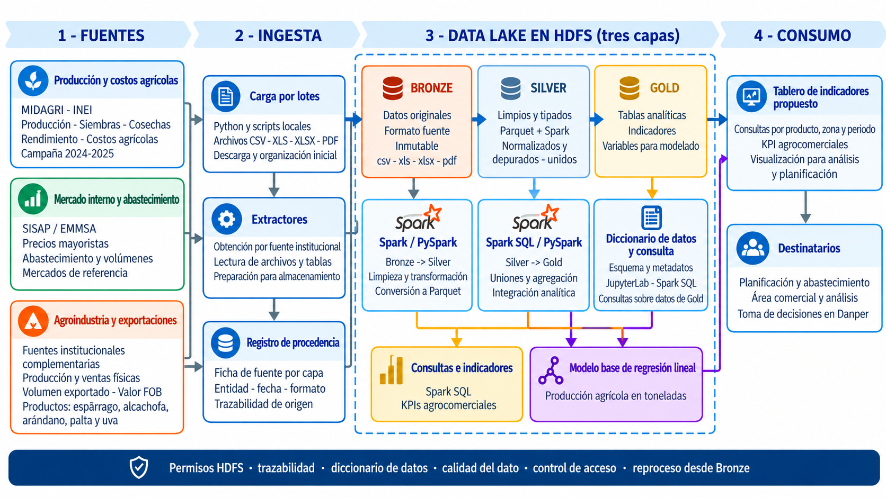

Figura 2.1. Arquitectura propuesta de la plataforma Big Data y Analítica Agrocomercial de Danper

El recorrido mostrado en la Figura 2.1 comienza con la obtención de información institucional de MIDAGRI, INEI, SISAP/EMMSA y otras fuentes relacionadas con agroindustria y exportaciones. Mediante procesos de ingesta por lotes desarrollados en Python, los archivos serán incorporados a HDFS y organizados en la capa Bronze, conservando su estructura original y la información necesaria para identificar su procedencia.

Posteriormente, Apache Spark/PySpark realizará las transformaciones correspondientes a la limpieza, conversión de tipos, tratamiento de registros duplicados, normalización de nombres de productos, unidades de medida y fechas. Los conjuntos resultantes se almacenarán en la capa Silver, principalmente mediante archivos Parquet, para facilitar su procesamiento y consulta.

<!-- Página 21 del PDF -->

En la capa Gold se integrarán los conjuntos de información que compartan claves y granularidades compatibles, generando tablas analíticas e indicadores por producto, zona y periodo. Estos resultados servirán como entrada para el análisis exploratorio, el desarrollo del modelo predictivo y las visualizaciones utilizadas para apoyar la planificación del abastecimiento y el análisis agrocomercial de Danper.

**Tabla 2.1. Recorrido del dato en la arquitectura propuesto**

Etapa | Qué ocurre | Tecnología

1. Fuentes | Obtención de datos institucionales sobre producción, | MIDAGRI, INEI,

precios, costos, abastecimiento, agroindustria y | SISAP/EMMSA y fuentes

exportaciones. | complementarias

2. Ingesta | Descarga, lectura y organización de archivos | Python y scripts de ingesta

institucionales, registrando su procedencia y fecha de incorporación.

3a. Bronze | Almacenamiento de archivos originales sin modificar su | Hadoop HDFS

contenido.

3b. Silver | Limpieza, normalización, validación de esquemas y | Spark/PySpark, HDFS y

conversión de los datos a formatos adecuados para el | Parquet

procesamiento.

3c. Gold | Integración de fuentes, agregaciones y generación de | Spark SQL/PySpark y

tablas analíticas por producto, zona y periodo. | Parquet

4. Análisis y | Consultas sobre los conjuntos integrados, generación de | Spark SQL, JupyterLab,

modelado | indicadores y entrenamiento de un modelo predictivo. | Python y Scikit-learn para el

análisis exploratorio y el modelo base de regresión lineal.

5. Consumo Presentación de indicadores y visualizaciones que apoyen | Tablero analítico por

la planificación agrocomercial. | implementar

Tipo de arquitectura

Se selecciona una arquitectura Data Lake porque permite conservar datos de diferentes formatos antes de definir las transformaciones necesarias para su análisis. A diferencia de utilizar exclusivamente un almacén de datos estructurado, este enfoque facilita mantener tanto los archivos institucionales originales como las versiones procesadas y las tablas destinadas al consumo analítico.

La solución adopta una organización por capas, conocida como arquitectura medallón, en la que Bronze almacena los datos originales, Silver contiene información limpia y validada, y Gold reúne los conjuntos integrados para responder a las necesidades del negocio. Esta separación permite mantener trazabilidad desde la fuente original hasta los indicadores utilizados en los análisis.

**Tabla 2.2. Arquitectura por capas: Bronze, Silver y Gold**

Capa | Qué contiene | Transformación | Formato | Procesamiento y

recuperación

Bronze | Datos originales | Conservación del | CSV, XLS, XLSX, Ingesta con Python y

<!-- Página 22 del PDF -->

(Cruda) | obtenidos de las | archivo original y | PDF y demás | almacenamiento

instituciones públicas, | registro de su | formatos | HDFS. Constituye la

organizados por fuente | procedencia. | originales. | fuente para

y fecha de carga. | reprocesar las demás

capas.

Silver | Datos limpios, tipados y | Tratamiento de | Parquet con | Procesamiento con

(procesada) | validados, manteniendo | valores nulos, | compresión | PySpark. Se

identificada la fuente de | normalización de | Snappy, según | reconstruye desde

cada registro. | productos, fechas y | corresponda. | Bronze.

unidades, control de duplicados y validaciones.

Gold | Tablas e indicadores | Uniones entre | Parquet y tablas | Procesamiento con

(analítica) | agrocomerciales | fuentes compatibles, | consultables | PySpark y Spark SQL.

integrados por | agregaciones, | mediante Spark | Se reconstruye desde

producto, zona y | indicadores y | SQL. | Silver.

periodo. | preparación de

variables para el modelo predictivo.

Para garantizar que la información pueda pasar correctamente entre las capas Bronze, Silver y Gold, se establecen contratos de datos que definen las condiciones de entrada, salida y validación de cada etapa. Estos contratos permiten identificar errores de estructura, mantener la trazabilidad y facilitar la modificación de los componentes sin alterar las reglas de negocio del proyecto.

Tabla 2.3. Contratos de datos entre las capas del Data Lake

Transición | Datos de entrada | Datos de salida | Condiciones y validaciones

Fuentes | → | Archivos institucionales | Archivos originales | Identificación del archivo,

Bronze | CSV, XLS, XLSX y PDF. | organizados en | conservación del contenido

/danper/bronze. | original, verificación de

existencia e integridad mediante SHA-256.

Bronze | → | Archivos originales de | Conjuntos estructurados | Verificación de columnas

Silver | producción, | en formato Parquet, | requeridas, conversión de tipos

exportaciones, costos, | almacenados en | de datos, normalización de

agroindustria y otras | /danper/silver. | fechas y categorías, y control de

fuentes. | registros inconsistentes o

duplicados.

<!-- Página 23 del PDF -->

Silver | → | Gold | Conjuntos Silver con | Tablas analíticas, | Validación de esquemas, claves

esquemas estructurados | dimensiones, hechos e | obligatorias, coherencia de

y campos compatibles. | indicadores en | periodos, compatibilidad de

/danper/gold. | unidades y comprobación de los

componentes generados.

Gold | → | Tablas analíticas en | Gráficos, indicadores y | Selección de campos necesarios,

Análisis y | formato Parquet. | conjuntos para | identificación de valores

modelado | entrenamiento y | faltantes y utilización de

evaluación. | registros válidos según el

objetivo analítico.

Los contratos permiten separar las responsabilidades de cada etapa. Por ejemplo, si cambia la estructura de un archivo de producción publicado por una institución, la modificación debe realizarse principalmente en el proceso de transformación hacia Silver, procurando mantener el esquema utilizado por Gold.

En la implementación actual, las validaciones se encuentran distribuidas entre los scripts de ingesta, transformación y procesamiento. Por tanto, estos contratos documentan las condiciones técnicas y de calidad de la arquitectura, sin afirmar que exista un sistema independiente de gestión automática de contratos.

La arquitectura permitirá conservar las características propias de cada fuente para evitar interpretaciones incorrectas. Por ejemplo, la información de precios mayoristas no se utilizará como equivalente directo del precio en chacra, debido a que representan diferentes etapas de la comercialización. De igual manera, los indicadores regionales no se atribuirán a un distrito determinado sin información que permita justificar dicha relación.

Por ello, las uniones y agregaciones considerarán las dimensiones de producto, ubicación geográfica y periodo, siempre que exista correspondencia válida entre los registros. Cuando una dimensión no se encuentre disponible para un producto o zona, dicha ausencia deberá identificarse y documentarse, evitando generar valores inexistentes.

La arquitectura propuesta busca que la información institucional dispersa pueda transformarse en datos integrados, trazables y reutilizables. Su principal aporte es establecer una estructura que permita consultar conjuntamente las seis dimensiones agrocomerciales y reducir el esfuerzo de elaboración de análisis como el definido en la línea base del proyecto: el estudio del espárrago en Virú.

### 2.2. Atributos de calidad del diseño

La arquitectura propuesta para Danper Trujillo S.A.C. busca garantizar que los datos agrocomerciales puedan almacenarse, procesarse y consultarse de manera confiable, considerando tanto las necesidades actuales como un posible crecimiento de las fuentes de información. De acuerdo con Bass et al. (2021), los atributos de calidad permiten evaluar las decisiones de una arquitectura más allá de las funciones que realiza, considerando su comportamiento frente a fallos, cambios y condiciones de operación. En este proyecto se priorizan cinco atributos: escalabilidad, disponibilidad, mantenibilidad, seguridad y costo.

<!-- Página 24 del PDF -->

● | Escalabilidad

La arquitectura utiliza Apache Spark/PySpark para el procesamiento de datos y Hadoop HDFS como sistema de almacenamiento. Para evaluar su escalabilidad se realizaron pruebas con el volumen original de datos y réplicas de 10 y 100 veces su tamaño, utilizando una máquina virtual Debian 12 con 5 CPU virtuales y aproximadamente 8 GiB de memoria RAM.

Los tiempos registrados durante el procesamiento Silver | → | Gold fueron de 54,98 segundos

(×1), 55,03 segundos (×10) y 53,35 segundos (×100). Estos resultados muestran que, en las condiciones evaluadas, el aumento del volumen no produjo un incremento proporcional del tiempo de ejecución. Sin embargo, no permiten asegurar que el comportamiento se mantenga con datos reales más diversos ni determinar el punto de saturación del equipo. Por ello, antes de incorporar nuevos nodos o ampliar la infraestructura, será necesario

completar las pruebas del pipeline Bronze | → | Silver | → | Gold y evaluar cargas superiores.

● | Disponibilidad

Para reducir el riesgo de pérdida de información durante el procesamiento, los archivos originales se conservarán en la capa Bronze, permitiendo reconstruir las capas Silver y Gold si una transformación presenta errores. Por ejemplo, si falla un trabajo de Spark mientras integra los precios agrícolas y la producción, será necesario corregir el problema y ejecutar nuevamente el proceso correspondiente. Los archivos originales podrán mantenerse siempre que el almacenamiento permanezca íntegro. No obstante, debido a que el prototipo puede depender de una sola máquina virtual, una falla de dicho entorno interrumpiría temporalmente los servicios. Por lo tanto, la propuesta contempla recuperación mediante reprocesamiento, pero no garantiza alta disponibilidad física.

● | Mantenibilidad

La arquitectura separa las responsabilidades de ingesta, almacenamiento, procesamiento e integración. Cada capa utilizará esquemas definidos, rutas organizadas y formatos de intercambio que faciliten identificar dónde debe realizarse una modificación. Por ejemplo, si MIDAGRI cambia la estructura de uno de sus archivos, los ajustes deberían concentrarse en el proceso de lectura y normalización de esa fuente, evitando modificar las demás dimensiones agrocomerciales. Esta separación busca disminuir el acoplamiento entre componentes y facilitar su mantenimiento.

● | Seguridad

Aunque el proyecto utiliza principalmente información pública institucional, es necesario proteger la integridad de los datos y evitar modificaciones no autorizadas. Para ello, se considera la aplicación de permisos de lectura y escritura en los directorios HDFS, la separación entre archivos originales y procesados y el registro de procedencia de las fuentes. En una implementación productiva también se requerirían mecanismos de autenticación, cifrado de datos almacenados y protección de las comunicaciones mediante conexiones seguras. Estas medidas deberán distinguirse de los controles efectivamente configurados durante la implementación académica, los cuales serán documentados en la sección 3.8.

● | Costo

<!-- Página 25 del PDF -->

La selección de la ruta on-premise permite aprovechar el entorno de trabajo disponible durante el curso y evita depender de servicios de nube para ejecutar el prototipo. Asimismo, se propone utilizar el formato Parquet para almacenar los datos procesados, aplicar filtros antes de las operaciones de integración cuando corresponda y utilizar caché únicamente cuando un conjunto de datos deba reutilizarse. Estas decisiones buscan reducir lecturas innecesarias, consumo de memoria y tiempo de procesamiento, aunque sus beneficios deberán comprobarse mediante las mediciones de rendimiento de la sección 3.6.

En conjunto, estos atributos permiten evaluar la arquitectura a partir de criterios técnicos verificables. La solución no pretende incorporar la mayor cantidad posible de tecnologías, sino utilizar una infraestructura que responda al problema de integración agrocomercial de Danper, manteniendo la posibilidad de crecimiento y reconociendo las limitaciones de su implementación académica.

### 2.3. Prueba de sustitución de componentes

Una arquitectura de datos debe permitir reemplazar determinadas tecnologías sin que sea necesario reconstruir completamente la solución. Bass et al. (2021) relacionan esta capacidad con la modificabilidad, entendida como la posibilidad de introducir cambios controlando su impacto sobre los demás componentes. En la plataforma propuesta para Danper, esta característica se busca mediante la separación entre almacenamiento, procesamiento y consumo, utilizando formatos, esquemas y reglas de transformación documentados.

Si Danper decidiera reemplazar Apache Spark por otro motor de procesamiento, como Apache Flink, sería necesario adaptar las transformaciones desarrolladas en PySpark, las operaciones de limpieza, las uniones entre fuentes y la configuración de ejecución. Esto representaría un cambio importante en la capa de procesamiento, ya que las funciones utilizadas por cada motor no son necesariamente equivalentes. Sin embargo, podrían conservarse los archivos originales de Bronze, los conjuntos almacenados en formatos compatibles como Parquet y las definiciones de los indicadores de producción, precios, costos, abastecimiento y exportaciones. Las reglas de negocio seguirían siendo válidas, aunque su implementación técnica tendría que adaptarse al nuevo motor.

Por otro lado, si se decidiera migrar el almacenamiento de HDFS hacia Amazon S3, sería necesario trasladar los archivos, modificar las rutas de lectura y escritura, configurar los conectores y establecer los permisos correspondientes. No obstante, las transformaciones desarrolladas con Spark podrían conservar gran parte de su lógica, siempre que se garantice la compatibilidad de formatos y esquemas. La organización de las capas Bronze, Silver y Gold también podría mantenerse, debido a que representa una decisión de arquitectura y no una característica exclusiva de HDFS.

Para facilitar estos cambios, se propone mantener separados los parámetros de conexión y almacenamiento de las reglas agrocomerciales. Por ejemplo, la definición del rendimiento agrícola o la normalización de los nombres de productos no debería depender de una ruta específica de HDFS. De igual manera, las tablas analíticas deberán conservar nombres, tipos de datos, unidades de medida y niveles de agregación consistentes, independientemente de la herramienta que las procese.

Por lo tanto, la arquitectura propuesta permitiría conservar sus datos y definiciones analíticas frente a determinados cambios tecnológicos, aunque no eliminaría completamente el trabajo de migración. Su

<!-- Página 26 del PDF -->

principal ventaja es que los cambios podrían concentrarse en componentes identificables, reduciendo el riesgo de afectar todo el pipeline. Esta característica resulta relevante para una posible evolución de la plataforma, ya que las necesidades de procesamiento y almacenamiento podrían aumentar conforme se incorporen nuevas fuentes y periodos históricos.

### 2.4. Stack tecnológico y equivalencia entre rutas

La selección de tecnologías para la plataforma de Big Data y Analítica Agrocomercial de Danper Trujillo S.A.C. se fundamenta en las necesidades de almacenamiento, procesamiento e integración de datos institucionales y en la infraestructura disponible durante el curso. Se seleccionó la ruta on-premise, utilizando Hadoop HDFS para almacenar los datos en las capas Bronze, Silver y Gold, Apache Spark/PySpark para realizar las transformaciones y consultas analíticas, y JupyterLab como entorno de desarrollo y ejecución de notebooks. El procesamiento documentado se realizó en modo local, sin utilizar YARN como administrador de recursos.

Según Chambers y Zaharia (2018), Apache Spark proporciona herramientas para procesar datos mediante DataFrames y consultas SQL, facilitando operaciones de transformación, integración y análisis. Estas características resultan adecuadas para el proyecto, debido a que las fuentes agrocomerciales presentan diferentes estructuras, formatos y niveles de detalle.

## Herramientas seleccionadas

**Tabla 2.4. Stack tecnológico del proyecto**

Herramienta | Versión | Función | Estado

Debian GNU/Linux | 12 | Sistema operativo del | Utilizada

entorno de ejecución.

Apache Hadoop HDFS | 3.3.6 | Almacenamiento de los | Implementada

conjuntos procesados en las capas Silver y Gold y soporte para la organización del data lake.

Apache Spark / PySpark 3.5.1 | Limpieza, | Utilizada en el pipeline

transformación e | Gold

integración de fuentes.

Spark SQL | 3.5.1 | Consultas, agrupaciones | Utilizada

y uniones de datos.

Python | 3.11.2 | Scripts de ingesta y | Utilizada

preparación de archivos.

Git | 2.39.5 | Control de versiones, | Utilizada

gestión de ramas y seguimiento de cambios del proyecto.

<!-- Página 27 del PDF -->

JupyterLab | 4.6.3 | Desarrollo y ejecución | Utilizada

del pipeline.

Apache Parquet | Formato de | Almacenamiento | Utilizada

almacenamiento | columnar de las capas

Silver y Gold.

Apache Hadoop | 3.3.6 | Alternativa de | No seleccionado como

MapReduce | procesamiento por | motor principal

lotes.

Apache Kafka | No aplica | Procesamiento de flujos | No utilizado

de eventos.

Se seleccionó Spark como motor principal porque permite desarrollar transformaciones y consultas analíticas mediante una misma plataforma. Aunque Hadoop MapReduce también permite realizar procesamiento por lotes, Spark proporciona una interfaz de programación más adecuada para las operaciones de limpieza, integración y agregación previstas en el proyecto. Por su parte, Kafka no fue seleccionado porque las fuentes institucionales se obtienen mediante archivos y actualizaciones periódicas, sin requerir procesamiento continuo de eventos.

## Equivalencia entre rutas de despliegue

Aunque la solución será implementada en infraestructura local, se identificaron servicios equivalentes de Amazon Web Services para evaluar una eventual migración hacia un entorno gestionado.

**Tabla 2.5 Equivalencia entre las rutas de despliegue on-premise y en la nube**

Función | Componente on-premise | Servicio gestionado equivalente

Almacenamiento | Hadoop HDFS | Amazon S3

Procesamiento | Apache Spark/PySpark | Amazon EMR Serverless para Spark

Diccionario de datos; Hive Metastore

Catálogo de metadatos | AWS Glue Data Catalog

como alternativa

Consulta analítica | Apache Spark SQL | Amazon Athena

La equivalencia permite identificar qué componentes podrían reemplazarse ante un cambio de infraestructura. Sin embargo, una migración no sería completamente automática. Se requeriría adaptar las configuraciones de acceso, las rutas de almacenamiento y determinados aspectos de ejecución. La utilización de formatos abiertos y esquemas documentados contribuiría a conservar los datos procesados y las definiciones analíticas.

Estimación del costo mensual en la nube

Para comparar la ruta on-premise con una alternativa gestionada, se plantea un escenario académico de operación en AWS, considerando almacenamiento en Amazon S3, procesamiento mediante Amazon EMR Serverless y consultas analíticas con Amazon Athena.

<!-- Página 28 del PDF -->

La estimación considera un escenario hipotético de 10 GB almacenados, 20 ejecuciones mensuales del pipeline de 30 minutos cada una, con una asignación promedio de 4 vCPU y 16 GB de memoria, además de 50 GB de datos examinados mensualmente mediante consultas.

Bajo tarifas referenciales de US East (N. Virginia), y considerando únicamente el almacenamiento, las horas de vCPU, la memoria y los datos examinados en consultas, se obtiene un subtotal aproximado de US$ 3.50 mensuales. Este valor no incluye todos los posibles cargos por solicitudes, registros, transferencias, almacenamiento adicional o impuestos, por lo que no constituye una cotización completa.

La estimación deberá validarse en AWS Pricing Calculator, utilizando las tarifas vigentes y los recursos realmente necesarios una vez que se disponga de los tiempos de ejecución y el tamaño consolidado de los datasets.

El costo calculado representa únicamente una aproximación para el prototipo académico y no el costo de implementar una plataforma empresarial completa en Danper. Una evaluación productiva debería incorporar los requerimientos de disponibilidad, seguridad, actualización de información, mantenimiento y crecimiento futuro.

Eficiencia y sostenibilidad

La arquitectura propuesta contempla medidas para reducir el consumo innecesario de recursos. Una de las principales decisiones consiste en utilizar archivos Parquet en las capas Silver y Gold, debido a que su organización columnar permite disminuir la cantidad de información leída cuando las consultas requieren únicamente determinadas variables.

Asimismo, se considera el particionado de los datos por periodo cuando el volumen lo justifique, evitando generar una cantidad excesiva de archivos pequeños. Durante el procesamiento con Apache Spark se aplicaron técnicas de optimización, entre ellas el almacenamiento temporal de DataFrames en memoria mediante caché. Las pruebas realizadas sobre los datos de producción agrícola permitieron reducir el tiempo promedio de ejecución de las consultas repetidas de 1,5480 a 0,6090 segundos, lo que representa una mejora aproximada del 60,66 %. Sin embargo, este resultado corresponde a las condiciones específicas de la prueba y no debe interpretarse como una mejora general de todo el pipeline. Estas decisiones contribuyen a utilizar los recursos de manera más eficiente y reducir operaciones innecesarias de lectura y procesamiento.

En cuanto a sostenibilidad, se considera el apagado de los servicios cuando no se encuentren en uso, la asignación de CPU y memoria según la carga real y la eliminación de archivos temporales generados durante las pruebas de escalabilidad. Estas decisiones buscan disminuir el consumo eléctrico y evitar la utilización innecesaria de almacenamiento.

Por lo tanto, la elección tecnológica no responde únicamente a la capacidad de procesar información, sino también a la necesidad de mantener una solución proporcional al volumen y frecuencia de actualización de las fuentes agrocomerciales. El objetivo es construir una plataforma reproducible y preparada para crecer, sin incorporar infraestructura adicional que no aporte una mejora verificable al proyecto.

# 3. Implementación del pipeline de datos

### 3.1. Fuentes de datos y ficha de procedencia

<!-- Página 29 del PDF -->

Para desarrollar la plataforma de Big Data y Analítica Agrocomercial de Danper Trujillo S.A.C., se recopilaron conjuntos de datos relacionados con la producción agrícola, los costos de producción, la actividad agroindustrial y las exportaciones. Estos datos permiten analizar diferentes variables que influyen en las condiciones de abastecimiento y comercialización de productos agrícolas relevantes para la empresa.

Las fuentes seleccionadas corresponden principalmente a información pública atribuida a instituciones como el Instituto Nacional de Estadística e Informática (INEI), el Ministerio de Desarrollo Agrario y Riego (MIDAGRI) y la Superintendencia Nacional de Aduanas y de Administración Tributaria (SUNAT). Su utilización permite construir una base de análisis sin depender de información operativa interna de Danper, considerando las limitaciones de cobertura geográfica, temporal y de disponibilidad de registros.

Para garantizar la trazabilidad, se elaboraron fichas de procedencia que documentan las características principales de cada conjunto, incluyendo su origen, entidad publicadora, fecha de obtención, periodo de cobertura, formato, tamaño y condiciones de uso. Asimismo, se identificaron las columnas relevantes y su significado para el análisis agrocomercial.

A continuación, se presentan las seis fuentes principales consideradas en el proyecto, acompañadas de sus respectivas fichas de procedencia y diccionarios de columnas.

Figura 3.1. Organización de las fuentes de datos utilizadas en el proyecto.

# 1. Encuesta Nacional Agropecuaria 2025 (ENA 2025)

Microdatos de la Encuesta Nacional Agropecuaria (ENA 2025), organizados Nombre del conjunto en módulos temáticos.

Origen | ☐ | Cedido por la empresa (adjuntar constancia) X | ☐ | Fuente pública institucional

Instituto Nacional de Estadística e Informática (INEI), atribución consignada Entidad publicadora para la ENA. Debe conservarse la referencia oficial del conjunto descargado.

Repositorio local del proyecto, en datasets/Costos de producción — ENA Enlace o medio de entrega 2025 completa/ENA_2025/, con subdirectorios por módulo.

<!-- Página 30 del PDF -->

https://drive.google.com/drive/folders/170LVPE_m3S-NCbe9dSbqzpe0DKC3rSMa?usp=sharing

Fecha de obtención | fecha de descarga o incorporación al repositorio 20/09/2026

Licencia o condiciones de | Datos abiertos de acceso público bajo marco del secreto estadístico (D.S. N°

uso | 043-2001-PCM / D.S. N° 943-2001-PCM)

Identificado como ENA 2025. El inventario registra 30 CSV y 2.445.214 registros CSV asociados al grupo ENA.El conjunto de carpetas ENA contiene Período cubierto y número también 61 PDF de cuestionarios y diccionarios. El número de registros de registros corresponde a la suma de filas de los CSV, no a unidades agropecuarias únicas.

533,76 MB para los 91 archivos ENA, incluidos unos 389,86 MB de (30 CSV) Tamaño en disco y formato y 143,91 MB de (61 PDF).

## DICCIONARIO DE COLUMNAS RELEVANTES:

Nombre de la columna | Tipo de dato inferido | Descripción / significado de negocio para Danper

ANIO | Numérico | Año de ejecución de la encuesta. Permite identificar el periodo

estadístico de la observación.

CCDD | Texto | Código del departamento. Debe conservarse como texto para evitar

pérdida de ceros iniciales.

NOMBREDD | Texto | Nombre del departamento. Facilita la lectura y validación

geográfica.

CCPP | Texto | Código de provincia. Se utilizará para la ubicación territorial.

NOMBREPV | Texto | Nombre de la provincia.

CCDI | Texto | Código del distrito.

NOMBREDI | Texto | Nombre del distrito.

NSEGM | Texto | Identificador del segmento de muestreo. Su definición precisa debe

validarse con el diccionario ENA.

ID_PROD | Texto | Identificador de productor dentro de la estructura del módulo. No

debe asumirse como identificador empresarial o DNI.

<!-- Página 31 del PDF -->

UA | Texto | Identificador o código de unidad agropecuaria según el módulo.

Debe verificarse su tipo y unicidad.

RESFIN | Categórico | Resultado final de la entrevista. Permite distinguir registros

completos de otros estados de entrevista.

REGION | Categórico | Región asociada al registro u otra clasificación territorial del diseño

ENA, según el diccionario del módulo.

ESTRATO | Categórico | Estrato estadístico de la encuesta. Puede resultar necesario para el

análisis del diseño muestral.

FACTOR_PRODUCTOR | Decimal | Factor asociado al productor, potencialmente factor de expansión.

Su uso debe seguir las instrucciones metodológicas de la encuesta.

CODIGO | Texto | Código de clasificación o registro del módulo. Cuya función

específica debe comprobarse por módulo.

P101A | Entero o categoría | Variable del cuestionario. El significado y las categorías deben

obtenerse del diccionario correspondiente.

P142_1 /P142_2/P142_3 | Entero o categoría | Variable de pregunta del cuestionario.

# 2. Exportaciones Aduaneras SUNAT - DANPER TRUJILLO S.A.C. (2024–2026)

Registros de exportaciones aduaneras de DANPER TRUJILLO S.A.C., Nombre del conjunto organizados por año.

Origen | ☐ | Cedido por la empresa (adjuntar constancia) X | ☐ | Fuente pública institucional

Superintendencia Nacional de Aduanas y de Administración Tributaria Entidad publicadora (SUNAT), según la clasificación del proyecto.

Carpeta local datasets/aduanet/, que contiene SUNAT_DANPER_exportaciones_2024.csv, SUNAT_DANPER_exportaciones_2025.csv y Enlace o medio de entrega SUNAT_DANPER_exportaciones_2026.csv. https://drive.google.com/drive/folders/1phcXVlIvr_qz-0oOEQppHaDPKMYtAbfd?usp=drive_link

Fecha de obtención | 9/10/2026

Licencia o condiciones de Datos abiertos de acceso público (Registro oficial de comercio exterior) uso

Período cubierto y número | Años 2024, 2025 y 2026. Se identificaron 444 registros en 2024, 542 en 2025

de registros | y 138 en 2026, para un total de 1.124 registros. El año 2026 debe tratarse

<!-- Página 32 del PDF -->

como un periodo posiblemente parcial, sujeto a confirmación de la fecha de corte.

Aproximadamente 0,16 MB; 3 CSV codificados como utf-8-sig y separados Tamaño en disco y formato por coma.

DICCIONARIO DE COLUMNAS RELEVANTES:

Nombre de la columna | Tipo de dato inferido | Descripción / significado de negocio para Danper

ruc | Texto | Identificador tributario del exportador. Debe preservarse como

texto.

exportador | Texto | Razón social del exportador. Permite validar que los registros

correspondan a (DANPER TRUJILLO S.A.C.)

mes | Texto / Fecha | Periodo mensual del registro. Debe normalizarse a un formato

común, por ejemplo YYYY-MM.

agente | Texto | Agencia de aduanas asociada al despacho. Puede servir para

análisis descriptivos de operaciones.

aduana | Texto | Aduana de salida registrada en el archivo. (ej. Marítima del

Callao, Salaverry, Aérea del Callao, Paita).

pais | Texto | País de destino final de la mercancía exportada.

fob_usd | Decimal | Valor FOB de la mercancía exportada en dólares

estadounidenses.

pagina_origen | Texto | Campo presente en una parte de los archivos; referencia a la

página de origen o extracción, útil para trazabilidad.

# 3. Producción agrícola provincial de La Libertad

Producción agrícolas mensuales por provincias y distritos de La Libertad, Nombre del conjunto campaña agrícola 2024-2025.

Origen | ☐ | Cedido por la empresa (adjuntar constancia) X | ☐ | Fuente pública institucional

Ministerio de Desarrollo Agrario y Riego (MIDAGRI) / Gerencia Regional de Entidad publicadora Agricultura de La Libertad

<!-- Página 33 del PDF -->

Carpeta datasets/Produccion agricola -Provincias de La Libertad/, que contiene 12 libros XLSX provinciales. Enlace o medio de entrega https://drive.google.com/drive/folders/1IkzoT4ybweUMjxsRL-fG2opE3zNRRd5-?usp=drive_link

Fecha de obtención | Fecha de generación de reporte: 20/09/2026

Licencia o condiciones de Datos abiertos de acceso público uso

Campaña agrícola 2024-2025, según los nombres de archivo. Se identificaron 12 libros XLSX con hojas que representan provincias y distritos, Período cubierto y número con encabezados detectados aproximadamente en la fila 11. El total de filas de registros de datos debe establecerse después de excluir títulos, notas, subtotales y totales.

Tamaño en disco y formato | Aproximadamente 0,94 MB; 12 libros XLSX.

## DICCIONARIO DE COLUMNAS RELEVANTES:

Nombre de la columna | Tipo de dato inferido | Descripción / significado de negocio para Danper

COD.CULTIVO | Texto | Código del cultivo; debe ser la clave primaria cuando su

catálogo esté disponible.

CULTIVO | Texto | Nombre común del cultivo evaluado (ej. Alfalfa, Arroz, Maíz

Amarillo Duro, Frijol).

VARIABLES | Texto | Indicador estadístico de la fila, por ejemplo producción,

superficie, rendimiento o precio en chacra, según las categorías que contenga el archivo.

TOTAL EJEC. | Decimal | Valor acumulado o total ejecutado de la variable registrada.

Su unidad depende del indicador de la fila.

AGO | , | SET | , | OCT | , ..., | JUL | Decimal | Valores mensuales correspondientes al calendario de la

campaña agrícola.

# 4. Actividad agroindustrial de La Libertad (2010–2024)

Series históricas de ingreso de espárrago y alcachofa para procesamiento Nombre del conjunto agroindustrial en La Libertad.

Origen | ☐ | Cedido por la empresa (adjuntar constancia) X | ☐ | Fuente pública institucional

<!-- Página 34 del PDF -->

Ministerio de Desarrollo Agrario y Riego (MIDAGRI) / Gerencia Regional de Entidad publicadora Agricultura de La Libertad.

Carpeta datasets/Agroindustrial 2010-2024/, con dos libros XLSX: LA LIBERTAD AGROINDUSTRIA DE ALCACHOFA 2010-2024.xlsx.

Enlace o medio de entrega | LA LIBERTAD AGROINDUSTRIA DE ESPARRAGO 2010-2024.xlsx.

https://drive.google.com/drive/folders/11KRpu6Pz_avP6bFEmWg87cfjrDWl p2TV?usp=sharing

Fecha de obtención | 20/09/2026

Licencia o condiciones de Datos abiertos de acceso público uso

Período cubierto y número | Series identificadas por los nombres de archivo como 2010-2024. Cada libro

de registros | contiene una hoja principal con las columnas de año, total y meses.

Tamaño en disco y formato | Aproximadamente 0,09 MB; 2 libros XLSX.

## DICCIONARIO DE COLUMNAS RELEVANTES:

Nombre de la columna | Tipo de dato inferido | Descripción / significado de negocio para Danper

AÑO | Entero | Año correspondiente al registro estadístico de procesamiento

(2010 al 2024)

TOTAL | Decimal | Volumen total anual de alcachofa acopiada e ingresada para su

procesamiento agroindustrial (en toneladas métricas).

ENE | , | FEB | , | MAR | , ..., | DIC | Decimal | Volumen mensual ingresado a planta agroindustrial para

procesar (en toneladas métricas).

# 5. Costos complementarios de insumos y servicios agrícolas

Nombre del conjunto | Series de costos de jornales, alquiler de tractor agrícola y alquiler de yunta.

Origen | ☐ | Cedido por la empresa (adjuntar constancia) X | ☐ | Fuente pública institucional

Entidad publicadora | Ministerio de Desarrollo Agrario y Riego (MIDAGRI)

CSV locales en las carpetas datasets/Costos complementarios — MIDAGRI Insumos y Servicios Agropecuarios contiene varios CSV separados/

Enlace o medio de entrega | datasets/Alquiler de yunta — link específico del recurso/

datasets/Tractor agrícola — link específico del recurso/ https://drive.google.com/drive/folders/12KQS5Ha3qpSGq6mBCK9tBiaoIBM pBC8J?usp=drive_link

<!-- Página 35 del PDF -->

https://drive.google.com/drive/folders/1kcoDc3j8-QCsZUXP4utHLrnpcGvPJf8X?usp=drive_link https://drive.google.com/drive/folders/1shj67AqdsDXnIjTOPqxLeOQvXSeX9 zQa?usp=drive_link

Fecha de obtención | 20/09/2026

Licencia o condiciones de Datos abiertos de acceso público uso

Las series contienen los campos Región, Año y meses de enero a diciembre.

Período cubierto y número | El inventario registra 210, 175 y 212 registros en los tres archivos de costos

de registros | complementarios; además, hay archivos asociados de 175 y 212 registros en

las rutas específicas de yunta y tractor.

Tres conjuntos de datos principales CSV, con tamaños aproximados de 0,02

Tamaño en disco y formato | MB, 0,01 MB y 0,016 MB, respectivamente. El delimitador identificado es

punto y coma (;).

## DICCIONARIO DE COLUMNAS RELEVANTES:

Nombre de la columna | Tipo de dato | Descripción / Significado de la variable

Región | Texto | Departamento donde se registran los costos de mano de obra

y servicios de campo (relevante para zonas de acopio y producción agrícola).

AÑO | Texto | Año correspondiente al registro histórico de tarifas y costos

agropecuarios.

ENE | , | FEB | , | MAR | , ..., | DIC | Decimal | Costo o tarifa mensual registrada por concepto de jornal

agrícola o alquiler de maquinaria/yunta.

# 6. Exportaciones regionales por cultivo

Series regionales de exportación de espárrago, alcachofa, arándano, palta y Nombre del conjunto uva.

Origen | ☐ | Cedido por la empresa (adjuntar constancia) X | ☐ | Fuente pública institucional

Entidad publicadora | Gerencia Regional de Agricultura de La Libertad.

Carpeta datasets/Agroexportacion 2023/, con cinco libros XLSX. Enlace o medio de entrega https://drive.google.com/drive/folders/1E7u08fY-jTM5NY2NEDgs-4kmMXSBIod1?usp=drive_link

<!-- Página 36 del PDF -->

Fecha de obtención | 20/09/2026

Licencia o condiciones de Datos abiertos de acceso público uso

Series 2012-2023 según los nombres de los archivos. Cada libro Período cubierto y número corresponde a un cultivo y contiene columnas mensuales y una columna de registros anual de total o variación.

Tamaño en disco y formato | Aproximadamente 1,27 MB; cinco archivos XLSX.

## DICCIONARIO DE COLUMNAS RELEVANTES:

Nombre de la columna | Tipo de dato | Descripción / Significado de la variable

AÑO | Entero | Año de la serie estadística.

ENE | , | FEB | , | MAR | , ..., | DIC | Decimal | Valores mensuales de la serie de exportación.

Total anual | Decimal | Total anual declarado por la fuente.

Variación anual% | Decimal o porcentaje | Variación porcentual anual según la fuente.

Como complemento a las fichas de procedencia presentadas, se elaboró un diccionario de datos en formato Excel denominado Diccionario_Datos_Danper_G07.xlsx. Este documento reúne información de las columnas relevantes de las fuentes originales, los conjuntos procesados de la capa Silver y las tablas analíticas de la capa Gold.

El diccionario permite identificar el nombre de cada campo, su tipo de dato, descripción, unidad de medida, procedencia y observaciones de validación. De esta manera, facilita la interpretación de las variables utilizadas y contribuye a mantener la trazabilidad entre las fuentes de información y los resultados obtenidos durante el procesamiento.

El diccionario de datos completo se presenta como archivo Excel complementario en el Anexo C. Diccionario de datos del proyecto, mientras que las tablas incluidas en esta sección describen los campos más relevantes de cada fuente de información utilizada.

### 3.2. Ingesta y organización del data lake

<!-- Página 37 del PDF -->

La implementación del pipeline de datos para Danper Trujillo S.A.C. se desarrolló bajo una arquitectura on-premise, utilizando Apache Hadoop HDFS 3.3.6 como sistema de almacenamiento y Apache Spark/PySpark 3.5.1 para el procesamiento. Se adoptó un enfoque de ingesta por lotes, debido a que las fuentes agrocomerciales utilizadas se encuentran principalmente en archivos descargados de distintas entidades y no requieren procesamiento continuo en tiempo real.

Para organizar la información se utilizó una arquitectura de tres capas: Bronze, Silver y Gold. Esta separación permite distinguir los archivos originales de los conjuntos de datos estructurados y de las tablas analíticas, facilitando la trazabilidad de la información y evitando modificaciones directas sobre las fuentes recopiladas.

## Ingesta de archivos en la capa Bronze

El proceso de ingesta fue desarrollado mediante los scripts ingesta_bronze.py e inventario_bronze.py, disponibles en el repositorio GitHub del proyecto. El primero permite organizar y cargar los archivos desde el directorio local de datasets hacia HDFS, mientras que el segundo genera un inventario con información sobre las características de los archivos.

Figura 3.2-A. Scripts de ingesta e inventario de la capa Bronze disponibles en el repositorio GitHub del proyecto.

Evidencia complementaria del apartado 3.2. Scripts de ingesta e inventario de la capa Bronze disponibles en el repositorio GitHub del proyecto, rama develop.

La disponibilidad de estos archivos permite identificar los procedimientos implementados para organizar las fuentes originales, registrar su inventario y verificar su integridad. Su existencia en el repositorio complementa la evidencia de almacenamiento en HDFS presentada en la Figura 3.2.

Durante la ingesta se identifican los archivos disponibles y se determina su ubicación de acuerdo con la categoría agrocomercial correspondiente. Además, se comprueba si los archivos ya existen en HDFS para evitar sobrescrituras involuntarias. El procedimiento incorpora verificaciones de integridad mediante el algoritmo SHA-256, que permite comparar el contenido de los archivos locales con las copias almacenadas en el sistema distribuido.

De acuerdo con la documentación disponible en el repositorio, el proceso Bronze fue desarrollado para gestionar 180 archivos pertenecientes a diferentes categorías agrocomerciales. Los formatos recopilados incluyen CSV, XLS, XLSX y PDF, los cuales se conservan para permitir su revisión y posterior transformación.

La ruta utilizada para la ingesta de archivos originales es /danper/bronze. Su existencia fue comprobada mediante una consulta de Hadoop HDFS realizada en Debian 12, donde se identificaron nueve elementos de primer nivel correspondientes a distintas categorías agrocomerciales, entre ellas abastecimiento, agroindustria, comercio regional, costos, exportaciones, pecuaria, precios, producción y sostenibilidad.

Esta evidencia confirma que la estructura de almacenamiento de Bronze existe en el entorno consultado. Sin embargo, la verificación de los 180 archivos debe contrastarse con el inventario generado durante la ingesta, debido a que la consulta realizada muestra directorios y no el número total de archivos almacenados.

<!-- Página 38 del PDF -->

## Organización de las capas del data lake

La capa Silver contiene conjuntos de datos estructurados que se obtienen mediante los scripts de transformación desarrollados para las distintas fuentes. Estos procesos preparan la información para realizar consultas y análisis posteriores, almacenando los resultados principalmente en formato Parquet.

Por su parte, la capa Gold recibe los conjuntos Silver utilizados para elaborar tablas analíticas, dimensiones, hechos e indicadores. En esta etapa se aplican operaciones de agrupación e integración mediante Apache Spark/PySpark, generando información preparada para el análisis exploratorio, el modelado y la interpretación de resultados agrocomerciales.

**Tabla 3.1. Organización de las capas del data lake**

Capa | Ruta HDFS | Contenido | Estado de verificación

Bronze | /danper/bronze | Archivos originales organizados por | Estructura verificada en HDFS, con

categorías agrocomerciales. | nueve elementos de primer nivel;

cantidad total de archivos pendiente de contrastar con el inventario.

Silver | /danper/silver | Conjuntos estructurados y | Implementada y verificada mediante

procesados en formato Parquet. | consulta HDFS.

Gold | /danper/gold | Tablas analíticas, dimensiones, | Implementada y verificada; 26

hechos e indicadores KPI. | componentes encontrados.

## Resultados de la organización y procesamiento

La documentación técnica de Silver registra once conjuntos de datos y un total de 79 498 filas, correspondientes a distintas fuentes y niveles de detalle. Entre ellos se encuentran datos de producción agrícola, exportaciones, abastecimiento, precios de mercado, agroindustria, costos, ENA 2025 y sostenibilidad.

En la consulta del directorio /danper/silver se identificaron diez elementos de primer nivel. Esta cantidad no representa necesariamente el total de conjuntos procesados, debido a que algunas fuentes se encuentran organizadas en subdirectorios, como ocurre con las exportaciones y los datos de la ENA 2025.

Para el procesamiento Gold se utilizaron siete conjuntos Silver principales. A partir de ellos se generaron 26 componentes analíticos, distribuidos en siete tablas analíticas, seis dimensiones, siete tablas de hechos y seis tablas de indicadores KPI.

La consulta realizada sobre /danper/gold confirmó la presencia de los 26 componentes. Estos resultados evidencian la organización de los productos analíticos en HDFS, aunque la comprobación de sus esquemas y cantidades de registros requiere ejecutar los controles de lectura y validación correspondientes.

<!-- Página 39 del PDF -->

## Evidencia de implementación

La estructura de almacenamiento del Data Lake fue comprobada mediante consultas ejecutadas desde la terminal de Debian 12, utilizando el comando hdfs dfs -ls sobre las rutas de Bronze, Silver y Gold. Estas consultas permiten observar los directorios existentes y verificar que las capas del proyecto se encuentran organizadas dentro de HDFS..

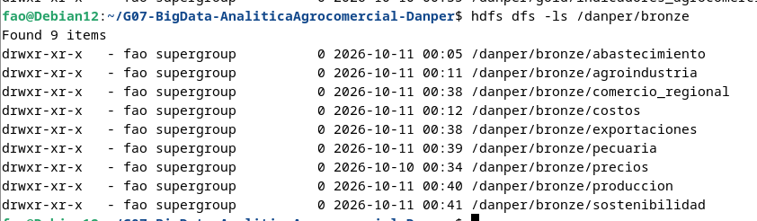

Figura 3.2. Estructura de almacenamiento de la capa Bronze en HDFS.

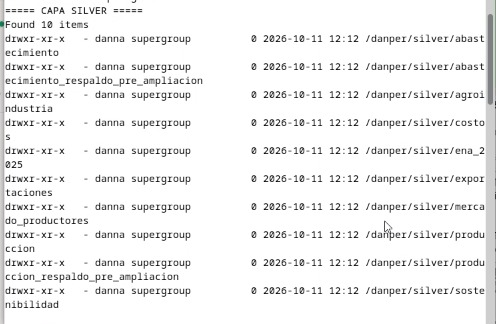

Figura 3.3. Estructura de almacenamiento de la capa Silver en HDFS.

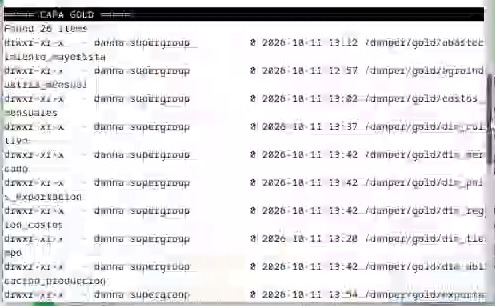

Figura 3.4. Estructura de almacenamiento de la capa Gold en HDFS.

Las evidencias muestran que las tres rutas de almacenamiento existen en los entornos consultados. Cabe precisar que las capturas de Bronze y de las capas procesadas corresponden a usuarios distintos del entorno Debian, por lo que estas verificaciones acreditan la existencia de sus respectivos directorios, pero no constituyen por sí solas una prueba de ejecución completa del pipeline desde Bronze hasta Gold.

<!-- Página 40 del PDF -->

En conjunto, la organización del Data Lake permite separar las fuentes originales de la información procesada y de los productos analíticos. Esta estructura facilita la trazabilidad de los datos, el mantenimiento de los procesos y la ejecución de nuevas transformaciones sin modificar directamente los archivos de origen, contribuyendo a una gestión más ordenada de la información agrocomercial utilizada en el proyecto.

### 3.3. Procesamiento y limpieza

El procesamiento y la limpieza de datos constituyen una etapa fundamental en el desarrollo de la plataforma de Big Data y Analítica Agrocomercial para Danper Trujillo S.A.C., debido a que las fuentes recopiladas presentan diferentes estructuras, formatos, periodos de cobertura y niveles de detalle. Para preparar esta información se implementaron scripts en Python y Apache Spark/PySpark que permiten extraer, estructurar, normalizar y validar los datos antes de utilizarlos en los análisis agrocomerciales.

El procesamiento sigue el recorrido Bronze | → | Silver | → | Gold. En primer lugar, los archivos originales

almacenados en Bronze son leídos y transformados en conjuntos estructurados de la capa Silver. Posteriormente, los datos Silver seleccionados se integran y agregan para generar los componentes analíticos de Gold. Esta separación permite conservar los archivos originales, documentar las transformaciones y evitar que los análisis dependan directamente de documentos sin procesar.

Carga de datos y verificación de esquemas

La primera actividad consistió en identificar el formato y la estructura de los archivos originales. Las fuentes utilizadas incluyen documentos CSV, Excel y PDF, por lo que fue necesario aplicar procedimientos de lectura específicos según las características de cada conjunto.

Para los archivos CSV, los scripts consideran los encabezados y las columnas esperadas, mientras que los documentos Excel requieren identificar las filas y bloques donde se encuentran los valores estadísticos. En el caso de los boletines PDF de abastecimiento y precios mayoristas, se desarrollaron procedimientos de extracción para convertir la información relevante en registros estructurados.

Un ejemplo es el procesamiento de producción agrícola provincial, implementado en scripts/transformacion_silver.py. Este procedimiento recupera doce archivos Excel desde Bronze, extrae la información agrícola, construye un DataFrame con un esquema definido y comprueba la existencia de las variables necesarias.

En las exportaciones asociadas a Danper, el script transformacion_exportaciones_danper_silver.py verifica la presencia de campos obligatorios, entre ellos ruc, exportador, mes, agente, aduana, pais y fob_usd. La verificación de esquemas permite detectar diferencias entre los archivos antes de consolidar la información.

Tratamiento de valores nulos, duplicados y registros inconsistentes

Durante la preparación de los datos se aplicaron controles para identificar registros incompletos, duplicados y valores que no cumplen las condiciones esperadas. El tratamiento depende del significado de cada variable y de las reglas implementadas para cada fuente.

Los valores nulos no se sustituyeron automáticamente por cero, porque la ausencia de información no significa necesariamente que una producción, ingreso o costo haya sido igual a cero. Por ejemplo, los boletines de abastecimiento presentan indicadores que no están disponibles en determinados reportes y deben conservarse como datos faltantes para evitar conclusiones incorrectas.

<!-- Página 41 del PDF -->

Asimismo, los scripts de transformación incorporan verificaciones de duplicados mediante las claves correspondientes a cada conjunto. En producción agrícola se evalúan combinaciones de provincia, distrito, cultivo, variable, posición temporal y archivo de origen; en otras fuentes se utilizan las dimensiones temporales, geográficas o comerciales pertinentes.

En los procesos de costos, agroindustria y exportaciones regionales también se identifican incidencias relacionadas con valores no numéricos, totales anuales o datos ausentes. Determinados procedimientos almacenan estas incidencias en rutas separadas de calidad dentro de HDFS, permitiendo conservar evidencia para su revisión.

Los registros que incumplen condiciones críticas pueden provocar la interrupción del procesamiento, según las validaciones definidas en el script correspondiente. Por ello, no debe asumirse que todos los registros identificados como problemáticos fueron eliminados automáticamente.

Corrección de tipos de datos y normalización de formatos

Una parte importante del procesamiento consistió en convertir la información original en variables con formatos consistentes. Los campos cuantitativos se prepararon como valores numéricos para permitir cálculos y agregaciones, mientras que los identificadores se conservaron como texto cuando correspondía.

En la producción agrícola, los nombres de provincias, distritos y cultivos se normalizaron mediante operaciones de eliminación de espacios adicionales y conversión a mayúsculas. Además, se generaron campos temporales a partir de la posición de las columnas mensuales de los archivos provinciales.

Esta transformación permitió distinguir los meses de la campaña agrícola 2024–2025 y construir las variables anio, mes_numero y periodo, necesarias para analizar la evolución de los cultivos.

En las exportaciones Danper también se normalizaron las denominaciones textuales y los periodos mensuales. El campo fob_usd se preparó como variable numérica para realizar operaciones sobre los valores comerciales, mientras que los registros conservaron información de procedencia, como el archivo original.

En los costos agrícolas se normalizaron los nombres de las regiones y los tipos de costo. No obstante, las unidades de medida que no pudieron confirmarse permanecen identificadas como una limitación de la fuente, en lugar de asignarles unidades sin respaldo documental.

Transformación de estructuras e ingeniería de características

Las fuentes originales presentaban diferentes formas de organización. Algunas utilizaban tablas con meses distribuidos horizontalmente, mientras que otras contenían registros individuales por fecha o producto.

Para facilitar su análisis, los scripts de transformación convirtieron parte de estas estructuras en conjuntos de datos con observaciones identificadas por periodo, ubicación, producto o indicador.

En producción agrícola, los registros obtenidos desde Excel permiten construir una estructura con variables como provincia, distrito, cultivo, variable, valor y periodo. De esta manera, es posible consultar la producción, los precios en chacra, las siembras y las cosechas por mes y territorio, según la disponibilidad de los datos originales.

<!-- Página 42 del PDF -->

En la capa Gold se generaron características y medidas adicionales orientadas al análisis agrocomercial. Entre ellas se encuentran los volúmenes de producción, los valores FOB exportados, las cantidades agroindustriales, los valores de costos reportados y los indicadores de cobertura de información.

Estas transformaciones permiten pasar de archivos heterogéneos a conjuntos estructurados que pueden utilizarse en consultas, visualizaciones y modelos analíticos.

**Tabla 3.2. Principales transformaciones aplicadas durante el procesamiento**

Fuente de datos | Transformación principal | Resultado

Producción agrícola | Extracción de Excel, normalización geográfica | Datos por cultivo, provincia,

y construcción de periodos mensuales. | distrito, variable y periodo.

Exportaciones | Verificación de columnas, normalización de | Registros de exportación

Danper | países y fechas, conversión de valores FOB. | estructurados.

Exportaciones | Extracción de series mensuales, | Datos por cultivo, año, mes e

regionales | identificación de indicadores y comprobación | indicador de exportación.

de totales.

Agroindustria | Extracción de cuadros Excel y organización de | Series de actividad

cantidades por año, mes, cultivo y proceso. | agroindustrial.

Costos agrícolas | Normalización de regiones, tipos de costo, | Registros mensuales de costos

periodos y valores numéricos. | de referencia.

Abastecimiento | Extracción de boletines PDF y organización | Registros de abastecimiento

mayorista | de fechas, productos, ingresos y precios. | por fecha y producto.

ENA 2025 | Selección de módulos y variables, | Tablas temáticas de

preparación de tipos de datos y validación de | producción, insumos y uso de

campos. | tierra.

<!-- Página 43 del PDF -->

Figura 3.5. Transformación de datos agrícolas de Silver a Gold mediante PySpark.

Como se observa en la Figura 3.5, el procesamiento mediante PySpark permitió transformar los datos agrícolas en una tabla analítica con 561 registros y 13 columnas. Entre las variables generadas se encuentran el periodo, año, mes, producción, precio en chacra y superficie agrícola. Asimismo, se identifican valores nulos en determinadas variables, los cuales se mantienen como información no disponible para evitar introducir valores artificiales que alteren los resultados del análisis.

Integración de datos y construcción de la capa Gold

Una vez preparados los conjuntos Silver, se desarrolló la integración analítica mediante el script scripts/procesamiento_gold.py. Este procedimiento utiliza Apache Spark para leer los datos almacenados en Parquet y realizar operaciones de filtrado, agrupación, transformación y unión entre tablas compatibles.

La integración considera las características propias de cada fuente. Por ejemplo, los registros de producción se organizan por provincia, distrito, cultivo y periodo, mientras que las exportaciones regionales se agrupan por cultivo, año y mes. Por su parte, las exportaciones asociadas a Danper se agrupan por país y periodo, sin atribuirles automáticamente un cultivo cuando la fuente no contiene una identificación suficiente.

Para relacionar los conjuntos se construyeron dimensiones como tiempo, cultivo, ubicación de producción, región de costos, país de exportación y mercado. Estas dimensiones permiten establecer relaciones entre los datos y las tablas de hechos correspondientes.

El procesamiento también generó indicadores agregados, entre ellos producción agrícola anual, exportaciones regionales anuales, exportaciones Danper por año, actividad agroindustrial, costos y abastecimiento.

<!-- Página 44 del PDF -->

Como resultado, la capa Gold dispone de 26 componentes: siete conjuntos analíticos, seis dimensiones, siete tablas de hechos y seis tablas de indicadores KPI.

Resultados del procesamiento

La documentación técnica del proyecto registra once conjuntos Silver, con un total de 79 498 filas procedentes de diferentes fuentes y granularidades. Estos registros no representan una única población y, por tanto, deben interpretarse individualmente según su origen.

La implementación Gold permitió organizar los datos seleccionados en componentes analíticos almacenados en formato Parquet dentro de HDFS. Estos resultados constituyen la base utilizada para el análisis exploratorio, la evaluación del modelo predictivo inicial y la construcción de indicadores agrocomerciales.

En conjunto, las transformaciones realizadas permitieron convertir información originalmente dispersa y heterogénea en datos estructurados y preparados para el análisis. No obstante, permanecen limitaciones relacionadas con valores faltantes, unidades de medida no confirmadas y diferencias de cobertura temporal y geográfica, las cuales deben considerarse al interpretar los resultados. Las verificaciones específicas de estas condiciones se presentan en el apartado 3.4. Control de calidad de los datos.

### 3.4. Control de calidad de los datos

El control de calidad de los datos se realizó durante el desarrollo del pipeline de procesamiento implementado con Apache Spark y PySpark, siguiendo la arquitectura de datos Bronze, Silver y Gold. Su propósito fue identificar posibles inconsistencias, valores faltantes y errores en los datasets utilizados para el análisis de la producción, costos y exportaciones agrícolas relacionadas con Danper. Este proceso permite mejorar la confiabilidad de la información antes de utilizarla para generar indicadores y apoyar la toma de decisiones.

Durante el procesamiento se definieron reglas de calidad relacionadas con la completitud, validez, consistencia y coherencia de los datos. Estas reglas permiten identificar registros que podrían afectar los resultados y establecer criterios para su tratamiento.

Tabla 3.3 Reglas de control de calidad aplicadas a los datos

Regla de calidad | Descripción | Criterio de validación

Validación de | Verificar que los datasets contengan las | Presencia de los campos

estructura | columnas necesarias para su lectura, | requeridos en cada dataset.

transformación e integración mediante PySpark.

Completitud de | Identificar valores nulos en campos como | Cantidad y porcentaje de registros

campos críticos | producto, región, año, mes, producción, | completos e incompletos por

costos y exportaciones. | campo crítico.

<!-- Página 45 del PDF -->

Validación de tipos | Comprobar que los campos numéricos y | Valores numéricos válidos y

de datos | temporales tengan formatos adecuados | fechas o períodos con formatos

para realizar cálculos, agrupaciones y | correctos.

comparaciones.

Comprobación de | Detectar valores negativos en producción, | Cantidades no negativas, meses

rangos | superficie agrícola y exportaciones, así | entre 1 y 12 y años dentro del

como períodos fuera de los límites | período analizado.

esperados.

Consistencia y | Revisar la uniformidad de productos, | Nombres normalizados, claves de

coherencia | regiones y períodos, además de identificar | integración coherentes y ausencia

posibles registros duplicados durante la | de duplicados no justificados.

integración.

Hemos validado la estructura, claves obligatorias y registros duplicados mediante PySpark.

Figura 3.6 Validación de estructura, claves obligatorias y duplicados mediante PySpark.

Como parte de la revisión de calidad, se comprobó la disponibilidad y lectura de los 26 conjuntos de datos generados en la zona Gold. Esta verificación permitió confirmar que los archivos analíticos se encontraban accesibles para su posterior utilización.

Asimismo, se evaluó la completitud del campo produccion_t del dataset produccion_mensual, identificándose un total de 561 registros. De ellos, 267 presentaron valores no nulos, mientras que 294 contenían valores faltantes. Los resultados se presentan en la siguiente tabla.

<!-- Página 46 del PDF -->

Figura 3.7 Resultados de completitud del campo producción y disponibilidad de conjuntos Gold.

Los resultados obtenidos mediante PySpark muestran que, de los 561 registros evaluados en el dataset produccion_mensual, 267 contienen información en el campo produccion_t, lo que representa una completitud del 47,59 %. Por otro lado, se identificaron 294 registros con valores nulos, equivalentes al 52,41 % del total. Esta situación evidencia una limitación en la disponibilidad de información sobre los volúmenes de producción agrícola, por lo que es importante considerar estos valores faltantes al realizar cálculos e interpretar los indicadores generados. Se verificó que los 26 conjuntos de datos de la zona Gold se encuentran disponibles y pueden ser leídos correctamente mediante PySpark. El pipeline incorpora comprobaciones de claves obligatorias, registros duplicados, periodos y valores numéricos. Como se observa en la Figura 3.8, las reglas evaluadas registraron cero incumplimientos de las condiciones verificadas. Por otro lado, se identificaron 294 valores nulos en el campo produccion_t, que fueron conservados como información faltante y no deben contabilizarse automáticamente como registros rechazados. Aunque se verificaron estas reglas, todavía no se dispone de un conteo global consolidado de los registros rechazados

durante todas las transformaciones Bronze | → | Silver | → | Gold.

La veracidad de los datos se evidencia mediante la identificación de valores faltantes, la definición de reglas de validación y la verificación de disponibilidad de los conjuntos de datos procesados. Estas comprobaciones permiten reconocer posibles limitaciones en la información antes de utilizarla en los análisis de producción, costos y exportaciones agrícolas relacionados con Danper.

De esta manera, el control de calidad contribuye a mejorar la confiabilidad de los resultados del pipeline, al permitir identificar datos incompletos y establecer criterios para su tratamiento. Asimismo, demuestra la importancia de evaluar la calidad de la información antes de generar indicadores que sirvan de apoyo a la toma de decisiones.

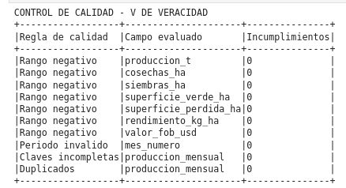

Figura 3.8 Resultados de las reglas de calidad y coherencia de los datos en la capa Gold.

### 3.5. Almacenamiento de datos procesados

El almacenamiento de los datos procesados se realizó mediante Apache Hadoop HDFS, siguiendo la arquitectura de tres capas definida para la plataforma de Big Data y Analítica Agrocomercial de Danper Trujillo S.A.C. Esta organización permite conservar los archivos originales en Bronze y mantener separados los conjuntos estructurados de Silver y los productos analíticos de Gold.

Para las capas Silver y Gold se utilizó el formato Apache Parquet, debido a que permite almacenar información estructurada de manera eficiente y facilita su posterior lectura y procesamiento mediante

<!-- Página 47 del PDF -->

Apache Spark/PySpark. La selección de este formato responde a la necesidad de trabajar con fuentes agrocomerciales heterogéneas, cuyas variables deben consultarse y agruparse por producto, ubicación geográfica y periodo.

Ubicación de los datos procesados

Los conjuntos de datos limpios y estructurados se almacenaron en la ruta /danper/silver de HDFS. Esta capa contiene información procedente de producción agrícola, exportaciones, abastecimiento mayorista, mercado de productores, agroindustria, costos agrícolas, Encuesta Nacional Agropecuaria 2025 y sostenibilidad.

Por otro lado, los conjuntos integrados y preparados para el análisis se almacenaron en /danper/gold. En esta zona se organizaron tablas analíticas, dimensiones, tablas de hechos e indicadores KPI destinados a facilitar las consultas y el análisis agrocomercial.

**Tabla 3.4. Organización del almacenamiento de datos procesados**

Capa | Ruta HDFS | Formato | Contenido

Silver | /danper/silver/produccion | Parquet | Registros estructurados de producción

agrícola.

Silver | /danper/silver/exportaciones | Parquet | Exportaciones de Danper y exportaciones

regionales.

Silver | /danper/silver/costos | Parquet | Registros de costos agrícolas.

Silver | /danper/silver/agroindustria | Parquet | Series mensuales de actividad agroindustrial.

Silver | /danper/silver/ena_2025 | Parquet | Conjuntos temáticos de producción, insumos y

uso de tierra.

Gold | /danper/gold | Parquet | Tablas analíticas, dimensiones, hechos e

indicadores KPI.

La documentación del proyecto registra once conjuntos de datos Silver, con un total de 79 498 filas provenientes de diferentes fuentes. Asimismo, la capa Gold contiene 26 componentes analíticos: siete tablas analíticas, seis dimensiones, siete tablas de hechos y seis tablas de indicadores KPI. Estos componentes se almacenan por separado para mantener identificable la función y granularidad de cada conjunto.

Criterio de organización y particionado

<!-- Página 48 del PDF -->

El criterio de almacenamiento implementado se basa principalmente en la separación física por capa y conjunto de datos. Cada fuente procesada dispone de su propio directorio, lo que facilita su identificación, lectura y mantenimiento.

En el código revisado no se identificó un particionado físico explícito mediante partitionBy() por año, mes o región. Por tanto, la organización actual no debe confundirse con una estrategia de particionado por columnas. Las variables temporales y geográficas sí forman parte de los esquemas de datos y permiten realizar operaciones de filtrado y agrupación durante las consultas.

En el script procesamiento_gold.py se contempla, además, el uso de coalesce() para controlar la cantidad de archivos de salida de determinados componentes Gold. Esta operación permite reducir el número de particiones antes de la escritura y busca evitar la generación innecesaria de archivos pequeños.

La decisión de no aplicar un particionado físico más detallado resulta razonable para la escala actual del prototipo, aunque no constituye una demostración de que sea la estrategia óptima. Si el volumen de datos aumenta, será necesario evaluar el particionado por periodo o región mediante pruebas de rendimiento y considerando la cantidad de registros que tendría cada partición.

Justificación del formato columnar Parquet

A diferencia de CSV y Excel, formatos utilizados principalmente para la obtención e intercambio de información, Apache Parquet organiza los datos por columnas y permite aplicar mecanismos de compresión y optimización de lectura.

Esta característica resulta conveniente para el proyecto porque muchas consultas agrocomerciales necesitan trabajar únicamente con determinadas variables. Por ejemplo, un análisis de producción agrícola podría utilizar cultivo, provincia, periodo y toneladas producidas, sin requerir todas las columnas del conjunto original.

Asimismo, Parquet conserva información sobre el esquema de los datos, incluyendo los tipos de las columnas, lo que facilita su lectura mediante Spark y reduce la necesidad de interpretar nuevamente los formatos originales.

En consecuencia, su utilización contribuye a una gestión más eficiente de los conjuntos procesados, especialmente cuando se realizan filtros, agrupaciones y consultas repetidas sobre los resultados de Silver y Gold. No obstante, los beneficios específicos de rendimiento deben comprobarse mediante mediciones y no atribuirse únicamente al formato de almacenamiento.

Verificación del almacenamiento

La existencia de las rutas Silver y Gold se comprobó mediante consultas realizadas en HDFS. Adicionalmente, el reporte técnico de calidad Gold registra la verificación de los 26 componentes analíticos, incluyendo su disponibilidad, lectura en formato Parquet y cantidad esperada de registros.

<!-- Página 49 del PDF -->

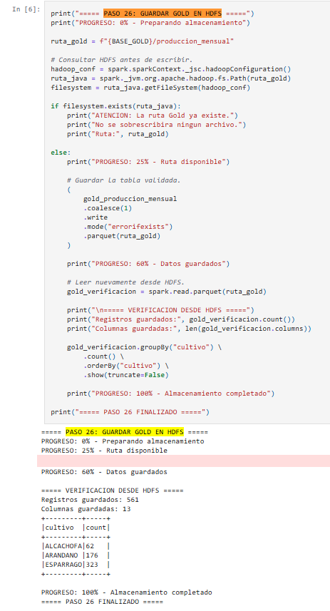

Figura 3.9. Almacenamiento y verificación de datos procesados en formato Parquet en HDFS.

Esta validación permite establecer que los conjuntos procesados se encuentran disponibles para su utilización en etapas posteriores del proyecto. La verificación de contenido y calidad de los campos se desarrolla de manera complementaria en el apartado 3.4.

En conjunto, el almacenamiento mediante HDFS y Parquet permite mantener una separación entre los datos originales, los conjuntos estructurados y los resultados analíticos. Esta organización facilita la trazabilidad, el reprocesamiento y el acceso a la información necesaria para el análisis de producción, precios, costos, abastecimiento, agroindustria y exportaciones, contribuyendo al desarrollo de una plataforma de datos organizada para Danper Trujillo S.A.C.

### 3.6. Optimización del rendimiento

Con la finalidad de mejorar la eficiencia del procesamiento de datos agrocomerciales, se aplicó una técnica de optimización mediante el almacenamiento temporal de DataFrames en memoria caché de Apache Spark. Esta técnica permite reutilizar información previamente cargada, evitando realizar nuevamente determinadas lecturas y operaciones cuando se ejecutan consultas repetidas.

La prueba se realizó en Debian 12, utilizando PySpark 3.5.1 y el conjunto de producción agrícola de la capa Silver, almacenado en /danper/silver/produccion. Este contiene 65 922 registros y 13 columnas. Para evaluar

<!-- Página 50 del PDF -->

el rendimiento, se ejecutó una operación de agrupación por cultivo, año y variable, calculando la suma de los valores y la cantidad de registros de cada grupo. La operación produjo 834 grupos.

Comparación del procesamiento sin caché y con caché Se realizaron cinco ejecuciones de la misma operación sin caché y otras cinco utilizando cache(). En el segundo escenario, los datos se almacenaron temporalmente en memoria y se reutilizaron durante las consultas posteriores. Se registraron los tiempos para comprobar si esta optimización generaba una mejora medible.

**Tabla 3.5 Comparación de tiempos de procesamiento con y sin caché**

Indicador | Sin caché | Con caché

Tiempo promedio de cinco ejecuciones | 1,5480 s | 0,6090 s

Tiempo promedio sin la primera ejecución | 0,8307 s | 0,5218 s

Tiempo mediano | 0,8969 s | 0,5293 s

Tiempo total medido, incluida la preparación de caché | 7,7400 s | 6,1337 s

PRUEBA SIN CACHÉ

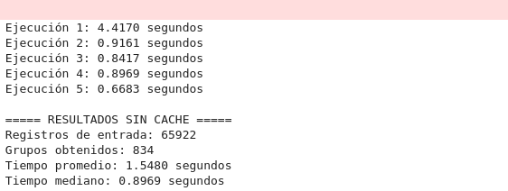

Figura 3.10 Resultados del procesamiento de datos sin utilizar memoria caché.

PRUEBA CON CACHE

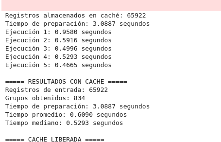

Figura 3.11 Resultados del procesamiento de datos utilizando memoria caché.

<!-- Página 51 del PDF -->

Los resultados muestran que el tiempo promedio de procesamiento disminuyó de 1,5480 a 0,6090 segundos, lo que representa una reducción del 60,66 %. Esta mejora se explica porque Spark puede reutilizar los datos almacenados temporalmente en memoria, evitando repetir parte del trabajo necesario para procesar el DataFrame.

Sin embargo, la preparación inicial de la caché requirió 3,0887 segundos, por lo que este costo debe considerarse antes de utilizar la técnica. Además, al excluir la primera ejecución de cada escenario, la reducción del tiempo promedio fue del 37,19 %. Esto demuestra que parte de la diferencia inicial puede estar relacionada con el calentamiento del entorno de ejecución y no únicamente con la aplicación de caché.

Comparación final

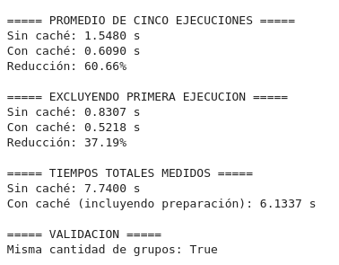

Figura 3.12 Comparación de tiempos de procesamiento con y sin memoria caché.

La optimización resulta conveniente cuando un mismo conjunto de datos se utiliza repetidamente para realizar consultas o transformaciones. Pero su aplicación también requiere memoria disponible y puede resultar menos beneficiosa cuando los datos se utilizan una sola vez. Esta prueba nos permitió comprobar una mejora medible en las consultas repetidas sobre los datos agrícolas de la capa Silver.

### 3.7. Prueba de escalabilidad

En la prueba de escalabilidad tuvimos como finalidad evaluar el comportamiento del procesamiento de datos ante un incremento del volumen de información. Para ello, se utilizaron siete conjuntos de datos reales de la capa Silver y se generaron réplicas equivalentes a 10 y 100 veces su tamaño original. Estas réplicas se emplearon exclusivamente para evaluar el rendimiento del sistema, sin incorporarse al análisis exploratorio, al entrenamiento del modelo predictivo ni a las conclusiones de negocio.

La evaluación se realizó en una máquina virtual Debian 12, con 5 CPU virtuales y aproximadamente 8 GiB de memoria RAM, utilizando Apache Spark 3.5.1 y Hadoop HDFS. Se ejecutó el procesamiento de Silver a Gold en tres escenarios: ×1, ×10 y ×100, registrando el tiempo de ejecución y el consumo máximo observado de recursos.

**Tabla 3.6 Resultados de la prueba de escalabilidad del procesamiento Silver a Gold**

<!-- Página 52 del PDF -->

Indicador | ×1 | ×10 | ×100

Tiempo de ejecución (s) | 54,98 | 55,03 | 53,35

Pico de RAM del sistema (GiB) | 5,42 | 5,59 | 5,36

Pico de RAM de procesos (MiB) | 1 063,24 | 1 152,34 | 954,01

Pico de CPU del sistema (%) | 83,9 | 76,8 | 84,5

Componentes Gold generados | 26 | 26 | 26

Estado de ejecución | Correcto | Correcto | Correcto

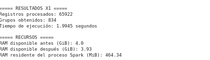

Figura 3.13 Resultados de la prueba de escalabilidad con el volumen original de datos (×1).

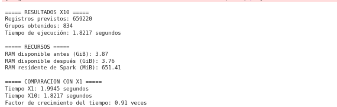

Figura 3.14 Resultados de la prueba de escalabilidad con diez veces el volumen de datos (×10).

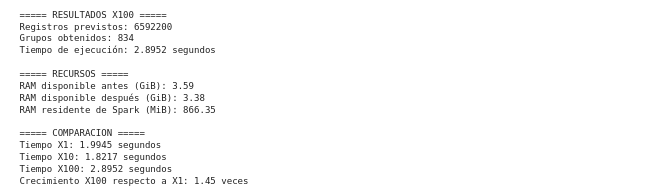

Figura 3.15 Resultados de la prueba de escalabilidad con cien veces el volumen de datos (×100).

Las Figuras 3.13, 3.14 y 3.15 presentan una prueba complementaria de agregación de registros de producción agrícola con diferentes volúmenes de datos. Sus tiempos corresponden únicamente a esa operación y no

<!-- Página 53 del PDF -->

representan la duración total del procesamiento de la capa Gold. Por otro lado, la Tabla 3.6 y la Figura 3.16

muestran los resultados de la prueba principal de escalabilidad Silver | → | Gold, que comprende la generación

y validación de 26 componentes analíticos. Esta distinción permite interpretar correctamente las mediciones y evita comparar operaciones de diferente alcance.

Los resultados muestran que los tres escenarios finalizaron correctamente y generaron los 26 componentes analíticos de Gold. Este comportamiento puede relacionarse con el costo fijo de inicialización de Spark, las operaciones de agrupación que reducen la cantidad de registros y la repetición de datos con las mismas claves. Por ello, los resultados no significan que el sistema mantendrá necesariamente el mismo rendimiento ante un crecimiento de datos reales y diversos.

En cuanto al consumo de recursos, el máximo de memoria RAM del sistema se mantuvo entre 5,36 y 5,59 GiB, mientras que los picos de CPU estuvieron entre 76,8 % y 84,5 %. Esto indica que la máquina virtual pudo procesar los tres escenarios evaluados sin que se registraran fallos por falta de recursos.

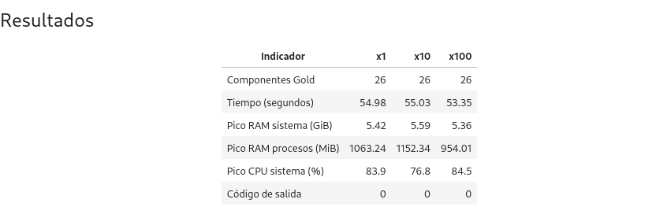

Figura 3.16 Comparación de tiempos y consumo de recursos durante la prueba de escalabilidad.

Respecto a la capacidad de una sola máquina, no se identificó un punto exacto a partir del cual dejaría de ser suficiente, debido a que los tres escenarios terminaron correctamente. Para determinar ese límite sería necesario realizar pruebas adicionales con mayores volúmenes, datos más variados y mediciones repetidas.

### 3.8. Seguridad de la plataforma

La seguridad de la plataforma constituye un componente importante del proyecto, debido a que permite proteger la información utilizada durante los procesos de ingesta, transformación, almacenamiento y análisis de datos. Para ello, se consideran medidas orientadas a garantizar la integridad, confidencialidad y disponibilidad de los datasets relacionados con la producción, costos y exportaciones agrícolas de Danper.

El proyecto utiliza una infraestructura on-premise basada en Apache Hadoop HDFS para el almacenamiento distribuido y Apache Spark con PySpark para el procesamiento de datos. En este entorno, la seguridad se aborda mediante el control de permisos de acceso, la protección de las comunicaciones y la gestión de credenciales, diferenciando las configuraciones existentes de aquellas previstas para un despliegue productivo.

Tabla 3.7 Medidas de seguridad de la plataforma de datos

<!-- Página 54 del PDF -->

Medida | Descripción

Control de acceso | Gestión de propietarios, grupos y permisos de lectura, escritura y ejecución sobre los

directorios de HDFS.

Integridad de los | Validación de la estructura de los conjuntos Gold y comprobación de claves obligatorias

datos | y duplicados durante su creación.

Cifrado en reposo | Protección de los archivos almacenados en HDFS mediante mecanismos de cifrado.

Cifrado en tránsito Protección de las comunicaciones entre los servicios mediante TLS/HTTPS.

Gestión | de | Protección de contraseñas, claves y archivos de configuración utilizados para acceder a

credenciales | los servicios.

Principio | de | Asignación de los permisos estrictamente necesarios según las funciones de cada

mínimo privilegio | usuario.

El control de acceso a los datos almacenados en HDFS se gestiona mediante permisos asociados a usuarios y grupos del sistema. Estos permisos permiten establecer quién puede leer, modificar o acceder a los directorios correspondientes a las zonas Bronze, Silver y Gold. Para un entorno productivo se propone aplicar el principio de mínimo privilegio, de manera que los responsables de los procesos ETL dispongan de permisos de escritura únicamente en las zonas necesarias, mientras que los usuarios encargados del análisis puedan consultar los datos sin modificarlos.

El cifrado en reposo tiene como finalidad proteger los archivos almacenados frente a accesos no autorizados. Para un despliegue productivo se contempla utilizar las zonas de cifrado de HDFS, que permiten proteger los datos almacenados mediante claves administradas. En cuanto al cifrado en tránsito, se plantea habilitar TLS/HTTPS para proteger las comunicaciones entre clientes, servicios de Hadoop y componentes de procesamiento. También se recomienda configurar adecuadamente la transferencia cifrada de datos entre los servicios de HDFS.

<!-- Página 55 del PDF -->

Figura 3.17 Verificación de permisos y directorios de almacenamiento en Hadoop HDFS.

La Figura 3.17 muestra los permisos y directorios disponibles en el entorno HDFS consultado. En esta instalación se identificaron las capas Silver y Gold, mientras que Bronze fue verificada en el entorno de otro integrante, como se documenta en la sección 3.2. Por tanto, esta captura evidencia los permisos observados en el entorno específico, pero no constituye una comprobación de las tres capas en una misma instalación.

# 4. Análisis, modelado y capa de consumo

### 4.1. Análisis exploratorio de datos

El análisis exploratorio de datos se realizó con la finalidad de identificar tendencias, diferencias y patrones en la producción agrícola registrada en la región La Libertad, considerando productos de interés para Danper Trujillo S.A.C. Para ello, se utilizó información previamente procesada y almacenada en la capa Gold del Data Lake, mediante Apache Spark y PySpark.

El conjunto analizado corresponde a produccion_mensual, almacenado en la ruta /danper/gold/produccion_mensual. Este contiene 561 registros y 13 columnas, entre ellas provincia, distrito, cultivo, periodo, producción en toneladas, precio en chacra y superficie agrícola. Sin embargo, únicamente 267 registros presentan valores disponibles en el campo produccion_t, por lo que se excluyeron los valores nulos de los análisis de volumen de producción.

A partir de los registros válidos correspondientes a 2025 se desarrollaron tres visualizaciones mediante Matplotlib, con el propósito de analizar la evolución mensual, la distribución por cultivo y la concentración territorial de la producción agrícola.

## Evolución mensual de la producción agrícola

Pregunta de análisis: ¿Cómo evoluciona el volumen de producción agrícola registrado durante los meses de 2025?

Para responder esta pregunta se agruparon los registros por periodo y se sumaron los valores disponibles de produccion_t, obteniendo el volumen mensual de producción de los cultivos presentes en el conjunto analizado.

<!-- Página 56 del PDF -->

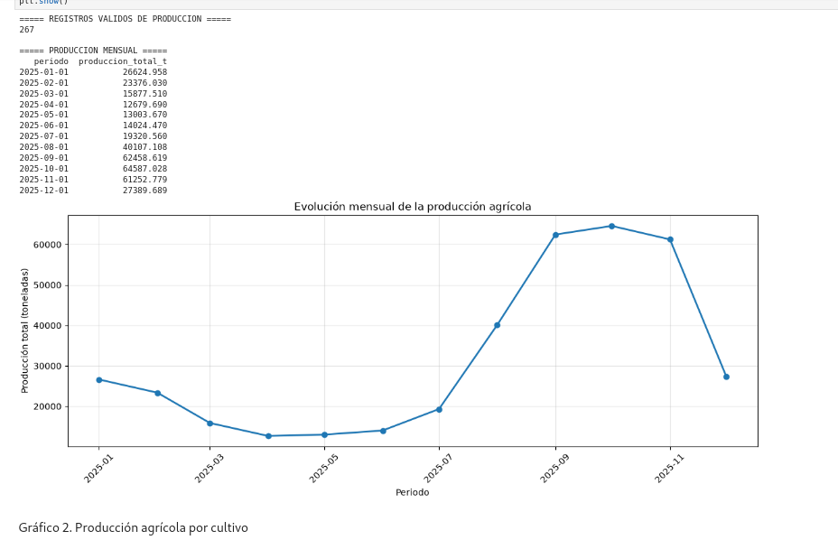

Figura 4.1 Evolución mensual de la producción agrícola durante 2025.

Con lo obtenido interpretamos que los resultados muestran variaciones importantes en el volumen de producción a lo largo de 2025. Durante abril se registró el menor volumen mensual, con 12 679,69 toneladas, mientras que octubre alcanzó el valor más alto, con 64 587,03 toneladas. Asimismo, entre agosto y noviembre se observan volúmenes superiores a los registrados durante varios meses del primer semestre.

Este comportamiento permite identificar periodos de mayor y menor producción dentro de la información disponible, lo cual puede servir como referencia para analizar posibles necesidades de abastecimiento y planificación agrocomercial. No obstante, al disponer únicamente de registros válidos de producción para 2025, estas variaciones no deben interpretarse todavía como un patrón estacional permanente.

## Producción agrícola por cultivo

Pregunta de análisis: | ¿Qué cultivos concentran el mayor volumen de producción agrícola registrado en 2025?

Se agruparon los datos por cultivo y se calculó la suma de las toneladas de producción registradas. Esta operación permitió comparar los volúmenes de los productos disponibles en el conjunto de datos analizado.

<!-- Página 57 del PDF -->

Figura 4.2 Distribución del volumen de producción agrícola por cultivo durante 2025.

interpretación: | El arándano presentó el mayor volumen registrado, con 197 208,30 toneladas, seguido del

espárrago, con 159 163,01 toneladas. Por su parte, la alcachofa alcanzó 24 330,80 toneladas.

Estos resultados muestran diferencias significativas entre los tres cultivos con información válida de producción. El espárrago y la alcachofa son especialmente relevantes para el proyecto debido a su relación con las actividades agroindustriales de Danper. Sin embargo, el mayor volumen regional de un cultivo no significa necesariamente que exista una mayor disponibilidad de materia prima para la empresa, ya que intervienen factores como los contratos, la calidad comercial, la ubicación y los compromisos de venta.

Distribución de la producción agrícola por provincia

Pregunta de análisis: ¿Qué provincias concentran los mayores volúmenes de producción agrícola registrados durante 2025?

Para este análisis se agruparon los registros por provincia y se sumaron los valores disponibles de producción, permitiendo identificar diferencias geográficas en los volúmenes reportados.

<!-- Página 58 del PDF -->

Figura 4.3 Distribución del volumen de producción agrícola por provincia durante 2025.

Interpretación: La provincia de Virú presentó el mayor volumen de producción entre los registros evaluados, con 199 402,70 toneladas. Le siguieron Ascope, con 96 081,98 toneladas, y Chepén, con 54 836,90 toneladas. Los menores volúmenes dentro de este conjunto se registraron en Trujillo y Pacasmayo, con 25 352,33 y 5 028,21 toneladas, respectivamente.

Esta distribución evidencia una concentración territorial importante de los volúmenes registrados en Virú. Desde la perspectiva agrocomercial, este hallazgo puede orientar el análisis de zonas con mayor producción disponible y contribuir a la identificación de áreas prioritarias para estudiar condiciones de abastecimiento. Sin embargo, las cantidades corresponden al conjunto de datos regional utilizado y no representan directamente la producción propia de Danper ni garantizan la disponibilidad comercial de esos volúmenes.

En este punto el análisis exploratorio permitió identificar tres hallazgos principales: variaciones mensuales de producción durante 2025, diferencias considerables entre los cultivos analizados y una mayor concentración territorial de los volúmenes registrados en la provincia de Virú. Losresultados proporcionan información inicial para comprender el comportamiento productivo de los cultivos de interés agrocomercial y sirven como punto de partida para el desarrollo de modelos predictivos. Asimismo, se identificó una limitación importante de completitud, debido a que 294 de los 561 registros del conjunto Gold carecen de valores de producción.

### 4.2. Modelo base

Se implementó un modelo de regresión lineal orientado a estimar el volumen de producción agrícola expresado en toneladas. Se seleccionó este modelo debido a su interpretabilidad, permitiendo establecer una referencia inicial para comparar posteriormente otros modelos de mayor complejidad.

<!-- Página 59 del PDF -->

El modelo utilizó información del conjunto produccion_mensual, almacenado en la capa Gold del Data Lake mediante Hadoop HDFS. Se consideraron como variables de entrada el cultivo, la provincia, el distrito y el mes, mientras que la variable objetivo fue produccion_t, correspondiente al volumen de producción agrícola.

### 4.2.1. Preparación y división de los datos

El conjunto original contiene 561 registros; sin embargo, únicamente 267 presentaron información válida en la variable objetivo. Por esta razón, se excluyeron los registros con producción nula y se aplicó la técnica One-Hot Encoding para transformar las variables categóricas en representaciones numéricas.

Para evaluar el modelo se realizó una división temporal de los registros correspondientes a 2025, utilizando los meses de enero a septiembre para entrenamiento y los meses de octubre a diciembre para prueba.

**Tabla 4.1 Distribución temporal de los datos de entrenamiento y prueba**

Conjunto | Periodo | Registros

Entrenamiento | Enero – septiembre de 2025 | 186

Prueba | Octubre – diciembre de 2025 81

Total | 2025 | 267

Esta separación permitió evaluar las predicciones sobre meses posteriores a los utilizados durante el entrenamiento, evitando una distribución aleatoria que mezclara periodos.

### 4.2.2. Entrenamiento y evaluación del modelo

El entrenamiento se realizó utilizando Scikit-learn, mediante un pipeline que integra la preparación de las variables categóricas y el algoritmo de regresión lineal. Posteriormente, se generaron predicciones sobre los 81 registros de prueba y se calcularon tres métricas: MAE, RMSE y R².

Se seleccionó como métrica principal el error absoluto medio (MAE), debido a que permite expresar el error promedio de las estimaciones en la misma unidad de la variable objetivo, es decir, toneladas de producción.

**Tabla 4.2 Resultados de evaluación del modelo base de regresión lineal**

Métrica | Resultado

Error absoluto medio (MAE) | 1 868,54 toneladas

Raíz del error cuadrático medio (RMSE) | 3 086,99 toneladas

<!-- Página 60 del PDF -->

Coeficiente de determinación (R²) | 0,2989

MAE del modelo de referencia (mediana) | 1 745,51 toneladas

Figura 4.4 Resultados de evaluación y ejemplos de predicciones del modelo base de regresión lineal.

Los resultados muestran que la regresión lineal obtuvo un MAE de 1 868,54 toneladas, lo que significa que las predicciones presentan, en promedio, una diferencia absoluta de aproximadamente esa magnitud respecto a la producción registrada. El RMSE de 3 086,99 toneladas evidencia la presencia de errores elevados en determinadas observaciones, mientras que el R² de 0,2989 indica que el modelo explica aproximadamente el 29,89 % de la variabilidad observada en los datos de prueba.

Tambien se realizó una comparación con un modelo sencillo que utiliza la mediana de la producción del conjunto de entrenamiento como predicción constante. Este obtuvo un MAE de 1 745,51 toneladas, inferior al resultado de la regresión lineal. Por tanto, el modelo implementado todavía no supera esta referencia, lo que demuestra la necesidad de mejorar su capacidad predictiva.

### 4.2.3. Interpretación de las predicciones

Para complementar la evaluación numérica, se elaboró un gráfico de dispersión que compara los valores reales de producción con los valores estimados por la regresión lineal.

<!-- Página 61 del PDF -->

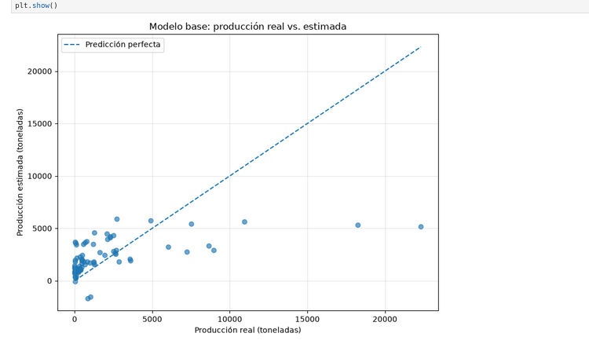

Figura 4.5 Comparación entre la producción agrícola real y la estimada por el modelo de regresión lineal.

La visualización permite observar diferencias entre los valores reales y las predicciones del modelo, especialmente en los registros con mayores volúmenes de producción.Las variables seleccionadas y las relaciones lineales aprendidas no representan completamente el comportamiento de la producción agrícola. Desde la perspectiva de Danper, estas limitaciones son importantes porque una estimación imprecisa podría afectar la planificación de las necesidades de abastecimiento. Por ello, el modelo todavía debe considerarse experimental y no una herramienta validada para decisiones operativas.

## Línea base técnica y mejoras previstas

Se establece como línea base técnica inicial un MAE de 1 868,54 toneladas, correspondiente al modelo de regresión lineal. Adicionalmente, el MAE de 1 745,51 toneladas obtenido por el modelo de referencia basado en la mediana constituye un umbral que las siguientes alternativas deberán intentar superar. Durante la segunda mitad del semestre se propone evaluar algoritmos no lineales, como Random Forest, que podrían representar mejor las diferencias de producción entre cultivos, distritos y periodos. También se buscará incorporar nuevas variables relacionadas con las condiciones productivas, siempre que presenten información suficiente, y ampliar la cobertura temporal para mejorar la evaluación.

### 4.3. Modelo definitivo, selección y evaluación

Justifique el modelo final frente a al menos una alternativa descartada y documente la preparación de datos, la partición entre entrenamiento y prueba y el ajuste de hiperparámetros. Reporte las métricas e interprete cada una en términos del negocio; la interpretación es lo que se evalúa, no el valor numérico. Contraste el resultado con la línea base técnica declarada en la Semana 7.

Un modelo con 85 % de exactitud sobre una población donde solo el 5 % abandona puede ser peor que inútil. Explique qué significa cada error para la organización: qué cuesta un falso positivo, qué cuesta un falso negativo, y cuál de los dos prefiere la operación.

### 4.4. Modelo dimensional y capa de consumo

Diseñe la capa que consumirá el negocio: modelo dimensional con su tabla de hechos, sus dimensiones y la

granularidad declarada, más un tablero con | tres a cinco | indicadores derivados de los objetivos de la sección

⟨ | ⟩

<!-- Página 62 del PDF -->

1. Cada indicador debe tener definición, fórmula, frecuencia de actualización y responsable de la decisión asociada.

Un tablero no es un conjunto de gráficos atractivos: es el instrumento con el que alguien toma una decisión periódica. Si no puede nombrar quién mira cada indicador y qué hace cuando se mueve, el indicador sobra.

# 5. Ética, privacidad y gobierno de datos

### 5.1. Datos sensibles y protección aplicada

Identifique qué datos personales o sensibles contiene su conjunto. Describa y evidencie la técnica de protección aplicada —anonimización, seudonimización, enmascaramiento o hashing— y explique qué riesgo de reidentificación permanece después de aplicarla.

### 5.2. Linaje y gobierno del dato

Documente la trazabilidad del dato desde su origen hasta el indicador final: quién es el responsable de cada conjunto, qué transformaciones lo modificaron y cómo se auditaría un valor concreto del tablero hasta su registro de origen.

### 5.3. Sesgos y consecuencias del modelo

Analice qué sesgos puede contener el modelo, a quiénes podrían perjudicar y qué grupos quedan sub-representados en los datos de entrenamiento. Indique qué salvaguarda propondría antes de un uso real.

Pregunta guía: si esta solución se pusiera en producción mañana y se equivocara sistemáticamente, ¿quién sería el perjudicado y quién respondería por ello?

### 5.4. Marco normativo aplicable

Identifique la normativa que rige el tratamiento de estos datos. Como mínimo, la Ley N.º 29733 de Protección de Datos Personales del Perú y su reglamento; cuando corresponda, referencias internacionales como el RGPD europeo. No basta citar la norma: indique qué obligación concreta le aplica a su proyecto y cómo la cumple.

### 5.5. Aporte al desarrollo sostenible de la región

Explique de qué manera los hallazgos pueden aportar al desarrollo de la empresa, de su sector y de la región. Sea concreto y evite las afirmaciones genéricas sobre transformación digital.

# 6. Valor generado, conclusiones y recomendaciones

Esta es la sección que decide si el proyecto aportó valor o se quedó en el uso de tecnología. Es también la que más pesa en la medición final.

### 6.1. Trazabilidad del valor

Complete una fila por cada recomendación. Una recomendación que no pueda llenar todas las columnas todavía no está lista.

Responsable en | Efecto estimado sobre la

Objetivo | Hallazgo del análisis | Decisión propuesta

la empresa | línea base

<!-- Página 63 del PDF -->

Responsable en | Efecto estimado sobre la

Objetivo | Hallazgo del análisis | Decisión propuesta

la empresa | línea base

### 6.2. Conclusiones

Responda uno por uno a los objetivos de la subsección 1.5, indicando si se cumplieron y con qué evidencia. Declare también lo que no se logró y por qué; un objetivo no alcanzado con un análisis honesto de la causa vale más que una afirmación de éxito sin respaldo.

### 6.3. Recomendaciones de negocio

Desarrolle en prosa las recomendaciones de la tabla anterior. Cada una debe indicar qué hacer, sobre qué segmento, con qué resultado esperado y a partir de qué evidencia del análisis.

Formulación insuficiente | Formulación adecuada

«Lanzar una campaña de retención con 20 % de descuento dirigida a clientes de 25 a 35 años sin compras en los últimos 60 días, segmento que el modelo

«La empresa debe mejorar su estrategia de marketing.» | identifica con 90 % de probabilidad de abandono y que

concentra el 31 % de la facturación en riesgo. Responsable: jefatura comercial. Efecto estimado: reducir la tasa de abandono mensual de 3.1 % a 2.4 %.»

### 6.4. Trabajo futuro

Señale qué haría a continuación con recursos adicionales: nuevas fuentes, modelos alternativos, automatización del pipeline o puesta en producción. Sea específico sobre qué problema resolvería cada mejora.

# 7. Anexos

• Enlace al repositorio, con README que permita reproducir la solución desde cero: requisitos del entorno, pasos de instalación, orden de ejecución de los scripts y datos de muestra. • Constancia de autorización de la empresa, cuando los datos hayan sido cedidos. • Declaración de uso de herramientas de IA generativa, según el formato del Anexo A. • Evidencias de la ejecución: capturas o registro de las corridas relevantes, de las mediciones de rendimiento y de la prueba de escalabilidad. • Referencias bibliográficas y fuentes de datos, en normas APA 7.ª edición, incluida la licencia de uso de cada conjunto.

<!-- Página 64 del PDF -->

# Anexo A. Declaración de uso de herramientas de IA generativa

El uso de herramientas de inteligencia artificial generativa está permitido en este curso como apoyo al trabajo, y debe declararse. Lo que se evalúa es la comprensión y la responsabilidad del equipo sobre el resultado: todo contenido asistido por estas herramientas debe haber sido verificado por los autores, quienes responden por su exactitud. Tenga presente que la sustentación individual pesa más que el informe precisamente porque mide lo que cada estudiante comprende, con independencia de cómo se haya redactado el documento. La omisión de esta declaración se trata como falta a la integridad académica conforme al reglamento de la universidad.

Herramienta | Uso que se le dio | Sección del informe | Verificación realizada

Ejecución de los procedimientos en Asistencia para desarrollar y Debian 12, corregir scripts de comprobando los

ChatGPT (OpenAI) | procesamiento con PySpark, | 3.2, 3.3 y 3.5

resultados consultas SQL y operaciones de almacenados en transformación de datos. HDFS y las salidas de los notebooks.

Apoyo en la revisión, síntesis y | Contraste de los

organización de información | textos redactados

documental para mejorar la | con los documentos

NotebookLM (Google) | 1.2, 1.3 y 2.1

redacción del contexto | y las fuentes

empresarial, la problemática y la | consultadas por el

arquitectura propuesta. | equipo.

Apoyo en la organización de las Comparación de las explicaciones del análisis explicaciones con las

Gemini (Google) | exploratorio y en la

4.1 y 4.2 | gráficas, métricas y

interpretación de conceptos resultados obtenidos relacionados con los modelos en JupyterLab. predictivos. Los integrantes declaran que el contenido de este informe fue revisado y verificado por el equipo, y asumen la responsabilidad académica correspondiente.

______________________ _______________________ _______________________

______________________

# Anexo B. Lista de verificación previa a la entrega

<!-- Página 65 del PDF -->

Revise estos puntos antes de subir el informe. Los cuatro primeros son requisitos de admisibilidad.

• El repositorio es accesible y el README permite reproducir la solución desde cero. • Existe evidencia de al menos una corrida completa del pipeline. • La ficha de procedencia está completa para cada fuente, con su entidad publicadora o la constancia de la empresa. • La declaración del Anexo A está completa y firmada por todos los integrantes. • La empresa es real y está identificada; no hay datos sintéticos en el análisis ni en el modelo. • La línea base del negocio está declarada con su fuente y su fecha. • La prueba de escalabilidad está ejecutada y reportada con tiempos. • La prueba de sustitución de componentes está respondida por escrito. • Cada recomendación completa las cinco columnas de la tabla de trazabilidad del valor. • El texto guía en cursiva de la plantilla fue eliminado en su totalidad. • Los diagramas corresponden a lo implementado y no a la versión inicial del diseño. • Las métricas del informe coinciden con las que produce el código del repositorio. • Ningún dato personal identificable aparece en el informe, en las capturas ni en el repositorio.

# Anexo C. Diccionario de datos del proyecto

Como complemento al apartado 3.1. Fuentes de datos y ficha de procedencia, se elaboró un diccionario de datos en formato Excel para documentar la estructura de los conjuntos de datos utilizados en la plataforma de Big Data y Analítica Agrocomercial para Danper Trujillo S.A.C. El diccionario contiene información sobre los nombres de las columnas, tipos de datos, descripciones, unidades de medida, procedencia y observaciones de validación. Además, incluye los campos correspondientes a los conjuntos procesados en las capas Silver y Gold, facilitando la identificación y comprensión de las variables empleadas durante el procesamiento y análisis de información. Este documento complementario permite mantener la trazabilidad entre las fuentes originales y los resultados analíticos, favoreciendo la documentación, reproducibilidad y mantenimiento del pipeline. Nombre del archivo: Diccionario_Datos_Danper_G07.xlsx Formato: Microsoft Excel (.xlsx). Ubicación: Archivo complementario del proyecto.

Enlace | de

acceso: | https://docs.google.com/spreadsheets/d/1w0gHNnG8TmM_YMSohqq22fSBbrWDA3qB/edit?usp=s

haring&ouid=107862472151977588900&rtpof=true&sd=true

# Anexo D Repositorio

Repositorio donde se encuentran nuestros avances del código.

Enlace de acceso del repositorio: | https://github.com/vfabrizio95-oss/G07-BigData-AnaliticaAgrocomercial-

Danper/tree/develop

## Referencias sugeridas

<!-- Página 66 del PDF -->

Amazon Web Services. (s. f.-a). Amazon Athena pricing. | https://aws.amazon.com/athena/pricing

Amazon Web Services. (s. f.-b). Amazon EMR pricing. | https://aws.amazon.com/emr/pricing/

Amazon Web Services. (s. f.-c). Amazon S3 pricing. | https://aws.amazon.com/s3/pricing/

Apache Software Foundation. (s. f.). Apache Hadoop 3.3.6 – HDFS architecture. https://hadoop.apache.org/docs/r3.3.6/hadoop-project-dist/hadoop-hdfs/HdfsDesign.html

Bass, L., Clements, P., & Kazman, R. (2021). Software architecture in practice (4th ed.). Addison-Wesley Professional.

Chambers, B., & Zaharia, M. (2018). Spark: The definitive guide: Big data processing made simple. O'Reilly Media.

Congreso de la República del Perú. (2011). Ley N.º 29733, Ley de Protección de Datos Personales. https://www.gob.pe/institucion/congreso-de-la-republica/normas-legales/243470-29733

Danper. (2022). Danper. | https://danper.com/

Géron, A. (2023). Hands-on machine learning with Scikit-Learn, Keras & TensorFlow (3rd ed.). O'Reilly Media.

Instituto Nacional de Estadística e Informática. (2025). Producción nacional: Abril 2025 (Informe técnico N.º

6, | junio | de | 2025). | https://www.inei.gob.pe/media/MenuRecursivo/boletines/informe-

tecnico_produccionnacional_abr2025.pdf

James, G., Witten, D., Hastie, T., & Tibshirani, R. (2021). An introduction to statistical learning: With

applications in R (2nd ed.). Springer. | https://doi.org/10.1007/978-1-0716-1418-1

Kleppmann, M. (2017). Designing data-intensive applications. O'Reilly Media.

Ministerio de Desarrollo Agrario y Riego. (2026). Compendio anual de producción agrícola. https://www.gob.pe/institucion/midagri/informes-publicaciones/2730325-compendio-anual-de-produccion-agricola

White, T. (2015). Hadoop: The definitive guide (4th ed.). O'Reilly Media.

Zaharia, M., Xin, R. S., Wendell, P., Das, T., Armbrust, M., Dave, A., Meng, X., Rosen, J., Venkataraman, S., Franklin, M. J., Ghodsi, A., Gonzalez, J., Shenker, S., & Stoica, I. (2016). Apache Spark: A unified engine

for big data processing. Communications of the ACM, 59(11), 56–65. | https://doi.org/10.1145/2934664
